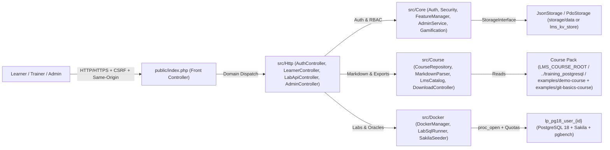

# LightPath Training Portal — Technical Gateway

[](https://github.com/jmrenouard/lightpath-training-portal/actions/workflows/ci.yml) [](https://github.com/jmrenouard/lightpath-training-portal/actions/workflows/docs-ci.yml) · [**Documentation Portal (`https://lms.lightpath.fr/`)**](https://lms.lightpath.fr/)

> **Organization:** LightPath SARL (`https://www.lightpath.fr` | `contact@lightpath.fr`)  
> **Lead Instructor & Author:** Jean-Marie Renouard (Database & DataOps Expert, Co-developer of MySQLTuner)  
> **License:** MIT License ([LICENSE](LICENSE)) — LMS Engine & Bundled Demo Course-Packs  
> **Stack:** Zero-dependency PHP `>= 8.3` • Atomic JSON / Transactional PDO • Docker / WSL2 PostgreSQL 18 Sandbox • Self-hosted Studio Assets (`Zero External CDNs`) • Qualiopi / Datadock / SCORM 1.2

---

## 1. Platform Overview

**LightPath Training Portal** (`LightPath Academy v2.0.0`, Ref. `LP-LMS-QUALIOPI-2026`) is an industrial-grade Learning Management System purpose-built for hands-on technical certifications. It boots out-of-the-box with **two** MIT-licensed course-packs—[examples/demo-course/](examples/demo-course/) (`2` PostgreSQL 18 modules, `1` 7-pillar Qualiopi Docker lab, cheatsheets, Python companion example, vector Mermaid SVG, and MP4 streaming stub) and [examples/git-basics-course/](examples/git-basics-course/) (`3` Git fundamentals modules, `3` 7-pillar Qualiopi labs, `6` cheatsheets, `GUIDE_PARCOURS.md`, and `3` vector Mermaid SVGs)—and scales seamlessly to full multi-track commercial curricula such as the 4-track **PostgreSQL 18** curriculum (`34` modules, `34` 7-pillar Qualiopi practical labs, `69` cheatsheets, `18` Qualiopi reference documents, `35` pure-Python `pgscripts`, multi-language client examples, and synchronized 16:9 Studio slide decks) mounted via `LMS_COURSE_ROOT`.

### System Architecture



---

## 2. Moodle vs. LightPath Training Portal

### Positioning & Interoperability
- **When to choose LightPath Training Portal (`v2.0.0`):** Technical academies, DevOps/DBA bootcamps, and French training organizations needing `~0` operational footprint (zero-dependency PHP `>= 8.3`, atomic JSON or auto-bootstrapped PDO, no mandatory Node/Redis/cron runtime), isolated per-learner **Docker PostgreSQL 18 sandboxes** with automated verification oracles, **Git-versioned Markdown + 16:9 Studio slides**, built-in **Qualiopi / OPCO compliance** (attendance, offline SVG QR certificates, J+60 surveys), and a strict **zero-CDN Content Security Policy** (`style-src 'self'`, SHA-256 `script-src`).
- **When to choose Moodle (`4.5 LTS` / `5.0`):** Multi-faculty universities or large enterprises requiring `2,000+` community plugins, rich shared question banks (Cloze/essay/drag-and-drop), `mod_assign` rubric grading, multi-tenant custom RBAC, OIDC/SAML 2.0/LDAP SSO, native H5P/LTI 1.3 Advantage, and `100+` language packs.
- **How they interoperate:** LightPath already exports **SCORM 1.2** (`imsmanifest.xml` + standalone `.zip` packages via `DownloadController`) so existing Moodle instances can ingest LightPath modules today. Planned **LTI 1.3 Advantage (`FEAT-12`)** will enable Moodle and Canvas to launch LightPath Docker SQL labs with grade passback, alongside inbound SCORM/H5P/`xAPI`/`cmi5` (`FEAT-11`) and portable `.lpcourse.zip` archives (`FEAT-10`).

### 12-Dimension Feature Comparison

| Dimension | Moodle (`4.5 LTS` / `5.0`) | LightPath Training Portal (`v2.0.0`) |
| :--- | :--- | :--- |
| **1. Runtime & Deployment** | Monolithic LAMP/LEMP + PostgreSQL/MySQL, Composer/Node build pipeline, Redis/Memcached cache, mandatory cron worker | Zero-dependency PHP `>= 8.3` (1 command `php -S` or non-root Docker), dual `JsonStorage` / `PdoStorage`, `0` external CDN or JS runtime deps |
| **2. Content & Slide Authoring** | Browser WYSIWYG/TinyMCE pages, Book, File, URL, Folder activities | Git-native Markdown (`MarkdownParser`), pre-rendered vector Mermaid SVGs, 16:9 Studio slide decks + speaker notes, HTTP `206`/`416` byte-range MP4 streaming |
| **3. Docker Code/SQL Sandboxes** | Requires third-party plugins (e.g., VPL / CodeRunner + external jail servers) | Native per-learner `lp_pg18_user_<id>` PG18 containers, `Sakila`/`pgbench` auto-seeding, savepoints, bounded `pgbench`, least-privilege `lms_student` SQL workbench, oracle checks, `cloud_simulated` fallback |
| **4. Quizzes & Assignments** | Shared question bank (`15+` types incl. Cloze, essay, drag-drop), `mod_assign` file upload & rubric grading | Per-module formative MCQs, positioning diagnostic (`15` PG18 / `6` Git), timed final exam (`40` PG18 / `10` Git, `75%` pass); rich question bank (`FEAT-04`) & assignments (`FEAT-05`) planned |
| **5. Gradebook & Conditional Progress** | Unified weighted gradebook, custom scales, course completion & activity access restrictions | Module/lab completion tracking, quiz/exam thresholds, XP/ranks/badges; weighted gradebook (`FEAT-06`) & prerequisite unlock chains (`FEAT-07`) planned |
| **6. Qualiopi/OPCO Attendance & QR Verification** | Manual/third-party attendance plugins (`mod_attendance`), external certificate plugins without French OPCO schema | Built-in 7-pillar Qualiopi trail: half-day attendance (`J1_AM`..`J11_PM`) with dual signatures, CSPRNG certificates (`LP-*-CERT-*`), offline SVG QR `page=verify`, J+60 cold survey, formula-safe OPCO CSV & JSON dossier |
| **7. SCORM/H5P/xAPI/LTI/Badges** | Native SCORM 1.2 player, H5P core, LTI 1.3 Advantage Tool/Consumer, Open Badges `v2.1`/`v3.0`, xAPI plugins | Outbound SCORM 1.2 `imsmanifest.xml` & `.zip` export today; inbound SCORM/H5P/xAPI (`FEAT-11`), LTI 1.3 (`FEAT-12`), Open Badges v3.0 (`FEAT-13`) planned |
| **8. Auth/SSO/RBAC** | Email self-reset, OAuth 2/OIDC, SAML 2.0, LDAP, TOTP/WebAuthn MFA, granular capability RBAC | CSPRNG first-boot credentials, persistent `(email, ip)` rate limiting, `3` scoped roles (`student`, `trainer`, `admin`), per-course ACL; self-service reset (`FEAT-03`) & SSO/2FA (`FEAT-09`) planned |
| **9. Cohorts & Calendar** | Site/category cohorts, groups/groupings, `.ics` calendar feeds, enrollment keys | Trainer cockpit, 1-click classroom presets (`lecture`, `guided_lab`, `exam_lockdown`, `open_review`), live broadcast banner; multi-session cohorts & `.ics` (`FEAT-08`), enrollment keys (`FEAT-20`) planned |
| **10. Collaboration & Notifications** | Forums, Workshop peer assessment, Choice polls, Wiki, Glossary, SMTP/mobile/webhook digests | Per-module/lab Q&A threads with trainer resolution, personal Markdown notes, SRS flashcards, glossary; SMTP/webhooks (`FEAT-14`) & workshops/polls/wikis (`FEAT-16`) planned |
| **11. i18n Localization** | `100+` community language packs with per-user & per-course locale switching | French UI & dual-documented `pgscripts` today; `FR`/`EN` i18n engine & English demo pack (`FEAT-01`) prioritized at `P0` |
| **12. Analytics & AI** | Configurable competency frameworks (`CBE`), psychometric quiz stats, opt-in AI providers (`v4.5+`/`5.0`) | At-risk learner cockpit, `8` course-aware gamification badges, SHA-256 tamper-evident audit hash chain; CBE (`FEAT-17`), psychometrics (`FEAT-18`), opt-in local AI (`FEAT-19`) planned |

### Prioritized Missing-Feature Roadmap (`P0`–`P3`)

Full architectural analysis, YAGNI anti-goals, and acceptance criteria live in [docs/MOODLE_COMPARISON.md](docs/MOODLE_COMPARISON.md) and [docs/ACTION_LOGBOOK.md](docs/ACTION_LOGBOOK.md):

| Priority | Target | Focus Theme | Planned Feature IDs (`0/20` Implemented) |
| :---: | :---: | :--- | :--- |
| **`P0`** | `v2.1` | Global OSS Adoption & Self-Service Auth | `FEAT-01` (`FR`/`EN` i18n Engine), `FEAT-02` (Visual Identity / `1280x640` Hero / White-Label Tokens), `FEAT-03` (Self-Service Password Reset & Email Verification) |
| **`P1`** | `v2.2` | Rich Assessments, Gradebook & Cohorts | `FEAT-04` (Shared Question Bank & Cloze/Code Match), `FEAT-05` (Assignments & Rubrics), `FEAT-06` (Weighted Gradebook & Transcripts), `FEAT-07` (Conditional Access & Prerequisites), `FEAT-08` (Multi-Session Cohorts, Groups & `.ics` Calendar) |
| **`P2`** | `v2.3` | Enterprise SSO, Interoperability & APIs | `FEAT-09` (OIDC/SAML2/LDAP SSO & TOTP 2FA), `FEAT-10` (Portable `.lpcourse.zip` Backup/Restore), `FEAT-11` (Inbound SCORM/H5P & `xAPI`/`cmi5`), `FEAT-12` (LTI 1.3 Advantage), `FEAT-13` (Open Badges v3.0), `FEAT-14` (SMTP/Slack/Teams Notifications), `FEAT-15` (Token REST API & Webhooks) |
| **`P3`** | `v2.4+` | Collaborative Pedagogy, CBE & Local AI | `FEAT-16` (Peer Workshops, Live Polls & Collaborative Wiki), `FEAT-17` (Competency Frameworks & Learning Plans), `FEAT-18` (Psychometric Stats & Early Warning), `FEAT-19` (Opt-In Local AI Study Coach), `FEAT-20` (Event Hook Contract & Enrollment Keys) |

---

## 3. Two-Minute Quickstart

### A. 1-Command Docker Compose (Standalone Out-of-the-Box)
Build and launch the non-root PHP `8.3` CLI container on `http://localhost:8080` with persistent storage and the bundled [examples/demo-course/](examples/demo-course/) pack:

```bash
cp .env.example .env   # optional: customize environment variables
docker compose up -d
```

Docker Compose defaults `LMS_DOCKER_FORCE_SIMULATED=1` and mounts the named volume `lms_data` at `/app/storage/data`.

### B. Zero-Config Local PHP Server (`examples/demo-course/`)
Start the built-in PHP development server directly with zero Composer or Node runtime dependencies—JSON stores and the bundled demo course-pack load automatically on first request:

```bash
php -S localhost:8080 -t public
```

Or via Composer script:

```bash
composer serve
```

### C. Mounting an External Course-Pack (`LMS_COURSE_ROOT`)
By default, [config/courses.php](config/courses.php) resolves `LMS_COURSE_ROOT` if set, then an adjacent `../training_postgresql` checkout if present, and otherwise falls back to `examples/demo-course/`:

```bash
export LMS_COURSE_ROOT=/path/to/training_postgresql
export LMS_PGSCRIPTS_ROOT=/path/to/pgscripts
php -S localhost:8080 -t public
```

With Docker Compose, bind-mount the external pack read-only into `/course-pack` and set `LMS_COURSE_ROOT=/course-pack`.

### D. Production Relational PDO Mode (`pgsql` / `mysql` / `sqlite`)
Point `LMS_STORAGE_DRIVER=pdo` to PostgreSQL, MySQL, or SQLite (`lms_kv_store` table is auto-created on boot):

```bash
export LMS_STORAGE_DRIVER=pdo
export LMS_PDO_DSN="pgsql:host=127.0.0.1;port=5432;dbname=lightpath_lms"
export LMS_PDO_USER=postgres
export LMS_PDO_PASS="<strong-password>"
php -S 0.0.0.0:8080 -t public
```

### E. Docker Classroom Labs & Simulated Fallback
Each authenticated user can launch an isolated PostgreSQL 18 lab container (`lp_pg18_user_<id>`, port `5500 + userId`) seeded automatically via [SakilaSeeder.php](src/Docker/SakilaSeeder.php) with **12 Sakila tables**, **4 `pgbench` tables (`1,000` accounts)**, **4 diagnostic extensions**, and restricted non-superuser role `lms_student`. Non-staff learners cannot fall back to the shared `pg_formation_primary` cluster during web seeding or log inspection (`$allowSharedFallback = false`).

- **Windows WSL2 hosts:** Set `LMS_WSL_DISTRO=Ubuntu-24.04` (default in [config/app.php](config/app.php)).
- **Shared hosting / CI / Docker Compose without DinD:** Automatically uses `cloud_simulated` mode with static Sakila/PG18 schema catalog; force simulated mode explicitly via `LMS_DOCKER_FORCE_SIMULATED=1`.

### First-Boot Credentials & Authentication Defaults (`JsonStorage::ensureDefaultUsers()`)
No static default passwords are hardcoded in the repository. On first boot when `users.json` does not yet exist:

1. **Environment override (recommended for automation/Docker):** Set `LMS_INIT_ADMIN_PASSWORD` (and optionally `LMS_INIT_TRAINER_PASSWORD`, `LMS_INIT_STUDENT_PASSWORD`) before starting the server.
2. **Auto-generated one-time bootstrap file:** If an environment password is unset, `JsonStorage::ensureDefaultUsers()` generates a cryptographically random 24-hex-character password (`bin2hex(random_bytes(12))`) per unconfigured account and writes the credentials once to `storage/data/initial_admin_credentials.txt` (or `$LMS_DATA_DIR/initial_admin_credentials.txt`, mode `0600`). Rotate passwords and delete the bootstrap file after initial sign-in.
3. **Demo quick-login disabled by default:** `demo_quick_login` defaults to `false` in [config/features.php](config/features.php); 1-click demo role buttons are hidden on the login screen unless explicitly enabled by an administrator.

| Role | Default Email | Scope |
| :--- | :--- | :--- |
| `admin` | `jmrenouard@lightpath.fr` | Full platform control, users, enrollments, courses, audit CSV, feature flags, system health |
| `trainer` | `formateur@lightpath.fr` | Cohort KPIs, Q&A moderation, classroom locks/broadcast, attendance countersign, OPCO/SCORM exports, Docker lab ops |
| `student` | `stagiaire@lightpath.fr` | Enrolled courses, modules, quizzes, isolated Docker SQL labs, diagnostic, attendance, exam, satisfaction |

---

## 4. Role & Feature Matrix

| Module / Capability | `student` | `trainer` | `admin` | Notes |
| :--- | :---: | :---: | :---: | :--- |
| Course catalog, modules, PDF/HTML/MP4 playback | Enrolled | All | All | HTTP `206` / `416` byte-range streaming + `Auth::canAccessCourse()` (`[]` = 0 courses) + standalone HTML frame CSP |
| Sandboxed SQL workbench, savepoints, `pgbench`, PG18 Diag, lab readiness | Own container | Own + Cohort | Own + Cohort | `stripCommentsAndLiterals()` guard + `lms_student` (`statement_timeout=15000`, `pg_read_all_stats`), `Ctrl+Enter` execution |
| Classroom broadcast, 1-click presets, `lock_solutions`, `lock_exam` | Read banner | Full control | Full control | Persisted per course slug (`lecture`, `guided_lab`, `exam_lockdown`, `open_review`) |
| Half-day Attendance (`J1_AM`..`J11_PM`) & OPCO/Cohort/Qualiopi Exports | Sign own slots | Countersign + Exports | Countersign + Exports | Formula-safe `;`-delimited UTF-8 BOM CSV + structured Qualiopi JSON dossier |
| Trainer Cockpit (`cohort`, `qna`, `docker` partials) | `403` | Full access | Full access | Lazy-loaded per tab (`tab_*.php`), KPI strip (`tabular-nums`), at-risk learners, fleet reaper & chaos heal |
| Admin Control Plane (`users`, `courses`, `audit`, `system` partials) | `403` | `403` (Hidden) | Full access | Suspend/reset/bulk ops, throttle unlock, SHA-256 audit hash-chain check, 10 flags/4 profiles/per-course overrides, `.admin-split-grid` System Health |

---

## 5. Modular Feature Flags ([config/features.php](config/features.php))

Managed at runtime through [FeatureManager.php](src/Core/FeatureManager.php) and **Administration -> Système** (`action=admin_save_features`), supporting `requires` dependency enforcement, **4 deployment profiles** (`full_enterprise`, `classroom_workshop`, `exam_lockdown`, `static_hosting_nodocker`), **per-course overrides**, and **JSON config export/import**:

| Flag Key | Default | Category | Requires | Controlled Capability |
| :--- | :---: | :--- | :---: | :--- |
| `self_registration` | `true` | Authentification & Accès | — | Self-service account creation on login page |
| `demo_quick_login` | `false` | Authentification & Accès | — | 1-click Demo role sign-in buttons on login page |
| `docker_labs` | `true` | Laboratoires & Pratique | — | Per-user Docker PostgreSQL 18 containers, savepoints, bounded `pgbench`, PG18 diagnostics, readiness & SQL console |
| `chaos_engineering` | `true` | Laboratoires & Pratique | `docker_labs` | Controlled failure injection scenarios (`bloat`, `lock`, `idle_in_tx`, `wal_pressure`) |
| `gamification` | `true` | Pédagogie & Engagement | — | XP scoring, 5 DBA grades, and 8 achievement badges |
| `qna_forum` | `true` | Pédagogie & Engagement | — | Module/lab Q&A threads and trainer resolution workflow |
| `personal_notes` | `true` | Pédagogie & Engagement | — | Learner personal notes editor (`notes`) and Markdown export (`export_notes_md`) |
| `flashcards_srs` | `true` | Pédagogie & Engagement | — | Active recall SRS flashcards (`flashcards`) and technical glossary |
| `scorm_export` | `true` | Conformité & Exports | — | SCORM 1.2 `imsmanifest.xml` & standalone `.zip` exports |
| `cold_satisfaction_j60` | `true` | Conformité & Exports | — | Qualiopi J+60 post-training impact evaluation workflow |

---

## 6. CLI Utilities

| Command | Purpose |
| :--- | :--- |
| `php bin/lab-runner.php <cmd> [args] [--json]` | Manage lab containers: `list`, `fleet`, `status <uid>`, `start <uid>`, `stop <uid>`, `restart <uid>`, `reset <uid>`, `seed <uid> [dataset]`, `logs <uid> [tail]`, `stats <uid>`, `oracle <uid> <lab_id>`, `savepoint <uid> <name\|list\|create\|restore\|delete>`, `restore <uid> <name> [db]`, `bench <uid> [clients] [duration] [db] [--select-only]`, `diag <uid> [db]`, `readiness <uid> <lab_id>`, `reap-idle [secs]`, `heal [course]`, `stop-all`, `prune` |
| `php bin/sync-course.php <slug> <source-dir>` | Validate source directory and write `storage/courses/<slug>/manifest.json` |
| `python bin/export_slides_cache.py` | Export 135 DPI Studio 16:9 slide PNGs + speaker notes `manifest.json` for course-pack modules (`LMS_COURSE_ROOT` or `../training_postgresql`) |

---

## 7. Testing, Adversarial QA & Git Hooks

### PHP Syntax, Unit & Adversarial Suites
```bash
# Run core TDD, functional HTTP, and reflection/CSP coverage audit together
composer test:all

# Or execute each tier individually
php tests/run_tests.php
php tests/test_functional_http.php
php tests/test_coverage_audit.php

# Adversarial regression & security suites (B1 through B5)
for f in tests/test_adversarial_b*.php; do php "$f"; done
```

### Browser E2E Verification (`@playwright/mcp` JSON-RPC)
Uses isolated `LMS_DATA_DIR` temporary storage and [config/playwright-mcp.config.json](config/playwright-mcp.config.json) across `1440x900`, `768x1024`, and `375x812` viewports:

```bash
npm run test:e2e
npm run test:e2e:adversarial
```

### Mandatory Git Hooks Setup
Activate [.githooks/pre-commit](.githooks/pre-commit) and [.githooks/pre-push](.githooks/pre-push) to block direct commits/pushes to `main` and enforce passing tests prior to commit:

```bash
git config core.hooksPath .githooks
```

---

## 8. Qualiopi, Datadock & SCORM 1.2 Compliance

- **Complete Qualiopi Evidence Trail:** `15`-question positioning diagnostic -> half-day attendance (`J1_AM`..`J11_PM`) with dual trainee/trainer signatures -> formative module quizzes + oracle-verified 7-pillar labs -> `40`-question certification exam (`75%` pass threshold) -> CSPRNG certificate `LP-PG18-CERT-<uid>-<8HEX>` with offline SVG QR verification (`page=verify`) -> Hot & Cold (`J+60`) satisfaction surveys -> Formula-safe OPCO/Qualiopi CSV & SCORM 1.2 exports.
- **Accessibility & Brand Discipline:** WCAG 2.1 AA `--text-muted` contrast (`#94A3B8` dark / `#475569` light), keyboard `:focus-visible`, reduced-motion support, `tabular-nums`, self-hosted assets, zero external CDNs, and exclusive LightPath SARL branding.

---

## 9. Engineering Documentation Index

### Diátaxis Documentation Portal (`https://lms.lightpath.fr/`)

| Quadrant / Portal | Entrypoint | Focus & Audience |
| :--- | :--- | :--- |
| **Live Documentation Portal** | [**`https://lms.lightpath.fr/`**](https://lms.lightpath.fr/) · [**`docs/index.md`**](docs/index.md) | Versioned MkDocs Material portal (`latest` / `v2.0.0`, `dev` / `main`) deployed via IONOS SFTP |
| **1. Tutorials (`docs/01-tutorials/`)** | [**`docs/01-tutorials/index.md`**](docs/01-tutorials/index.md) | Step-by-step isolated sandbox labs (local quickstart, first PG18 Docker lab, custom course pack) |
| **2. How-To Guides (`docs/02-how-to-guides/`)** | [**`docs/02-how-to-guides/index.md`**](docs/02-how-to-guides/index.md) | Goal-oriented ASD-STE100 Issue 9 procedures (Docker/PDO deploy, cohorts/Qualiopi, flags, incidents, CSP/audit) |
| **3. Reference (`docs/03-reference/`)** | [**`docs/03-reference/index.md`**](docs/03-reference/index.md) | Exhaustive tables for environment variables, 10 feature flags, HTTP/JSON routes, CLI exit codes, and error matrices |
| **4. Explanation (`docs/04-explanation/`)** | [**`docs/04-explanation/index.md`**](docs/04-explanation/index.md) | Zero-dependency LMS architecture, SQL sandbox & Qualiopi integrity deep dive, and ADRs (`ADR-001`, `ADR-002`) |

### Engineering Handbooks & Governance Registers

| Document | Contents |
| :--- | :--- |
| [PROJECT-CONTEXT.md](PROJECT-CONTEXT.md) | Developer/agent onboarding baseline, storage & environment contracts, baseline test guardrails, 9-step GitHub workflow |
| [SECURITY.md](SECURITY.md) | Vulnerability disclosure policy (`contact@lightpath.fr`), 48h SLA, supported versions |
| [CONTRIBUTING.md](CONTRIBUTING.md) | Contribution guidelines, PHP `>= 8.3` zero-dependency rules, strict CSP, English comment policy, PR checklist |
| [CHANGELOG.md](CHANGELOG.md) | Release notes following Keep a Changelog (`2.0.0`) |
| [docs/MOODLE_COMPARISON.md](docs/MOODLE_COMPARISON.md) | Strategic 12-domain architectural & feature benchmark vs. Moodle `4.5 LTS` / `5.0`, canonical `FEAT-01`..`FEAT-20` gap analysis, and YAGNI anti-goals |
| [docs/ACTION_LOGBOOK.md](docs/ACTION_LOGBOOK.md) | Engineering Action Logbook (`ACT-001`..`ACT-005`), Phase 1–8 execution dashboard, and prioritized Moodle-gap backlog (`FEAT-01`..`FEAT-20`) |
| [docs/RCA_REGISTER.md](docs/RCA_REGISTER.md) | Living English Root Cause Analysis (`RCA`), technical dead-ends (`IMP`), approximations (`APP`), and roadmap (`IDEA`) ledger |
| [docs/ARCHITECTURE.md](docs/ARCHITECTURE.md) | Mermaid topology, `src/Http/*` controllers & admin partials, dual `JsonStorage`/`PdoStorage` concurrency, caching, strict zero-inline-style UI |
| [docs/SECURITY.md](docs/SECURITY.md) | Threat model, `style-src 'self'` CSP + standalone doc CSP, `verifySameOriginRequest()`, `isUserActive()`, SHA-256 tamper-evident audit hash chain, SQL sandbox |
| [docs/ADMIN_AND_TRAINER_GUIDE.md](docs/ADMIN_AND_TRAINER_GUIDE.md) | Role matrix, Trainer cockpit (at-risk learners, matrix, presets, Cohort/Qualiopi exports), Admin control plane (10 flags, 4 profiles, per-course overrides, `.admin-split-grid` health) |
| [docs/DOCKER_LABS_GUIDE.md](docs/DOCKER_LABS_GUIDE.md) | Per-user container topology, savepoints, bounded `pgbench`, PG18 diagnostics, lab readiness, idle reaper, chaos heal, `bin/lab-runner.php` |
| [docs/COURSE_PACK_GUIDE.md](docs/COURSE_PACK_GUIDE.md) | `config/courses.php` registry, per-course overrides, course-pack layout, Markdown/alerts/Mermaid rules, 7-pillar labs, `export_slides_cache.py`, `sync-course.php` |
| [docs/API_REFERENCE.md](docs/API_REFERENCE.md) | Every `api_*`, download/export, authenticated form, and admin action with auth, CSRF, same-origin, parameter, and JSON contract details |
| [docs/DEPLOYMENT_AND_OPERATIONS.md](docs/DEPLOYMENT_AND_OPERATIONS.md) | Production/workshop runbook: PHP 8.3+ extensions, Nginx/Apache strict CSP compatibility, `JsonStorage` vs `PdoStorage`, cron reaper/heal, audit verification, backup/restore |
| [docs/DEVELOPER_AND_TESTING_GUIDE.md](docs/DEVELOPER_AND_TESTING_GUIDE.md) | Developer onboarding (`src/Http/*`, `templates/partials/admin/*`), zero-inline-style/strict-English standards, 6-tier PHP & Playwright test pyramid |
| [docs/QUALITY_AUDIT_PONYTAIL.md](docs/QUALITY_AUDIT_PONYTAIL.md) | Deep 7-axis `/ponytail-audit` & `/dev-team` findings, remediation roadmap, Issue `#39` sign-off ledger, and Issue `#41` Iteration A baseline |
| [docs/internal/REGISTRE_RCA.md](docs/internal/REGISTRE_RCA.md) | Internal engineering Root Cause Analysis ledger (`RCA-LMS-01`..`RCA-LMS-41`) |
| [docs/internal/JOURNAL_DE_BORD.md](docs/internal/JOURNAL_DE_BORD.md) | Internal engineering changelog and test verification ledger |

---

## 10. License & Courseware Scope

- **Open-Source LMS Engine & Bundled Demo Packs (`MIT`):** The LightPath Training Portal engine (`src/`, `public/`, `templates/`, `bin/`, `config/`, `tests/`) and both bundled course-packs ([examples/demo-course/](examples/demo-course/) and [examples/git-basics-course/](examples/git-basics-course/)) are licensed under the [MIT License](LICENSE) (`Copyright (c) 2026 LightPath SARL (Jean-Marie Renouard)`).
- **Commercial Courseware Repositories:** Separate full-scale training repositories (such as LightPath SARL's proprietary `training_postgresql` curriculum) are **not** included in this repository and remain governed by their own commercial licensing terms when mounted via `LMS_COURSE_ROOT`.
