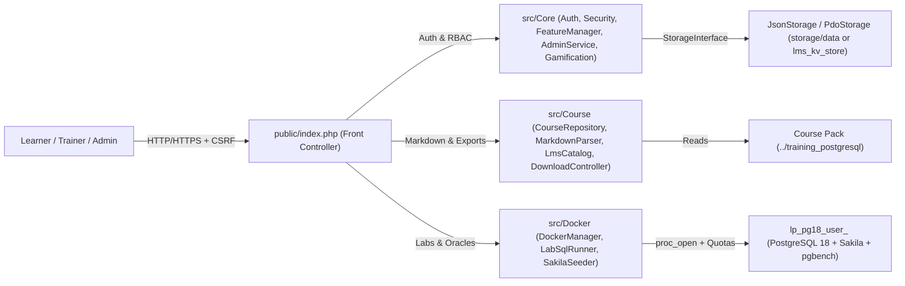

# LightPath Training Portal — Technical Gateway

> **Organization:** LightPath SARL (`https://www.lightpath.fr` | `contact@lightpath.fr`)  
> **Lead Instructor & Author:** Jean-Marie Renouard (Database & DataOps Expert, Co-developer of MySQLTuner)  
> **Stack:** Zero-dependency PHP `>= 8.1` • Atomic JSON / Transactional PDO • Docker / WSL2 PostgreSQL 18 Sandbox • Self-hosted Studio Assets (`Zero External CDNs`) • Qualiopi / Datadock / SCORM 1.2

---

## 1. Platform Overview

**LightPath Training Portal** (`LightPath Academy v2.0.0`, Ref. `LP-LMS-QUALIOPI-2026`) is an industrial-grade Learning Management System purpose-built for hands-on technical certifications—powering the 4-track **PostgreSQL 18** curriculum (`34` modules, `34` 7-pillar Qualiopi practical labs, `69` cheatsheets, `18` Qualiopi reference documents, `35` pure-Python `pgscripts`, multi-language client examples, and synchronized 16:9 Studio slide decks).

### System Architecture



---

## 2. Two-Minute Quickstart

### A. Zero-Config Local JSON Mode (Default)
Start the built-in PHP development server directly—JSON stores seed automatically on first request:

```bash
php -S localhost:8080 -t public
```

Or via Composer script:

```bash
composer serve
```

### B. Production Relational PDO Mode (`pgsql` / `mysql` / `sqlite`)
Point `LMS_STORAGE_DRIVER=pdo` to PostgreSQL, MySQL, or SQLite (`lms_kv_store` table is auto-created on boot):

```bash
export LMS_STORAGE_DRIVER=pdo
export LMS_PDO_DSN="pgsql:host=127.0.0.1;port=5432;dbname=lightpath_lms"
export LMS_PDO_USER=postgres
export LMS_PDO_PASS="<strong-password>"
php -S 0.0.0.0:8080 -t public
```

### C. Docker Classroom Labs & Simulated Fallback
Each authenticated user can launch an isolated PostgreSQL 18 lab container (`lp_pg18_user_<id>`, port `5500 + userId`) seeded automatically via [SakilaSeeder.php](src/Docker/SakilaSeeder.php) with **12 Sakila tables**, **4 `pgbench` tables (`1,000` accounts)**, **4 diagnostic extensions**, and restricted non-superuser role `lms_student`. Non-staff learners cannot fall back to the shared `pg_formation_primary` cluster during web seeding or log inspection (`$allowSharedFallback = false`).

- **Windows WSL2 hosts:** Set `LMS_WSL_DISTRO=Ubuntu-24.04` (default in [config/app.php](config/app.php)).
- **Shared hosting / CI without Docker:** Automatically uses `cloud_simulated` mode with static Sakila/PG18 schema catalog; force simulated mode explicitly via `LMS_DOCKER_FORCE_SIMULATED=1`.

### Seeded Development Accounts (`JsonStorage::ensureDefaultUsers()`)

| Role | Email | Default Dev Password | Scope |
| :--- | :--- | :--- | :--- |
| `admin` | `jmrenouard@lightpath.fr` | `LightPath2026!` | Full platform control, users, enrollments, courses, audit CSV, feature flags, system health |
| `trainer` | `formateur@lightpath.fr` | `Formateur2026!` | Cohort KPIs, Q&A moderation, classroom locks/broadcast, attendance countersign, OPCO/SCORM exports, Docker lab ops |
| `student` | `stagiaire@lightpath.fr` | `Stagiaire2026!` | Enrolled courses, modules, quizzes, isolated Docker SQL labs, diagnostic, attendance, exam, satisfaction |

---

## 3. Role & Feature Matrix

| Module / Capability | `student` | `trainer` | `admin` | Notes |
| :--- | :---: | :---: | :---: | :--- |
| Course catalog, modules, PDF/HTML/MP4 playback | Enrolled | All | All | HTTP `206` / `416` byte-range streaming + `Auth::canAccessCourse()` (`[]` = 0 courses) |
| Sandboxed SQL workbench, schema explorer, 34 oracles | Own container | Own + Cohort | Own + Cohort | `stripCommentsAndLiterals()` guard + `lms_student` (`statement_timeout=15000`) |
| Classroom broadcast, `lock_solutions`, `lock_exam` | Read banner | Full control | Full control | Persisted per course slug (`broadcast_message`, `broadcast_level`, `active_track`) |
| Half-day Attendance (`J1_AM`..`J11_PM`) & OPCO CSV | Sign own slots | Countersign + CSV | Countersign + CSV | Formula-safe `;`-delimited UTF-8 BOM CSV |
| Trainer Cockpit (`cohort`, `qna`, `docker` tabs) | `403` | Full access | Full access | Lazy-loaded per tab, KPI strip (`tabular-nums`), bulk Docker ops |
| Admin Control Plane (`users`, `courses`, `audit`, `system`) | `403` | `403` (Hidden) | Full access | CSV import, `enrolled_courses`, monthly archived audit CSV (`category`/`actor`), flags, health |

---

## 4. Modular Feature Flags ([config/features.php](config/features.php))

Managed at runtime through [FeatureManager.php](src/Core/FeatureManager.php) and **Administration -> Système** (`action=admin_save_features`):

| Flag Key | Default | Category | Controlled Capability |
| :--- | :---: | :--- | :--- |
| `self_registration` | `true` | Authentification & Accès | Self-service account creation on login page |
| `demo_quick_login` | `true` | Authentification & Accès | 1-click Demo role sign-in buttons on login page |
| `docker_labs` | `true` | Laboratoires & Pratique | Per-user Docker PostgreSQL 18 containers & interactive SQL console |
| `chaos_engineering` | `true` | Laboratoires & Pratique | Controlled failure injection scenarios (`bloat`, `lock`, `idle_in_tx`, `wal_pressure`) |
| `gamification` | `true` | Pédagogie & Engagement | XP scoring, 5 DBA grades, and 8 achievement badges |
| `qna_forum` | `true` | Pédagogie & Engagement | Module/lab Q&A threads and trainer resolution workflow |
| `scorm_export` | `true` | Conformité & Exports | SCORM 1.2 `imsmanifest.xml` & standalone `.zip` exports |
| `cold_satisfaction_j60` | `true` | Conformité & Exports | Qualiopi J+60 post-training impact evaluation workflow |

---

## 5. CLI Utilities

| Command | Purpose |
| :--- | :--- |
| `php bin/lab-runner.php <cmd> [args] [--json]` | Manage lab containers: `list`, `status <uid>`, `start <uid>`, `stop <uid>`, `restart <uid>`, `reset <uid>`, `seed <uid> [dataset]`, `logs <uid> [tail]`, `stats <uid>`, `oracle <uid> <lab_id>`, `stop-all`, `prune` |
| `php bin/sync-course.php <slug> <source-dir>` | Validate source directory and write `storage/courses/<slug>/manifest.json` |
| `python bin/export_slides_cache.py` | Export 135 DPI Studio 16:9 slide PNGs + speaker notes `manifest.json` for all 34 modules |

---

## 6. Testing, Adversarial QA & Git Hooks

### PHP Syntax, Unit & Adversarial Suites
```bash
# 1. Core unit & integration TDD suite (also runs via `composer test`)
php tests/run_tests.php

# 2. Functional HTTP & PHP coverage audit suites
php tests/test_functional_http.php
php tests/test_coverage_audit.php

# 3. Adversarial regression & security suites (B1 through B5)
php tests/test_adversarial_b1.php
php tests/test_adversarial_b2.php
php tests/test_adversarial_b3.php
php tests/test_adversarial_b4.php
php tests/test_adversarial_b5.php
```

### Browser E2E Verification (`@playwright/mcp` JSON-RPC)
Uses isolated `LMS_DATA_DIR` temporary storage and [config/playwright-mcp.config.json](config/playwright-mcp.config.json) across `1440x900`, `768x1024`, and `375x812` viewports:

```bash
node tests/e2e/run_playwright_campaign.mjs
node tests/e2e/test_adversarial_challenger.mjs
```

### Mandatory Git Hooks Setup
Activate [.githooks/pre-commit](.githooks/pre-commit) and [.githooks/pre-push](.githooks/pre-push) to block direct commits/pushes to `main` and enforce passing tests prior to commit:

```bash
git config core.hooksPath .githooks
```

---

## 7. Qualiopi, Datadock & SCORM 1.2 Compliance

- **Complete Qualiopi Evidence Trail:** `15`-question positioning diagnostic -> half-day attendance (`J1_AM`..`J11_PM`) with dual trainee/trainer signatures -> formative module quizzes + `34` oracle-verified 7-pillar labs -> `40`-question certification exam (`75%` pass threshold) -> CSPRNG certificate `LP-PG18-CERT-<uid>-<8HEX>` with offline SVG QR verification (`page=verify`) -> Hot & Cold (`J+60`) satisfaction surveys -> Formula-safe OPCO/Qualiopi CSV & SCORM 1.2 exports.
- **Accessibility & Brand Discipline:** WCAG 2.1 AA `--text-muted` contrast (`#94A3B8` dark / `#475569` light), keyboard `:focus-visible`, reduced-motion support, `tabular-nums`, self-hosted assets, zero external CDNs, and exclusive LightPath SARL branding.

---

## 8. Engineering Documentation Index

| Document | Contents |
| :--- | :--- |
| [PROJECT-CONTEXT.md](PROJECT-CONTEXT.md) | Developer/agent onboarding baseline, storage & environment contracts, baseline test guardrails, 9-step GitHub workflow |
| [docs/ARCHITECTURE.md](docs/ARCHITECTURE.md) | Mermaid topology, front controller routing, dual `JsonStorage`/`PdoStorage` concurrency, caching, responsive UI |
| [docs/SECURITY.md](docs/SECURITY.md) | Threat model, storage-backed throttling, RBAC, HTTP security headers, CSV/XSS/path sanitization, `lms_student` SQL sandbox, container quotas |
| [docs/ADMIN_AND_TRAINER_GUIDE.md](docs/ADMIN_AND_TRAINER_GUIDE.md) | Role matrix, Trainer cockpit, Admin control plane, Cohort KPIs, CSV bulk import, Feature Flags, System Health, Qualiopi workflows |
| [docs/DOCKER_LABS_GUIDE.md](docs/DOCKER_LABS_GUIDE.md) | Per-user container topology, WSL2/simulated bridge, timeouts, `SakilaSeeder`, SQL workbench, Schema Inspector, Chaos, `bin/lab-runner.php` |
| [docs/COURSE_PACK_GUIDE.md](docs/COURSE_PACK_GUIDE.md) | `config/courses.php` registry, course-pack layout, Markdown/alerts/Mermaid rules, 7-pillar labs, `export_slides_cache.py`, `sync-course.php` |
| [docs/API_REFERENCE.md](docs/API_REFERENCE.md) | Every `api_*`, download/export, authenticated form, and admin action with auth, CSRF, parameter, and JSON contract details |
| [docs/QUALITY_AUDIT_PONYTAIL.md](docs/QUALITY_AUDIT_PONYTAIL.md) | Iteration 1 `/ponytail-audit` & `/dev-team` 7-axis findings, remediation roadmap, and Iteration 2 QA sign-off ledger |
