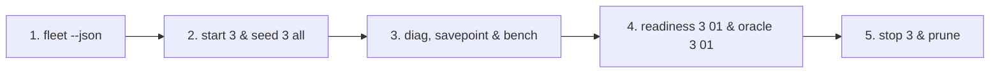

# Tutorial: Run Your First Docker PostgreSQL 18 Lab

> **Learning Goal:** Start an isolated per-learner PostgreSQL 18 Docker container (`lp_pg18_user_<id>`), inspect seeded Sakila and `pgbench` datasets, create a savepoint checkpoint, run a bounded benchmark, and pass Lab `01` validation.
>
> **Environment Warning:** Run this tutorial only on an isolated local workstation or training sandbox with Docker Engine running. Never target production databases or shared host clusters.

## Prerequisites

Make sure your workstation meets these requirements before starting:

- Docker Engine running locally (Linux native Docker, Docker Desktop, or Windows WSL2 `Ubuntu-24.04`)
- PHP `>= 8.3` CLI installed with `ext-json`
- Free local TCP port `5503` (reserved for user ID `3`, computed as `5500 + userId`) and port `8080`
- `LMS_DOCKER_FORCE_SIMULATED` unset or set to `0`

## What You Will Build

By the end of this tutorial, you will have:

1. Pulled `postgres:18` and inspected the Docker fleet status via `bin/lab-runner.php`.
2. Started container `lp_pg18_user_3` on port `5503` and seeded Sakila (`12` tables) plus `pgbench` (`1,000` accounts).
3. Captured live PG18 diagnostics, created a named savepoint, and run a bounded `pgbench` check.
4. Verified Lab `01` readiness and executed its automated SQL oracle.
5. Stopped and pruned the tutorial container cleanly.

## Lab Lifecycle



## Step 1: Pre-Pull PostgreSQL 18 and Check Fleet Status

Pull the official `postgres:18` fallback image and inspect current fleet telemetry in JSON format:

```bash
unset LMS_DOCKER_FORCE_SIMULATED
docker pull postgres:18
php bin/lab-runner.php fleet --json
```

Expected JSON output (example when no student containers exist yet):

```json
{
    "docker_available": true,
    "runtime_mode": "docker_live",
    "running_user_containers": 0,
    "stopped_user_containers": 0,
    "max_containers": 40,
    "idle_count": 0
}
```

## Step 2: Start and Seed Container `lp_pg18_user_3`

Launch the isolated container for learner `#3` (`stagiaire@lightpath.fr`), then run `SakilaSeeder` to provision extensions, datasets, and the restricted `lms_student` role:

```bash
php bin/lab-runner.php start 3 --json
php bin/lab-runner.php seed 3 all --json
```

Expected output from `start 3 --json`:

```json
{
    "success": true,
    "message": "...",
    "status": {
        "container_name": "lp_pg18_user_3",
        "port": 5503,
        "status": "running",
        "running": true
    }
}
```

Expected output from `seed 3 all --json`:

```json
{
    "success": true,
    "mode": "docker_live",
    "container": "lp_pg18_user_3",
    "dataset": "all"
}
```

Container `lp_pg18_user_3` runs with strict resource caps (`--memory=1g`, `--cpus=1.0`, `--shm-size=512m`, `--pids-limit=256`, `--security-opt=no-new-privileges`) and exposes both `formation_pg` and `dvdrental` databases with `pageinspect`, `pg_stat_statements`, `pgstattuple`, and `postgres_fdw`.

## Step 3: Capture Diagnostics, Create a Savepoint, and Benchmark

Inspect PostgreSQL 18 runtime settings, snapshot `formation_pg` with a savepoint named `baseline`, and execute a 2-client, 2-second read-only `pgbench` test:

```bash
php bin/lab-runner.php diag 3 --json
php bin/lab-runner.php savepoint 3 create baseline formation_pg --json
php bin/lab-runner.php bench 3 2 2 formation_pg --select-only --json
```

Expected output fields from `savepoint 3 create baseline`:

```json
{
    "success": true,
    "container": "lp_pg18_user_3",
    "savepoints": [
        {
            "name": "baseline",
            "database": "formation_pg"
        }
    ],
    "count": 1,
    "max_savepoints": 5
}
```

Expected output fields from `bench 3 2 2 formation_pg --select-only`:

```json
{
    "success": true,
    "mode": "docker_live",
    "clients": 2,
    "duration_seconds": 2,
    "select_only": true,
    "database": "formation_pg",
    "tps": 1240.5,
    "latency_avg_ms": 1.61
}
```

## Step 4: Verify Lab Readiness and Run the Automated Oracle

Check Lab `01` readiness first, then start the portal in a temporary `LMS_DATA_DIR`, sign in as `stagiaire@lightpath.fr`, and complete Lab `01` inside the web SQL workbench:

```bash
php bin/lab-runner.php readiness 3 01 --json
```

Expected readiness output:

```json
{
    "success": true,
    "ready": true,
    "lab_id": "01",
    "recommended_database": "formation_pg",
    "container_running": true
}
```

Now run the Lab `01` setup and check queries in the web workbench at `http://localhost:8080/index.php?page=lab&course=postgresql-18&id=lab_01_introduction_setup_postgresql_18`:

```sql
CREATE SCHEMA IF NOT EXISTS demo_audit;

CREATE TABLE IF NOT EXISTS demo_audit.cluster_checks (
    check_id INTEGER GENERATED ALWAYS AS IDENTITY PRIMARY KEY,
    check_name TEXT NOT NULL UNIQUE,
    observed_value TEXT NOT NULL,
    checked_at TIMESTAMPTZ NOT NULL DEFAULT now()
);

INSERT INTO demo_audit.cluster_checks (check_name, observed_value)
VALUES
    ('server_version', current_setting('server_version')),
    ('shared_buffers', current_setting('shared_buffers')),
    ('server_encoding', current_setting('server_encoding'))
ON CONFLICT (check_name) DO UPDATE
SET observed_value = EXCLUDED.observed_value,
    checked_at = now();
```

Validate completion from the CLI oracle runner:

```bash
php bin/lab-runner.php oracle 3 01 --json
```

Expected oracle output:

```json
{
    "passed": true
}
```

## Step 5: Stop and Prune the Lab Container

Stop all running tutorial containers and remove exited containers so host memory returns to baseline:

```bash
php bin/lab-runner.php stop 3 --json
php bin/lab-runner.php prune --json
```

Expected output from `stop 3 --json`:

```json
{
    "success": true,
    "message": "...",
    "status": {
        "container_name": "lp_pg18_user_3",
        "port": 5503,
        "status": "exited",
        "running": false
    }
}
```

## Next Steps

- Build your own Markdown course pack: [03. Author a Custom Course Pack](03-author-custom-course-pack.md)
- Remediate container and SQL sandbox incidents: [How-To Guides](../02-how-to-guides/index.md)
- Inspect all `bin/lab-runner.php` commands and exit codes: [CLI Utilities and Exit Codes](../03-reference/cli-and-scripts/cli-utilities-and-exit-codes.md)
- Understand `lms_student` isolation and `LabSqlRunner` guards: [SQL Sandbox and Qualiopi Integrity](../04-explanation/deep-dives/sql-sandbox-and-qualiopi-integrity.md)
