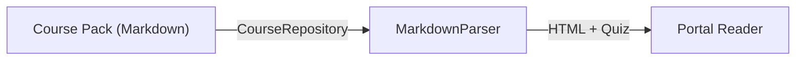

# Tutorial: Author and Sync a Custom Course Pack

> **Learning Goal:** Create a minimal custom course pack with a module, an interactive QCM quiz, and a 7-pillar lab, synchronize its manifest, and mount it in the portal.
>
> **Environment Warning:** Keep your tutorial course directory inside the repository workspace (`Security::isPathInside()` blocks directories outside the workspace root when registering custom courses in the admin panel). Never overwrite the production `postgresql-18` slug.

## Prerequisites

Make sure your environment meets these requirements before starting:

- Running local LightPath Training Portal sandbox (`php -S localhost:8080 -t public` with temporary `LMS_DATA_DIR`)
- Signed-in Administrator session (`jmrenouard@lightpath.fr`)
- PHP `>= 8.3` CLI installed

## What You Will Build

By the end of this tutorial, you will have:

1. Scaffolded a canonical LightPath course-pack tree under `./tmp-course-pack/`.
2. Authored `module_01_sandbox_basics.md` with GitHub alerts, quoted Mermaid node labels, SQL blocks, and a `<details>` quiz.
3. Authored `lab_01_sandbox_basics.md` with the 7-pillar structure and automated split heading.
4. Synchronized `storage/courses/sandbox-pack/manifest.json` with `bin/sync-course.php` and registered the pack in the LMS.
5. Removed the temporary pack cleanly.

## Step 1: Scaffold the Canonical Directory Layout

`CourseRepository` discovers course artifacts inside fixed subdirectories. Create a local sandbox course pack inside the workspace:

```bash
mkdir -p tmp-course-pack/01_programme_et_referentiel
mkdir -p tmp-course-pack/03_supports_de_cours
mkdir -p tmp-course-pack/04_ateliers_et_tp
mkdir -p tmp-course-pack/05_cheatsheets/modules
mkdir -p tmp-course-pack/05_cheatsheets/labs
```

Expected directory structure:

```text
tmp-course-pack/
├── 01_programme_et_referentiel/
├── 03_supports_de_cours/
├── 04_ateliers_et_tp/
└── 05_cheatsheets/
    ├── labs/
    └── modules/
```

## Step 2: Author a Module With Mermaid and Quiz Blocks

Create `tmp-course-pack/03_supports_de_cours/module_01_sandbox_basics.md`. Notice that Mermaid labels with parentheses must be quoted (`id["Node (Detail)"]`), and `MarkdownParser::extractQuizQuestions()` parses `<details><summary>...</summary>...</details>` blocks containing `* **A.**`..`* **D.**` choices:

```markdown
# Module 01: Sandbox Architecture Basics

> **Module:** 01 — Course Pack Authoring Demo
> **Duration:** 1h00
> **Objective (Bloom C2):** Understand how LightPath parses course Markdown
> **Instructor:** Jean-Marie Renouard — LightPath SARL

---

## 1. Course Flow

> [!NOTE]
> `MarkdownParser` caches compiled module HTML inside `storage/data/parsed_cache/`.



```sql
-- Inspect server timestamp in the SQL workbench
SELECT now() AS checked_at;
```

---

## 2. Formative Quiz

<details>
<summary>Question 1: Which component compiles course Markdown into cached HTML?</summary>

* **A.** `MarkdownParser`
* **B.** `DockerManager`
* **C.** `SakilaSeeder`
* **D.** `FeatureManager`

**Justification:** `MarkdownParser` compiles module Markdown, extracts quizzes, and caches rendered output in `parsed_cache/`.

</details>
```

Expected behavior: `CourseRepository::discoverModules()` registers `module_01_sandbox_basics` with code `01` and exposes the embedded quiz to `api_submit_quiz`.

## Step 3: Author a 7-Pillar Practical Lab

Create `tmp-course-pack/04_ateliers_et_tp/lab_01_sandbox_basics.md`. `MarkdownParser::splitLabEnonceAndCorrige()` splits the lab into prompt and solution tabs at a level-2 heading starting with `## Solution`:

```markdown
# Lab 01: Sandbox Verification Exercise

> **Lab:** 01 — Verify Server Version
> **Duration:** 0h30
> **Objective (Bloom C3):** Run a diagnostic query inside the sandbox

---

## 1. Prerequisites and Business Scenario

You are validating a new training instance before cohort kickoff. Create no external dependencies.

## 2. Step-by-Step Instructions

Run the version query inside the SQL workbench:

```sql
-- Check active PostgreSQL engine version
SELECT version();
```

Expected output:

```text
PostgreSQL 18.x
```

---

## Solution and Automated Validation

```sql
-- Verify PostgreSQL 18 runtime availability
SELECT current_setting('server_version');
```
```

Expected behavior: When a trainer enables `lock_solutions`, learners see only Sections `1` and `2`, while the `## Solution and Automated Validation` section remains hidden until unlocked.

## Step 4: Synchronize and Register the Custom Course Pack

Run `bin/sync-course.php` to validate the source directory and emit `storage/courses/sandbox-pack/manifest.json`:

```bash
php bin/sync-course.php sandbox-pack ./tmp-course-pack
```

Expected terminal output:

```text
[OK] Course manifest 'sandbox-pack' synchronized to .../storage/courses/sandbox-pack/manifest.json
```

Now sign in as `jmrenouard@lightpath.fr` (`admin`), open `?page=admin&tab=courses`, and submit the **Add Custom Course** (`admin_add_course`) form:

- **Slug:** `sandbox-pack`
- **Title:** `Sandbox Course Pack Demo`
- **Source Root:** `../tmp-course-pack` (relative to `public/` when running `php -S localhost:8080 -t public`, or the absolute workspace path `$(pwd)/tmp-course-pack`)

Click **Open Course** on the newly created card to verify Module `01` and Lab `01` load on the dashboard.

> [!NOTE]
> If you also include `.pptx` or `_slides.pdf` decks inside `03_supports_de_cours/`, run `python bin/export_slides_cache.py` to generate 135 DPI slide PNG caches under `public/assets/slides_cache/`.

## Step 5: Clean Up Tutorial Artifacts

Delete the `sandbox-pack` entry from `?page=admin&tab=courses`, then remove the temporary files from disk:

```bash
rm -rf tmp-course-pack storage/courses/sandbox-pack
```

Expected outcome: The portal catalog returns to the bundled `postgresql-18` and `git-basics` courses with zero leftover files.

## Next Steps

- Manage global feature flags and per-course overrides: [Configure Feature Flags and Courses](../02-how-to-guides/operations/configure-feature-flags-and-courses.md)
- Read all how-to operations and runbooks: [How-To Guides](../02-how-to-guides/index.md)
- Check `bin/sync-course.php` and `export_slides_cache.py` specifications: [CLI Utilities and Exit Codes](../03-reference/cli-and-scripts/cli-utilities-and-exit-codes.md)
- Review course-pack discovery and portal architecture: [Explanation](../04-explanation/index.md)
