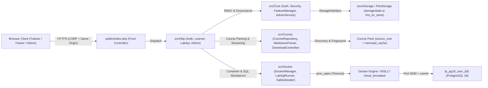
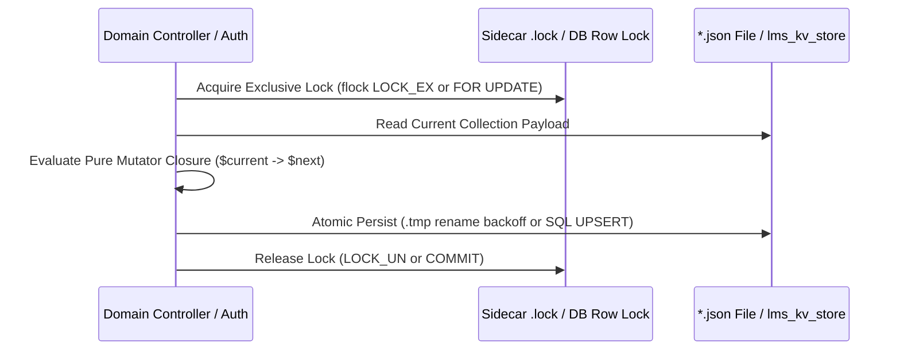

# Zero-Dependency LMS Architecture

Analytical overview of the runtime topology, request lifecycle, dual-driver persistence concurrency model, course-pack caching layers, and self-hosted user interface in LightPath Training Portal.

## 1. Architectural Context and Design Goals

LightPath Training Portal operates in two contrasting environments: live instructor-led technical workshops on local workstations or private LANs, and long-lived cloud virtual machines serving Qualiopi-certified cohorts. Both environments require deterministic startup, zero reliance on external internet access during labs, strict browser security policies, and reliable multi-user concurrency without heavy operational dependencies.

To satisfy these constraints, the platform runs directly on PHP 8.3+ using an internal PSR-4 autoloader (`LightPath\LMS\` mapped in `src/bootstrap.php`), native PHP extensions (`json`, `pdo`, `mbstring`, `zip`), and local static assets under `public/assets/`.

## 2. System Topology and Domain Boundaries

Requests enter through `public/index.php` and dispatch across four domain-specific HTTP controllers (`src/Http/`) backed by focused core, course, and Docker subsystems (`src/Core/`, `src/Course/`, `src/Docker/`).

### Request Lock Release and Domain Separation

PHP file-backed sessions normally hold an exclusive session file lock until script termination. If a learner streams an MP4 training video via HTTP `206 Partial Content` while concurrently polling `api_docker_status` or sending `api_heartbeat` telemetry, holding that session lock serializes concurrent requests from the same browser.

`public/index.php` prevents this bottleneck by initializing `Security::getCsrfToken()` early and invoking `session_write_close()` before dispatching any `GET` request or `api_*` JSON endpoint. Mutating HTML form `POST` routes retain the session write lock only long enough to store `$_SESSION['flash_error']` or `$_SESSION['flash_success']` across the redirect boundary.

## 3. Dual Persistence and Concurrency Model

`StorageInterface` decouples all application logic from storage mechanics. Both `JsonStorage` (`LMS_STORAGE_DRIVER=json`) and `PdoStorage` (`LMS_STORAGE_DRIVER=pdo`) expose identical collection semantics through `mutateFile()`, enforcing atomic read-modify-write isolation.

### Driver Trade-Offs

| Dimension | `JsonStorage` (`LMS_STORAGE_DRIVER=json`) | `PdoStorage` (`LMS_STORAGE_DRIVER=pdo`) |
| :--- | :--- | :--- |
| **Operational Footprint** | Zero external services; stores collections under `LMS_DATA_DIR`. | Requires PostgreSQL, MySQL, or SQLite reachable via `LMS_PDO_DSN`. |
| **Concurrency Mechanism** | Sidecar `<name>.lock` with `flock(LOCK_EX)` plus `.tmp.<pid>.<rand>` rename retry loop for Windows lock contention. | Transaction with `SELECT payload FROM lms_kv_store WHERE store_key = :k FOR UPDATE` (`pgsql` / `mysql`) and `ON CONFLICT DO UPDATE` / `ON DUPLICATE KEY UPDATE`. |
| **Corruption Safeguard** | Aborts writes with `RuntimeException` if a non-empty `.json` file decodes to an empty default. | Wraps mutations in SQL transactions; rolls back on exception. |
| **Failure Behavior** | Fails visibly if filesystem is read-only. | Falls back to `JsonStorage` only if unreachable during initial boot; throws `RuntimeException` on runtime write failures to prevent split-brain writes across JSON and SQL. |

Using a single key-value table (`lms_kv_store`) in `PdoStorage` allows identical domain methods and audit hash-chain logic (`JsonStorage::logAuditEvent()` and `verifyAuditIntegrity()`) to govern both backends without schema drift.

## 4. Multi-Layer Course-Pack Discovery and Caching

Course repositories contain dozens of long-form Markdown modules, labs, cheatsheets, Python utility scripts, MP4 videos, and pre-rendered slide decks. Parsing every Markdown file on every request would degrade classroom latency, so `CourseRepository` and `MarkdownParser` maintain two invalidation-safe cache layers inside `LMS_DATA_DIR`:

1. **Catalog Fingerprint Cache (`catalog_cache_<slug>.json`):** `CourseRepository::computeCatalogFingerprint()` hashes source directory structure and `.md` modification timestamps under prefix `v8_rca164`. When any course file changes on disk, the catalog cache rebuilds automatically without manual intervention, while `admin_clear_cache` provides explicit invalidation.
2. **Compiled Markdown and Slide Cache (`parsed_cache/*.json`):** `MarkdownParser` caches rendered HTML, extracted Table of Contents trees, server-side QCM answer keys, and slide metadata keyed by MD5 hashes that incorporate the course slug, source path, `.md` mtime, and `public/assets/slides_cache/<module_id>/manifest.json` mtime.
3. **Visual Asset Caching:** `MarkdownParser::renderMermaidBlock()` computes a normalized SHA-256 prefix for Mermaid blocks and serves Retina pre-rendered PNGs from `$sourceRoot/assets/mermaid_cache/` whenever present, falling back to local `public/assets/js/mermaid.min.js` only for uncached diagrams.

## 5. Self-Hosted Frontend and CSSOM Layout Shell

The web shell (`templates/layout.php`, `public/assets/css/app.css`, `public/assets/js/app.js`) separates presentation and behavior strictly from PHP markup:

- **Zero Inline Styling:** Templates emit semantic classes and `data-progress` / `data-accent` attributes instead of inline `style=` attributes, allowing `Security::sendSecurityHeaders()` to enforce `style-src 'self'` without `'unsafe-inline'`. `app.js` hydrates dynamic bar widths via CSSOM properties on `DOMContentLoaded`.
- **Sticky Contextual Navigation Without Overflow:** `body` applies `overflow-x: clip` rather than `overflow-x: hidden`, preserving `position: sticky` on the collapsible right-hand Table of Contents sidebar while preventing horizontal scrollbars across desktop (`1440x900`), tablet (`768x1024`), and mobile (`375x812`) viewports.
- **Tabular Precision:** KPI strips, exam scores, attendance totals, and `pgbench` telemetry apply `font-variant-numeric: tabular-nums` on an Obsidian (`#0B1120`) and Cyan (`#00B0F0`) palette.

## Related Reference and Procedures

- Configuration keys and feature flags: [Environment Variables and Feature Flags](../../03-reference/configuration/environment-and-feature-flags.md)
- Complete HTTP and JSON API contract: [HTTP Routes and JSON API Specification](../../03-reference/api-and-routes/http-routes-and-json-api.md)
- Security decision rationale: [ADR-001: Zero-Dependency, Zero-CDN, and Strict SHA-256 CSP](../design-decisions/adr-001-zero-dependency-zero-cdn-strict-csp.md)
- Production deployment guide: [Deploy Portal with Docker and PDO](../../02-how-to-guides/deployment/deploy-portal-docker-and-pdo.md)
