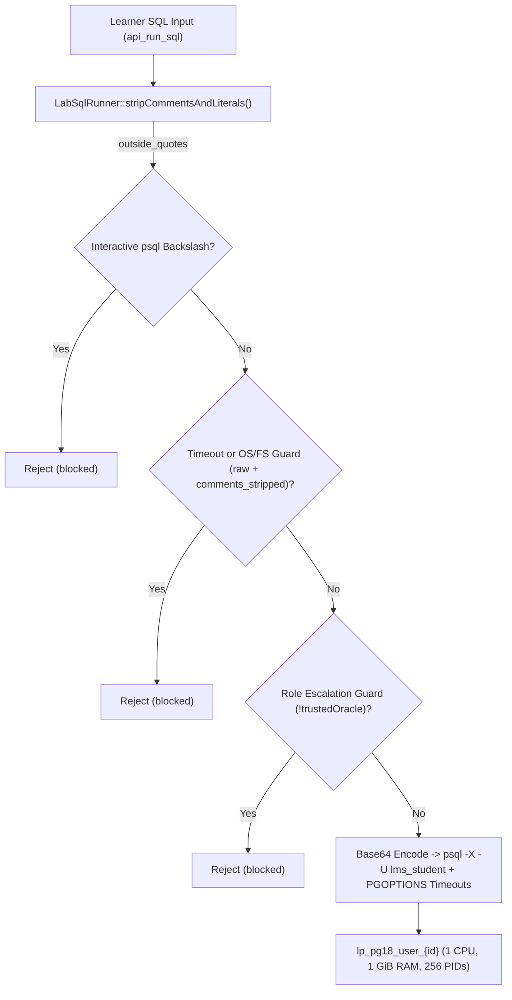

# Deep Dive: SQL Sandbox Isolation and Qualiopi Integrity

Architectural analysis of the multi-layer PostgreSQL 18 SQL execution sandbox (`LabSqlRunner`, `DockerManager`, `SakilaSeeder`) and the mathematical and cryptographic integrity guarantees underlying Qualiopi scoring, gamification, certificates, and audit hash chaining (`Gamification`, `LmsCatalog`, `JsonStorage`, `Security`).

## 1. Multi-Layer PostgreSQL 18 SQL Sandbox Isolation

Executing arbitrary learner SQL against live PostgreSQL 18 containers introduces two competing requirements: learners must run realistic DDL, DML, CTE, PL/pgSQL `DO $$ ... $$` blocks, and performance inspection queries (`pg_stat_activity`, `pageinspect`), while the host operating system, peer learner containers, and query workers must remain insulated from privilege escalation, filesystem reads, and resource exhaustion.

### Single-Pass Lexical Scanning (`stripCommentsAndLiterals`)

Naive regular expressions applied directly to raw SQL fail in opposite ways: they false-positive on harmless strings inside dollar-quoted `DO $$ ... $$` blocks (such as `\n` or educational comments), yet miss obfuscated attacks split across nested PostgreSQL comments (`/* /* */ */`) or dynamic `EXECUTE '...'` statements inside `DO` blocks.

`LabSqlRunner::stripCommentsAndLiterals()` solves both failure modes in one linear scan, producing two distinct views of the input:

1. **`outside_quotes`:** Strips `--` line comments, arbitrarily nested `/* ... */` block comments, single-quoted / escape literals (`'...'`, `E'...'`), and dollar-quoted blocks (`$$...$$`, `$tag$...$tag$`). Interactive `psql` backslash commands (`\!`, `\copy`, `\i`, `\c`, `\watch`, `\gexec`, `\lo_*`) run strictly against `outside_quotes`, eliminating false positives inside legitimate PL/pgSQL string literals.
2. **`comments_stripped`:** Strips SQL comments while preserving string and dollar-quoted literal bodies. Timeout tampering (`SET`/`RESET statement_timeout`, `set_config(...)` with timeout strings or `||` concatenation), OS command execution (`COPY ... PROGRAM`), server filesystem functions (`pg_read_file`, `pg_ls_dir`, `lo_import`), and role escalation (`ALTER SYSTEM`/`USER`/`ROLE`, `SET ROLE`, `SESSION AUTHORIZATION`) are evaluated against both raw SQL and `comments_stripped` so nested `DO $$ BEGIN EXECUTE '...'; END $$;` bypasses are caught prior to container invocation.

### Least-Privilege Database Role and Cgroup Containment

Trusted system validation (`api_validate_lab`, `api_run_oracle`, `api_run_lab_solution`) runs with `$trustedOracle = true` as `postgres`, whereas interactive learner SQL runs as `lms_student` (`SakilaSeeder::SANDBOX_ROLE`) bounded by `PGOPTIONS="-c statement_timeout=15000 -c lock_timeout=10000"` and an `18.0`-second PHP `proc_open()` deadline:

| Isolation Layer | Enforcement Mechanism | Concrete Bound / Privilege |
| :--- | :--- | :--- |
| **PostgreSQL Role** | `SakilaSeeder::getSandboxRoleSql()` | `NOSUPERUSER NOCREATEDB NOCREATEROLE NOINHERIT NOREPLICATION NOBYPASSRLS`; `REVOKE pg_execute_server_program, pg_read_server_files, pg_write_server_files`; `GRANT pg_read_all_stats` |
| **Statement / Lock Timeout** | `PGOPTIONS` + `execCommandWithTimeout()` | `statement_timeout = 15000` ms, `lock_timeout = 10000` ms, process kill at `18.0` s (`taskkill /F /T` on Windows, `SIGKILL` on Unix) |
| **Tenant Routing** | `DockerManager::resolveTargetContainer()` | `$allowSharedFallback = false` for students; blocks fallback to shared `pg_formation_primary` |
| **Container Cgroup** | `DockerManager::startUserContainer()` | `--memory=1g --cpus=1.0 --shm-size=512m --pids-limit=256 --security-opt=no-new-privileges` |

## 2. Deterministic Scoring, Gamification, and Qualiopi Integrity

Qualiopi compliance requires reproducible scoring, verifiable attendance records, and tamper-evident audit logs across both JSON and PDO persistence modes.

### XP Accumulation and Assessment Threshold Model

In `Gamification::computeUserBadgesAndXp()`, a learner's total experience score $X$ is computed deterministically from verified completion records, quiz submissions, diagnostic completion, exam success, and countersigned half-day attendance counts:

$$
X = 100 M_c + 150 L_c + 50 Q_c + 150 I_{\text{diag}} + 500 I_{\text{exam}} + 25 A_h
$$

where $M_c$ is the count of completed modules, $L_c$ is the count of completed practical labs, $Q_c$ is the count of recorded module quiz scores, $I_{\text{diag}} \in \{0, 1\}$ indicates completion of the initial positioning diagnostic, $I_{\text{exam}} \in \{0, 1\}$ indicates passing the summative exam (`passed === true`), and $A_h$ is the count of signed half-day attendance slots.

For summative certification in `LmsCatalog::evaluateFinalExam()`, the percentage score $P$ over $N$ weighted questions ($N = 40$ for `postgresql-18`, $N = 10$ for `git-basics`) with indicator $c_i \in \{0, 1\}$ for each question $i$ is rounded to the nearest integer and evaluated against the fixed $75\%$ certification gate:

$$
P = \text{round}\left(\frac{100}{N} \sum_{i=1}^{N} c_i\right), \quad \text{passed} \iff P \ge 75
$$

For pre-training positioning in `LmsCatalog::evaluateDiagnostic()` on `postgresql-18` ($N = 15$), the rounded score $P_{\text{diag}}$ partitions learners across three entry tracks: `fondamentaux-sql` when $P_{\text{diag}} < 45$, `cursus-complet` when $45 \le P_{\text{diag}} < 75$, and `performance-tuning` when $P_{\text{diag}} \ge 75$.

### Tamper-Evident SHA-256 Audit Hash Chain

`JsonStorage::logAuditEvent()` and `JsonStorage::verifyAuditIntegrity()` construct an append-only cryptographic hash chain across active logs (`audit_logs`, capped at `1,000` newest-first entries) and rotated monthly archive collections (`audit_logs_YYYYMM`).

For each chronologically ordered entry $e_k$ ($k \ge 1$) with canonical payload $C(e_k)$ formed by removing `entry_hash`, sorting keys lexicographically (`ksort($payload, SORT_STRING)`), and encoding unescaped JSON:

$$
\text{prev\_hash}_1 = 0^{64}, \quad \text{prev\_hash}_k = h_{k-1}, \quad h_k = \text{SHA256}\left(C(e_k)\right)
$$

When active logs exceed `1,000` entries, evicted entries migrate chronologically into `audit_logs_YYYYMM` inside the same `mutateFile()` critical section. Because `prev_hash` of the oldest active entry points to `entry_hash` of the newest archived entry, `verifyAuditIntegrity(true)` reconstructs the full timeline across monthly archives and active records while cleanly isolating pre-chain historical entries (`legacy_unchained`) from any post-chain tampering (`entry_hash_mismatch`, `prev_hash_mismatch`, `invalid_genesis_prev_hash`, `malformed_prev_hash`, `missing_hash_fields`, `unchained_entry_after_chain_start`).

### Offline Certificate Verification and QR Generation

When a learner passes the summative exam, `JsonStorage::saveExamAttempt()` issues a CSPRNG identifier matching `LP-<PREFIX>-CERT-<uid>-<8HEX>` (retained across the latest `20` attempts per user and course). Public verification at `?page=verify&code=...` renders a self-contained $21 \times 21$ SVG matrix (`Security::renderVerificationQrSvg()`) whose data modules derive directly from `hash('sha256', $certificateId . '|' . $verifyUrl, true)`, requiring zero external image generators or remote QR APIs.

## Related Reference and Procedures

- JSON API contracts for SQL execution, oracles, and exports: [HTTP Routes and JSON API Specification](../../03-reference/api-and-routes/http-routes-and-json-api.md)
- SQL guard rejections and audit chain break codes: [Error and Alert Matrix](../../03-reference/troubleshooting-codes/error-and-alert-matrix.md)
- Incident response for Docker and SQL issues: [Remediate Docker Lab and Auth Incidents](../../02-how-to-guides/incident-response/remediate-docker-lab-and-auth-incidents.md)
- Audit chain verification and credential hardening: [Harden CSP, Credentials, and Audit Chain](../../02-how-to-guides/security/harden-csp-credentials-and-audit-chain.md)
