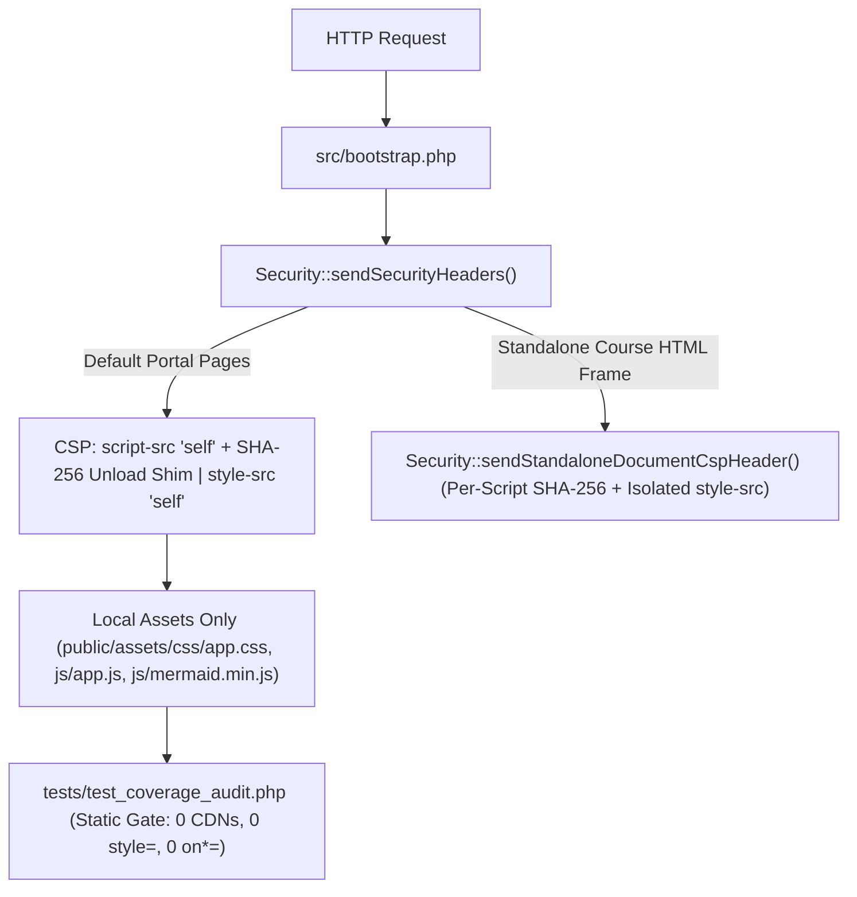

# ADR-001: Zero-Dependency, Zero-CDN, and Strict SHA-256 CSP Architecture

| Attribute | Value |
| :--- | :--- |
| **Status** | Accepted |
| **Date** | `2026-11-23` |
| **Deciders** | LightPath Architecture Engineering |
| **Supersedes** | None |

## Context

LightPath Training Portal serves live corporate training cohorts in classroom networks, restricted enterprise VPNs, and public cloud deployments. Traditional PHP and JavaScript stacks introduce Composer vendor lockfiles, npm frontend build pipelines, external font or script CDNs, and relaxed Content Security Policies (`'unsafe-inline'` in `script-src` and `style-src`).

In training environments, those patterns create three operational failures:

1. **Air-Gapped Workshop Breakage:** External script, font, or diagram CDN hosts fail inside isolated client labs or firewalled rooms.
2. **XSS and Injection Blast Radius:** Allowing `'unsafe-inline'` in `style-src` or `script-src` weakens browser isolation when rendering user-contributed notes, Q&A discussions, and Markdown course files.
3. **Supply-Chain Drift:** Transitive third-party PHP/Node runtime dependencies expand CVE exposure on an application whose core persistence and rendering needs fit cleanly in native PHP 8.3 and vanilla ES6.

## Architecture Overview

Every standard portal route enforces `style-src 'self'` and locks `script-src` to `'self'` plus the single base64 SHA-256 digest of `Security::UNLOAD_SHIM_JS` (`'sha256-Y+Iy31+SIVnkv2t35OtFkyF8C43lr3XQSadODH27V58='`), which rewrites browser-extension `unload` listeners to `pagehide`. Dynamic progress bars and track color indicators pass values via `data-progress` and `data-accent` HTML attributes and hydrate through `public/assets/js/app.js`.

Only pre-compiled standalone `.html` course files streamed inline via `DownloadController::streamFile()` invoke `Security::sendStandaloneDocumentCspHeader()`, which hashes trusted static inline `<script>` blocks individually into `sha256-...` tokens while keeping `script-src` free of `'unsafe-inline'`.

## Options Considered and Trade-Offs

| Option | Air-Gapped Reliability | XSS / CSP Strength | Build & Maintenance Overhead | Verdict |
| :--- | :--- | :--- | :--- | :--- |
| **Option A: Zero-Vendor PHP 8.3, Local Assets, Zero CDNs, Strict `style-src 'self'` + SHA-256 `script-src`** | Complete (works offline with zero external hosts) | High (`0` inline styles, `0` `on*=` handlers, SHA-256 locked scripts) | Low (no runtime Composer/Webpack pipeline) | **Selected** |
| **Option B: Symfony/Laravel + Vite Bundle + Public CDNs** | Poor when offline unless mirrored locally | Medium (often requires `'unsafe-inline'` for legacy plugins) | High (constant dependency patching and build artifacts) | Rejected |
| **Option C: Local Assets with Permissive `'unsafe-inline'` CSP** | Complete | Low (inline injection remains executable) | Low | Rejected |

## Decision

Adopt Option A across all application code and templates:

- Zero third-party PHP packages in `composer.json` (`require` stays limited to `php >= 8.3`, `ext-json`, `ext-pdo`).
- Zero external CDN references anywhere in `templates/`, `public/`, or `docs/` (`tests/test_coverage_audit.php` enforces this continuously).
- Zero inline `style=` attributes in `src/` or `templates/`, zero `on*=` event attributes in `templates/`, and strict `style-src 'self'` + SHA-256 `script-src` in `Security::sendSecurityHeaders()`.
- Pure-PHP/SVG fallbacks for QR verification (`Security::renderVerificationQrSvg()`) and SCORM 1.2 ZIP packaging (`DownloadController::buildScorm12ZipPackage()` when `ext-zip` is absent).

## Consequences

### Positive

- The LMS boots from a clean `php:8.3-cli-alpine` container or shared PHP host without running `composer install` or `npm run build` in production.
- Every HTML page, admin tab, and JSON endpoint passes automated static CSP and Playwright E2E zero-console-error checks.
- Offline workshops retain full Mermaid diagram rendering, Studio slide carousels, and Qualiopi QR verification badges.

### Negative and Operational Risks

- Any change to `Security::UNLOAD_SHIM_JS` or HTML template attribute patterns must update CSSOM hydration in `public/assets/js/app.js` and pass `tests/test_coverage_audit.php`.
- Reverse proxies (Nginx or Apache) must not inject an overriding `Content-Security-Policy` header that drops the unload shim SHA-256 token or breaks standalone course HTML frames.

## Related Reference and Procedures

- Security headers, CSP policy strings, and route contracts: [HTTP Routes and JSON API Specification](../../03-reference/api-and-routes/http-routes-and-json-api.md)
- Environment and runtime extension requirements: [Environment Variables and Feature Flags](../../03-reference/configuration/environment-and-feature-flags.md)
- Hardening and CSP verification guide: [Harden CSP, Credentials, and Audit Chain](../../02-how-to-guides/security/harden-csp-credentials-and-audit-chain.md)
- Production deployment configuration: [Deploy Portal with Docker and PDO](../../02-how-to-guides/deployment/deploy-portal-docker-and-pdo.md)
