# ADR-002: Versioned Diataxis MkDocs Material Publishing

| Attribute | Value |
| :--- | :--- |
| **Status** | Accepted |
| **Date** | `2026-11-23` |
| **Deciders** | LightPath Architecture Engineering |
| **Supersedes** | None |

## Context

`lightpath-training-portal` previously shipped flat root Markdown files (`docs/*.md`) without separation between learning tutorials, operational runbooks, reference tables, and architectural rationale. Publishing those files as a public engineering portal on `https://lsm.lightpath.fr/` introduced four distinct constraints:

1. **Genre Separation and Procedural Clarity:** Mixing architectural prose with incident commands slows operators under pressure. Operational guides require strict, unambiguous imperatives validated automatically.
2. **Immutable Historical Release Tags:** Historical Git tags such as `v2.0.0` predate the 4-quadrant Diataxis tree. Rewriting signed or released tags breaks Git provenance, yet publishing broken navigation or dead links across version selector entries degrades user trust.
3. **Zero-CDN Repository Policy:** `tests/test_coverage_audit.php` enforces zero external CDN hostnames across `docs/`, `templates/`, and `public/`. Documentation rendering tools (such as MkDocs KaTeX math scripts) must not introduce blocked CDN URLs inside `docs/**/*.md` or local JS/CSS files.
4. **Sensitive File Isolation:** Private engineering logs (`docs/internal/`), local vault artifacts, `.env*` files, and runtime credentials must never appear in the built static site deployed to IONOS via SFTP.

## Architecture Overview

```mermaid
flowchart LR
    SRC["Repo Tree (main + Git Tags vX.Y.Z)"] -->|"git archive + Overlay"| BLD["scripts/build_versioned_docs.py"]
    BLD -->|"Overlay Config, Hooks & Styles"| HOOKS["scripts/mkdocs_hooks.py"]
    HOOKS -->|"Prune Nav + Fallbacks + Rewrite Links"| MKDOCS["mkdocs build --strict"]
    MKDOCS -->|"assert_no_private_files()"| DIST["site_dist/ (/main/, /vX.Y.Z/, versions.json, .htaccess)"]
    DIST -->|"SFTP Deploy (GitHub Actions)"| IONOS["IONOS Apache Hosting (lsm.lightpath.fr)"]
```

The publishing pipeline splits responsibilities cleanly between root toolchain config, build-time Python hooks, and multi-version static packaging:

- **Diataxis 4-Quadrant Tree:** Content divides into `docs/01-tutorials/`, `docs/02-how-to-guides/` (enforcing ASD-STE100 Issue 9 via `ste_check.py`), `docs/03-reference/`, and `docs/04-explanation/`, rooted by `docs/index.md`.
- **Root-Only Math Asset Declaration:** External KaTeX stylesheets and runtime scripts required by MkDocs Material `pymdownx.arithmatex` live exclusively in root `mkdocs.yml`, keeping `docs/javascripts/katex.js`, `docs/stylesheets/extra.css`, and every Markdown file under `docs/` completely free of external CDN hostnames.
- **Tag Overlay and Historical Fallback Routing:** `scripts/build_versioned_docs.py` extracts each semver Git tag (`v2.0.0`, future `v*`) via `git archive`, overlays `ALWAYS_OVERLAY_FILES` (`mkdocs.yml`, `scripts/mkdocs_hooks.py`, `docs/stylesheets/extra.css`, `docs/javascripts/katex.js`) and missing `FALLBACK_OVERLAY_FILES` (`docs/index.md`, SVG brand assets), and executes `python -m mkdocs build --strict`. Inside `scripts/mkdocs_hooks.py`, `QUADRANT_HISTORICAL_FALLBACKS` maps missing quadrant paths on pre-Diataxis tags cleanly to legacy documents (`COURSE_PACK_GUIDE.md`, `DEPLOYMENT_AND_OPERATIONS.md`, `API_REFERENCE.md`, `ARCHITECTURE.md`) or `overview.md`, while pruning missing nav entries.
- **Apache Version Routing and Privacy Gate:** `scripts/build_versioned_docs.py` writes `versions.json` (`mike` provider schema), `.htaccess` (HTTPS `301`, security headers, `ErrorDocument 404`, and subpath-preserving `302` redirects for `/`, `/latest/...`, and `/dev/...`), HTML redirect fallbacks, and executes `assert_no_private_files()` before SFTP upload.

## Options Considered and Trade-Offs

| Option | Historical Tag Fidelity | Hosting Simplicity (IONOS) | Governance & Security Enforcement | Verdict |
| :--- | :--- | :--- | :--- | :--- |
| **Option A: Diataxis 4-Quadrant + `scripts/build_versioned_docs.py` Archive Overlay + Apache `.htaccess`** | High (immutable Git tags built unmodified via overlay + fallback routing) | High (pure static SFTP bundle, zero server runtime) | Automated via `diataxis_check.py --strict --check-ste`, `pytest`, and `assert_no_private_files()` | **Selected** |
| **Option B: `mike deploy` Directly onto `gh-pages` Only** | Medium (requires mutating `gh-pages` branch and loses IONOS custom hosting control) | Low for IONOS Apache vhost | Requires custom wrappers to inject `.htaccess` and privacy checks | Rejected |
| **Option C: Unversioned Single-Branch MkDocs Build** | None (historical releases overwritten on every merge) | High | Lacks version selector and immutable tag snapshots | Rejected |

## Decision

Adopt Option A as the standard documentation architecture and publishing pipeline:

- Partition all new documentation strictly across the four Diataxis quadrants (`01-tutorials/`, `02-how-to-guides/`, `03-reference/`, `04-explanation/`) while preserving existing deep-dive guides and virtual root documents (`README.md`, `CHANGELOG.md`, `CONTRIBUTING.md`, `PROJECT-CONTEXT.md`, `SECURITY.md`).
- Gate pull requests with `docs-ci.yml` (`pytest` Diataxis/publishing suites + `mkdocs build --strict`) and deploy multi-version bundles on `main` pushes and published GitHub releases via `docs-publish.yml`.
- Maintain strict separation between internal engineering notes (`docs/internal/**`, excluded via `exclude_docs` and rewritten to GitHub repository URLs if referenced) and public static output.

## Consequences

### Positive

- Operators receive concise, ASD-STE100-verified runbooks under `docs/02-how-to-guides/` linked bidirectionally to reference tables and ADRs.
- Historical tags such as `v2.0.0` remain immutable in Git while rendering cleanly under the modern Material theme and version selector.
- Every build enforces zero private file leaks and zero CDN strings inside `docs/`.

### Negative and Operational Risks

- Adding new files to `docs/` requires updating the explicit `nav:` contract in `mkdocs.yml` (though `prune_nav_for_existing_files()` handles historical tags safely).
- Live HTTPS smoke checks in `docs-publish.yml` depend on `lsm.lightpath.fr` DNS and IONOS Apache vhost binding; until DNS resolves, the workflow emits a warning while preserving SFTP deployment verification.

## Related Reference and Procedures

- Build script CLI flags, overlay constants, and test exit codes: [CLI Utilities and Exit Codes](../../03-reference/cli-and-scripts/cli-utilities-and-exit-codes.md)
- Documentation environment variables (`LMS_DOCS_REF`, `LMS_DOCS_SITE_URL`): [Environment Variables and Feature Flags](../../03-reference/configuration/environment-and-feature-flags.md)
- Feature flag and course configuration guide: [Configure Feature Flags and Courses](../../02-how-to-guides/operations/configure-feature-flags-and-courses.md)
- Portal and hosting deployment guide: [Deploy Portal with Docker and PDO](../../02-how-to-guides/deployment/deploy-portal-docker-and-pdo.md)
