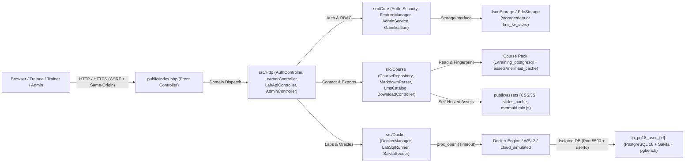
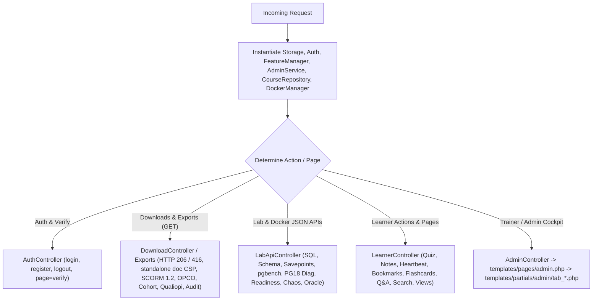
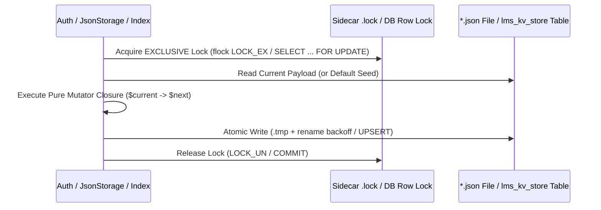

# System Architecture — LightPath Training Portal

> **Scope:** Runtime topology, request dispatch, persistence drivers, course-pack engine, Docker lab bridge, and self-hosted UI architecture for `lightpath-training-portal`.

---

## 1. System Topology

The LMS runs as a domain-modular PHP 8.1+ (PHP 8.3+ target) web application backed either by atomic local JSON stores or a PDO database, consuming an external multi-track Markdown/Slide course pack (`../training_postgresql`) and optionally orchestrating per-student PostgreSQL 18 Docker containers.

---

## 2. Bootstrap & Request Lifecycle

Every HTTP request and CLI utility loads [src/bootstrap.php](../src/bootstrap.php):
1. Configures timezone to `Europe/Paris`.
2. Registers an anonymous PSR-4 autoloader mapping namespace prefix `LightPath\LMS\` to `src/`.
3. For web SAPI requests (not CLI):
   - Aligns `session.gc_maxlifetime` and session cookie `lifetime` dynamically with `'session_idle_ttl'` (`7200`s default in [config/app.php](../config/app.php)) and hardens session parameters (`session.use_strict_mode=1`, `session.use_only_cookies=1`, `httponly=true`, `samesite=Lax`, and TLS-conditional `secure`).
   - Starts the PHP session and emits hardened HTTP headers via `Security::sendSecurityHeaders()` (strict `style-src 'self'` and SHA-256 locked `script-src`).

### Front Controller & Domain Router ([public/index.php](../public/index.php) -> `src/Http/*`)

Resolving `P1-7`, request orchestration is cleanly partitioned into four domain controllers under `src/Http/` (`AuthController`, `LearnerController`, `LabApiController`, `AdminController`), while [public/index.php](../public/index.php) remains a lean front controller preserving backward-compatible routing guards and calling `session_write_close()` on streaming and concurrent AJAX endpoints.

---

## 3. Domain Layer Organization

| Domain | Classes | Responsibilities |
| :--- | :--- | :--- |
| **HTTP Controllers** | `AuthController`, `LearnerController`, `LabApiController`, `AdminController` | Domain request handling, CSRF + `Security::verifySameOriginRequest()` guards, RBAC `403` enforcement, feature-flag checks, JSON API & page view dispatch |
| **Security & Governance** | `Security`, `Auth`, `FeatureManager` | CSRF tokens, strict zero-`unsafe-inline` `style-src 'self'` + SHA-256 `script-src`, `sendStandaloneDocumentCspHeader()`, same-origin verification, path/CSV sanitization, `isUserActive()` gating, session regeneration, 10 categorized feature flags (`personal_notes`, `flashcards_srs` added), `requires` dependencies, 4 deployment profiles, per-course overrides, JSON config export/import |
| **Administration** | `AdminService` | Course-scoped Cohort KPIs (zero N+1), at-risk learner detection (`detectAtRiskLearners()`), module completion matrix (`computeModuleCompletionMatrix()`), Cohort CSV & Qualiopi JSON exports, user/audit filtering, System Health probes (PHP, PDO + `getLastError()`, `parsed_cache`/`catalog_cache`, Docker, audit hash chain) |
| **Persistence** | `StorageInterface`, `JsonStorage`, `PdoStorage` | Atomic key-value store across 16+ domain collections (users, progress, courses, tamper-evident `audit_logs` + `audit_logs_YYYYMM`, diagnostic, exam, time, attendance, satisfaction, cold satisfaction, certificates, bookmarks, flashcards, discussions, classroom state, login throttles, feature flags, per-course feature overrides) |
| **Pedagogy & Gamification** | `Gamification`, `LmsCatalog` | XP calculation, 5 DBA ranks, 8 achievement badges, 15-question diagnostic, 40-question final exam across 5 DBA domains, 53 SRS flashcards, 56 glossary entries, SCORM 1.2 XML |
| **Content & Streaming** | `CourseRepository`, `MarkdownParser`, `DownloadController` | Course discovery, fingerprint cache invalidation, Markdown-to-HTML rendering, 5 GitHub alerts, slide deck extraction, 7-pillar Enonce/Corrige split, `resolveHttpRange()` HTTP `206` / `416` streaming, standalone HTML frame CSP, ZIP/SCORM packaging |
| **Container Labs** | `DockerManager`, `LabSqlRunner`, `SakilaSeeder` | WSL2/native Docker orchestration with `proc_open` timeouts, container quotas, per-user savepoints/restore, bounded `pgbench`, idle container reaper, fleet summary, chaos heal, `lms_student` + `pg_read_all_stats` SQL sandbox, schema inspector, live PG18 diagnostics, 34-lab readiness checks, 34 deterministic oracles, full Sakila + 1,000-row `pgbench` seeding |

---

## 4. Dual Persistence & Concurrency Design

`StorageInterface` decouples domain services from storage implementation. Both drivers guarantee atomic read-modify-write semantics through `mutateFile(string $name, callable $mutator, mixed $default = [])`.

### Driver Comparison

| Aspect | `JsonStorage` (`LMS_STORAGE_DRIVER=json`) | `PdoStorage` (`LMS_STORAGE_DRIVER=pdo`) |
| :--- | :--- | :--- |
| **Locking Mechanism** | `fopen('<name>.lock', 'c+')` + `flock($fp, LOCK_EX)` | `PDO::beginTransaction()` + `SELECT payload FROM lms_kv_store WHERE store_key = :k FOR UPDATE` |
| **Write Atomicity** | Write to `.tmp.<pid>.<uniqid>`, `rename()` with short Windows backoff retry | PostgreSQL/SQLite `ON CONFLICT (store_key) DO UPDATE`; MySQL `ON DUPLICATE KEY UPDATE` |
| **Audit Log Lifecycle** | Active window capped at `1,000` entries with SHA-256 chain links (`prev_hash`, `entry_hash`); overflow rotated to `audit_logs_YYYYMM`; `getAuditLogs($limit, true)` merges archives newest-first; `verifyAuditIntegrity()` verifies chain links cleanly (`legacy_unchained` tolerated) | Identical logical keys, SHA-256 hash chain, and monthly archive merging in `lms_kv_store` |
| **Failure Handling** | Corruption backup before default reset; returns explicit status | Falls back gracefully if DB unreachable at boot; logs & retains `getLastError()` on runtime write failures |

---

## 5. Course-Pack Discovery & Multi-Layer Caching

To maintain sub-50ms page loads across 34 long-form modules, 34 labs, 69 cheatsheets, and 35 `pgscripts`, parsing is memoized across two cache layers keyed by file modification times:

1. **Course Catalog Cache (`storage/data/catalog_cache_<slug>.json`):**
   - Managed by `CourseRepository::loadCourse()` and invalidated automatically via `computeCatalogFingerprint()` (`v8_rca164` + directory and `.md` mtime checksums) or manually via `clearCatalogCache(): int` from the Admin System panel.
2. **Parsed Markdown Cache (`storage/data/parsed_cache/*.json`):**
   - `MarkdownParser::parseModuleFile()` caches rendered HTML, Table of Contents, extracted quiz QCMs, and slide metadata keyed by `md5('mod_v8_rca158:' . $courseSlug . ':' . $mdPath . ':' . $mtime . ':' . $manifestMtime)`.
   - `MarkdownParser::parseLabFile()` caches full, Enonce-only, Corrige-only HTML/TOC plus extracted SQL code snippets keyed by `md5('lab_v9_rca158:' . $courseSlug . ':' . $mdPath . ':' . $mtime)`.
3. **Static Visual Caches (`public/assets/` & `$sourceRoot/assets/`):**
   - `public/assets/slides_cache/<module_id>/slide_NNN.png` + `manifest.json` generated offline by [bin/export_slides_cache.py](../bin/export_slides_cache.py) for 1:1 Studio slide alignment.
   - `$sourceRoot/assets/mermaid_cache/mermaid_<sha256_first16>.png` Retina 2x pre-rendered course-pack diagrams resolved in `MarkdownParser::renderMermaidBlock()` (via `resolveAssetUrl()` or `?action=course_asset`), falling back to local `public/assets/mermaid.min.js` when uncached.

---

## 6. Frontend & Responsive UI Architecture

- **Design Tokens (`public/assets/css/app.css`):**
  - Brand Palette: Dark theme Obsidian `#0B1120`, Navy `#0F172A`, Surface `#1E293B`, LightPath Cyan `#00B0F0` / `#38BDF8`; Light theme Slate `#F8FAFC` / `#F1F5F9`.
  - **WCAG 2.1 AA Compliance:** `--text-muted` uses `#94A3B8` on dark surfaces (`>= 6.9:1` on `#0F172A`) and `#475569` on light surfaces, accompanied by `:focus-visible` outlines, `@media (prefers-reduced-motion: reduce)`, skip-to-content navigation, and explicit `<label for>`/`aria-label` bindings.
  - **Numeric Precision:** All KPI counters, latency timings, TPS rates, XP metrics, and cohort tables enforce `font-variant-numeric: tabular-nums`.
  - **Strict CSP Zero-Inline-Style Architecture (`P1-6` Resolved):** Zero inline `style=` attributes exist across `src/` or `templates/`; dynamic progress widths hydrate via `data-progress` attributes in CSSOM, while the Admin `system` tab uses `.admin-split-grid` (`minmax(0, 1.15fr) minmax(0, 1fr)` collapsing cleanly below `1100px`) and `.table-col-nowrap` to prevent narrow-column wrapping.
- **Workspace Shell (`templates/layout.php` & Admin Partials):**
  - Dual collapsible sidebars (left curriculum navigation + module filter `#sidebar-module-filter`; right sticky contextual Table of Contents with ScrollSpy `updateScrollSpy` / `centerElementInScrollBox`). `notes` and `flashcards` navigation links are gated per course via `FeatureManager::isEnabledForCourse()`.
  - [templates/pages/admin.php](../templates/pages/admin.php) dispatches lazily to 7 clean partials under `templates/partials/admin/tab_{cohort,users,qna,docker,courses,audit,system}.php`.
  - `body { overflow-x: clip }` preserves `position: sticky` behavior on the right sidebar without horizontal overflow, while sidebars auto-collapse at `<= 1024px` (`@media (max-width: 1024px)`) and grids stack cleanly down to `375x812` mobile viewports.
- **Client Interactivity (`public/assets/js/app.js`):**
  - Vanilla ES6 module-free script loaded with `defer` (including on `login.php`, eliminating inline `<script>` tags under strict CSP) handling dark/light theme + logo sync (`syncThemeLogos`), `[data-demo-email]` quick-login, `data-progress` CSSOM width hydration, `[data-bulk-select-all]` admin table toggling, `buildApiUrl()`/`postApiJson()` helpers, `data-filter-table` client search, dual slide viewer (`switchSlideEngine`), SQL workbench Base64 UTF-8 transport via `TextDecoder` + `Uint8Array`, `Ctrl+Enter` SQL execution, Savepoints/`pgbench`/PG18 Diag/Readiness toolbar actions, schema browser rendering, and delegated event handlers.
