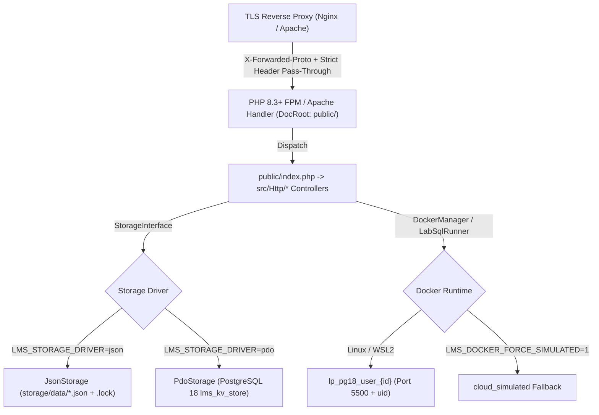

# Deployment & Operations Runbook — LightPath Training Portal

> **Organization:** LightPath SARL (`https://www.lightpath.fr` | `contact@lightpath.fr`)  
> **Lead Instructor & Author:** Jean-Marie Renouard (Database & DataOps Expert, Co-developer of MySQLTuner)  
> **Scope:** Production, classroom workshop, and static/shared hosting deployment; PHP 8.3+ runtime; Nginx/Apache strict CSP compatibility; `JsonStorage` vs `PdoStorage`; Docker daemon setup; `bin/lab-runner.php` cron automation (`reap-idle`, `heal`); SHA-256 audit log verification (`verifyAuditIntegrity()`); and backup/restore checklists.

---

## 1. Deployment Topologies & Profile Selection

LightPath Training Portal (`v2.0.0`, Ref. `LP-LMS-QUALIOPI-2026`) supports four operational deployment profiles configured through [config/features.php](../config/features.php) and `FeatureManager::applyProfile()`:

| Profile Key | Intended Environment | Storage Driver | Docker Runtime | Key Behavioral Characteristics |
| :--- | :--- | :--- | :--- | :--- |
| `full_enterprise` | Dedicated LMS server / Cloud VM | `pdo` (`pgsql` / `mysql`) or `json` | Native Linux Docker / WSL2 | All 10 modular features active (`docker_labs`, `chaos_engineering`, `personal_notes`, `flashcards_srs`, `scorm_export`, `cold_satisfaction_j60`, etc.) |
| `classroom_workshop` | Live instructor-led workshop (`10–30` trainees) | `json` or `pdo` | Native Docker / WSL2 (`max_containers=40`) | Enables Docker labs (SQL console, savepoints, bounded `pgbench`), notes, flashcards, Q&A, and classroom presets (`lecture`, `guided_lab`, `exam_lockdown`, `open_review`) |
| `exam_lockdown` | Supervised Qualiopi certification session | `pdo` or `json` | Disabled or read-only | Disables self-registration, demo login, and non-essential collaboration toggles while preserving positioning/exam/attendance/verification |
| `static_hosting_nodocker` | Shared PHP hosting / CI smoke runtime | `json` or `sqlite` PDO | `LMS_DOCKER_FORCE_SIMULATED=1` | Disables live Docker and chaos daemon expectations cleanly while serving static Sakila/PG18 schema catalog & simulated workbench telemetry |



---

## 2. PHP 8.3+ Runtime & Extension Requirements

Although [composer.json](../composer.json) sets a floor of PHP `>= 8.1`, production and workshop deployments target **PHP 8.3+** with zero external Composer vendor libraries.

### Required & Recommended Extensions

| Extension | Requirement | Purpose in LightPath LMS |
| :--- | :--- | :--- |
| `json` | Mandatory | Atomic KV persistence, catalog/parsed caches, API JSON payloads, Qualiopi JSON exports |
| `mbstring` | Mandatory | UTF-8 case-insensitive user/audit filtering (`AdminService`), UTF-8 safe snippet truncation (`CourseRepository::truncateUtf8`) |
| `pdo` + `pdo_pgsql` | Mandatory for `pdo` driver | Transactional `lms_kv_store` persistence (`PdoStorage` with `ON CONFLICT DO UPDATE` and `FOR UPDATE`) |
| `pdo_mysql` / `pdo_sqlite` | Optional | Alternative relational backends when PostgreSQL is not used as the portal store |
| `zip` | Recommended | Native `ZipArchive` packaging for SCORM 1.2 exports (built-in pure-PHP PKZIP store fallback in `DownloadController` operates automatically if `ext-zip` is absent) |
| `openssl` / CSPRNG | Built-in | `random_bytes()` for 256-bit CSRF tokens and `LP-PG18-CERT-<uid>-<8HEX>` certificate IDs |

### Recommended `php.ini` Production Settings

```ini
date.timezone = Europe/Paris
expose_php = Off
memory_limit = 256M
max_execution_time = 60
post_max_size = 32M
upload_max_filesize = 32M
session.use_strict_mode = 1
session.use_only_cookies = 1
session.cookie_httponly = 1
session.cookie_samesite = Lax
session.gc_maxlifetime = 7200
```

> [!NOTE]
> [src/bootstrap.php](../src/bootstrap.php) enforces `Europe/Paris` timezone, `session.use_strict_mode=1`, `session.use_only_cookies=1`, `httponly`, `samesite=Lax`, TLS-conditional `secure`, and dynamically aligns both `session.gc_maxlifetime` and session cookie `lifetime` with `'session_idle_ttl'` (`7200` seconds default in [config/app.php](../config/app.php)).

---

## 3. Environment Variables Reference

Configure runtime behavior cleanly via OS environment variables, systemd unit overrides, or FastCGI `fastcgi_param` / Apache `SetEnv` directives:

| Variable | Default | Production Recommendation | Purpose |
| :--- | :--- | :--- | :--- |
| `LMS_STORAGE_DRIVER` | `json` | `pdo` (multi-worker prod) or `json` (workshop) | Selects `JsonStorage` vs `PdoStorage` |
| `LMS_DATA_DIR` | `<repo>/storage/data` | Dedicated persistent volume (e.g. `/var/lib/lightpath-lms/data`) | Overrides JSON store, lockfiles, `parsed_cache/`, and `catalog_cache_*.json` directory |
| `LMS_PDO_DSN` | `pgsql:host=localhost;port=5432;dbname=lightpath_lms` | `pgsql:host=127.0.0.1;port=5432;dbname=lightpath_lms` | PDO DSN used when `LMS_STORAGE_DRIVER=pdo` |
| `LMS_PDO_USER` | `postgres` | Dedicated non-superuser DB role (e.g. `lms_app`) | Database user for `lms_kv_store` |
| `LMS_PDO_PASS` | `""` | Strong rotated secret | Database password for `PdoStorage` |
| `LMS_WSL_DISTRO` | `Ubuntu-24.04` | Target WSL2 distro name (Windows hosts only) | Linux distribution queried via `wsl.exe` when managing Docker containers |
| `LMS_DOCKER_FORCE_SIMULATED` | unset (`0`) | `1` on shared/no-Docker hosts & CI; unset on lab hosts | Forces deterministic `cloud_simulated` mode without invoking local Docker/WSL2 binaries |
| `LMS_CERT_HMAC_SECRET` / `APP_SECRET` | unset | 64-char random hex secret | Eliminates the development warning reported by `AdminService::getSystemHealthReport()` |

---

## 4. Storage Backend Configuration (`JsonStorage` vs `PdoStorage`)

### Option A: `JsonStorage` (Default Zero-Config Mode)
- Ideal for single-node workshops, rapid classroom boot, and offline evaluation.
- Stores 14+ domain collections under `LMS_DATA_DIR` (`users.json`, `progress.json`, `audit_logs.json`, `audit_logs_YYYYMM.json`, `feature_flags.json`, `course_features.json`, `classroom_state.json`, `login_throttles.json`, etc.).
- Guarantees concurrency safety via exclusive `.lock` sidecars (`flock($fp, LOCK_EX)`) and atomic temp-file writes (`rename()` with Windows retry backoff).
- **Permissions Checklist:** Ensure the PHP FPM/web user owns `LMS_DATA_DIR` (`0750` on directories, `0640` on `.json`/`.lock` files) and never share `LMS_DATA_DIR` on un-locked network filesystems (NFSv3 without lockd).

### Option B: `PdoStorage` (Production Relational Persistence)
1. Provision a dedicated PostgreSQL 18 database and least-privilege application role:
   ```sql
   CREATE ROLE lms_app WITH LOGIN PASSWORD 'REPLACE_WITH_STRONG_SECRET';
   CREATE DATABASE lightpath_lms OWNER lms_app;
   ```
2. Export `LMS_STORAGE_DRIVER=pdo`, `LMS_PDO_DSN`, `LMS_PDO_USER`, and `LMS_PDO_PASS`.
3. On first boot, `PdoStorage::initSchema()` automatically creates:
   ```sql
   CREATE TABLE IF NOT EXISTS lms_kv_store (
       store_key VARCHAR(128) PRIMARY KEY,
       payload TEXT NOT NULL,
       updated_at VARCHAR(32) NOT NULL
   );
   ```
4. All mutations run inside `BEGIN` ... `SELECT payload FROM lms_kv_store WHERE store_key = :k FOR UPDATE` ... `INSERT ... ON CONFLICT (store_key) DO UPDATE` ... `COMMIT`.
5. **Failure Mode Guarantee:** Once PDO is connected at startup, runtime write failures do **not** silently fall back to local JSON (preventing split-brain writes); errors are logged via `error_log()` and surfaced in **Administration -> Système** via `PdoStorage::getLastError()`.

---

## 5. Web Server Setup & Strict CSP Compatibility (Nginx / Apache)

### Strict Zero-`unsafe-inline` Portal CSP Architecture
Every portal route emits hardened security headers from `Security::sendSecurityHeaders()`:

- `script-src 'self' 'sha256-Y+Iy31+SIVnkv2t35OtFkyF8C43lr3XQSadODH27V58='` (matches `Security::UNLOAD_SHIM_JS`; **zero** `'unsafe-inline'`).
- `style-src 'self'` (**zero** `'unsafe-inline'`; every template uses CSS classes in [public/assets/css/app.css](../public/assets/css/app.css) and CSSOM `data-progress` hydration in [public/assets/js/app.js](../public/assets/js/app.js)).
- **Standalone HTML Document Exception:** When streaming self-contained course HTML previews inline inside iframes (`action=course_asset` / `DownloadController::streamFile()`), PHP emits `Security::sendStandaloneDocumentCspHeader()`, which scopes `style-src 'self' 'unsafe-inline'` strictly to that standalone HTML response.

> [!IMPORTANT]
> Do **not** add an unconditional `add_header Content-Security-Policy "..." always;` in Nginx or `Header always set Content-Security-Policy` in Apache unless it mirrors PHP's exact directive—doing so would either duplicate headers, break the SHA-256 unload shim hash, or break standalone HTML course previews. Let PHP emit CSP headers directly.

### Nginx Production Virtual Host Example

```nginx
server {
    listen 443 ssl http2;
    server_name academy.lightpath.fr;

    root /var/www/lightpath-training-portal/public;
    index index.php;

    # Reject dot-files and accidental sensitive paths
    location ~ /\. {
        deny all;
    }

    # Static studio assets (zero external CDNs)
    location /assets/ {
        expires 7d;
        add_header Cache-Control "public, immutable";
        add_header X-Content-Type-Options "nosniff" always;
        try_files $uri =404;
    }

    # Route all application requests through public/index.php
    location / {
        try_files $uri $uri/ /index.php?$query_string;
    }

    location ~ \.php$ {
        try_files $uri =404;
        include fastcgi_params;
        fastcgi_param SCRIPT_FILENAME $document_root$fastcgi_script_name;
        fastcgi_param HTTP_X_FORWARDED_PROTO $scheme;
        fastcgi_param LMS_STORAGE_DRIVER "pdo";
        fastcgi_param LMS_PDO_DSN "pgsql:host=127.0.0.1;port=5432;dbname=lightpath_lms";
        fastcgi_param LMS_PDO_USER "lms_app";
        fastcgi_param LMS_PDO_PASS "REPLACE_WITH_STRONG_SECRET";
        fastcgi_param LMS_CERT_HMAC_SECRET "REPLACE_WITH_64_HEX_SECRET";
        fastcgi_buffering off;
        fastcgi_read_timeout 120s;
        fastcgi_pass unix:/run/php/php8.3-fpm.sock;
    }
}
```

### Apache `.htaccess` / VirtualHost Notes
- Point `DocumentRoot` strictly to `/var/www/lightpath-training-portal/public`.
- Enable `mod_headers`, `mod_rewrite`, and `php-fpm` (`SetHandler "proxy:unix:/run/php/php8.3-fpm.sock|fcgi://localhost"`).
- Pass `HTTP_X_FORWARDED_PROTO` when behind a TLS load balancer so `Security::isHttpsRequest()` automatically enables HSTS and `Secure` session cookies.

---

## 6. Docker Daemon Setup & Workshop Capacity Sizing

On lab hosts running live per-student PostgreSQL 18 containers:
1. **Install Docker Engine:** Native Linux Docker (`docker-ce`) or Windows Docker Desktop / WSL2 (`Ubuntu-24.04`). Grant the PHP runtime user group membership (`usermod -aG docker www-data`) or configure a dedicated sudo/socket wrapper.
2. **Pre-Pull Lab Images:** Avoid first-click download timeouts during class kickoff:
   ```bash
   docker pull postgres:18
   # Or build/tag the classroom primary image referenced in config/app.php
   docker tag postgres:18 docker-pg-primary:18
   ```
3. **Capacity Planning Formula (Classroom Cohort):**
   - Each running container `lp_pg18_user_<id>` is hard-capped at `--memory=1g --cpus=1.0 --shm-size=512m --pids-limit=256`.
   - Default host limit is `max_containers = 40` (`port = 5500 + userId`).
   - Size classroom hosts at `>= (expected_concurrent_students * 1.2) GiB RAM` (e.g., `32 GiB RAM` / `8+ vCPU` for a 20-learner workshop).
4. **Verify Host Readiness via CLI:**
   ```bash
   php bin/lab-runner.php list --json
   php bin/lab-runner.php start 3 --json
   php bin/lab-runner.php seed 3 all --json
   php bin/lab-runner.php diag 3 --json
   php bin/lab-runner.php readiness 3 01 --json
   ```

---

## 7. Automated Operations & Cron Jobs (`bin/lab-runner.php`)

Schedule automated fleet hygiene and idle container reclamation to protect workshop memory/CPU capacity:

### Recommended Cron Schedule (`/etc/cron.d/lightpath-lms`)

```cron
# Reap student PostgreSQL lab containers idle for more than 60 minutes (3600s) every 15 minutes
*/15 * * * * www-data /usr/bin/php /var/www/lightpath-training-portal/bin/lab-runner.php reap-idle 3600 --json >> /var/log/lightpath-lms/reaper.log 2>&1

# Prune exited/stopped containers nightly at 02:30 Europe/Paris
30 2 * * * www-data /usr/bin/php /var/www/lightpath-training-portal/bin/lab-runner.php prune --json >> /var/log/lightpath-lms/prune.log 2>&1
```

### Operational CLI Reference (`bin/lab-runner.php`)

| Command | Purpose |
| :--- | :--- |
| `fleet [--json]` | Reports overall container fleet telemetry (`docker_live` vs `cloud_simulated`, running/stopped/max counts, idle count) |
| `reap-idle [max_idle_seconds] [--json]` | Stops running student containers whose `last_activity_at` exceeds the idle threshold (default `3600s`; supports `--max-idle=`) |
| `heal [course_slug] [--json]` | Terminates chaos blockers and drops residual chaos tables (`chaos_orders`, `chaos_ledger`, `chaos_sessions`, `chaos_wal_burst`; supports `--course=`) |
| `savepoint <uid> <name\|list\|create\|restore\|delete> [name_or_db] [db] [--json]` | Manages named per-user sandbox checkpoints (`^[a-zA-Z0-9_-]{1,32}$`, max `5` per user; supports `--db=`) |
| `restore <uid> <name> [db] [--json]` | Restores a named sandbox checkpoint into `formation_pg`, `dvdrental`, or `postgres` |
| `bench <uid> [clients] [duration] [db] [--select-only] [--json]` | Runs a bounded, non-blocking `pgbench` test (`1..8` clients, `1..5` seconds; supports `--clients=`, `--duration=`, `--db=`) |
| `diag <uid> [db] [--json]` | Captures live PostgreSQL 18 diagnostics (`pg_stat_activity`, `pg_settings`, buffer hit ratio, DB sizes) |
| `readiness <uid> <lab_id> [--json]` | Evaluates container, database, extension, and oracle readiness across all 34 labs (`01..29`, `sql_01..sql_05`) |

---

## 8. Audit Log Rotation & Cryptographic Integrity Verification

### Monthly Rotation & Tamper-Evident SHA-256 Chain
- `JsonStorage::logAuditEvent()` maintains an active rolling window of `1,000` records in `audit_logs` and automatically rotates overflow records into monthly `audit_logs_YYYYMM` buckets inside atomic `mutateFile()` transactions.
- Every newly recorded audit entry carries deterministic SHA-256 chaining metadata (`prev_hash` linking to the previous entry's hash, and `entry_hash` hashing timestamp, actor, action, details, and `prev_hash`).
- **Verification (`verifyAuditIntegrity(bool $includeArchives = false)`):**
  - Walks active (`audit_logs`) and optionally archived (`audit_logs_YYYYMM`) chains, distinguishing pre-chain historical records (`legacy_unchained`) from genuine broken chain links or modified payloads (`broken_links`).
  - Returns `['valid' => bool, 'total_checked' => int, 'chained_entries' => int, 'legacy_unchained' => int, 'broken_links' => array]`.
  - Surfaced live in **Administration -> Journal d'Audit** via the integrity status pill (`.integrity-pill-ok` / `.integrity-pill-error`) and exported alongside Qualiopi dossier reports.

### Periodic CLI Integrity Audit Check
```bash
php -r 'require "src/bootstrap.php"; $cfg = require "config/app.php"; $s = new LightPath\LMS\Core\JsonStorage($cfg["storage_path"]); echo json_encode($s->verifyAuditIntegrity(true), JSON_PRETTY_PRINT) . "\n";'
```

---

## 9. Course-Pack Sync, Backup & Restore Checklists

### Updating Course Content (`training_postgresql`)
1. Pull or deploy the updated course-pack directory (`../training_postgresql`).
2. Re-sync the course manifest:
   ```bash
   php bin/sync-course.php postgresql-18 ../training_postgresql
   ```
3. If PowerPoint `.pptx` / `_slides.pdf` decks changed, regenerate Studio 16:9 PNG slide caches:
   ```bash
   python bin/export_slides_cache.py
   ```
4. Flush LMS catalog/markdown caches from **Administration -> Système** (`action=admin_clear_cache`) or remove stale `catalog_cache_*.json` and `parsed_cache/*.json` files.

### Backup Checklist (Daily / Pre-Upgrade)
- [ ] **JSON Mode:** Back up `LMS_DATA_DIR/*.json` (especially `users.json`, `progress.json`, `diagnostics.json`, `exams.json`, `attendance.json`, `satisfaction.json`, `cold_satisfaction.json`, `audit_logs*.json`, `feature_flags.json`, `course_features.json`, `custom_courses.json`, `classroom_state.json`). Exclude `*.lock`, `docker_status_cache.json`, and `parsed_cache/`.
- [ ] **PDO Mode:** Run compressed PostgreSQL backup:
  ```bash
  pg_dump -Fc -h 127.0.0.1 -U lms_app -f /var/backups/lightpath_lms_$(date +%F).dump lightpath_lms
  ```
- [ ] **Audit Integrity Snapshot:** Run `verifyAuditIntegrity(true)` and verify `'valid' === true` before rotating backups offsite.
- [ ] **Feature Configuration Snapshot:** Export JSON configuration from **Administration -> Système** (`FeatureManager::exportConfigJson()`).

### Restore & Post-Recovery Verification Checklist
- [ ] Restore `LMS_DATA_DIR` JSON archives (`0750`/`0640` permissions) or `pg_restore --clean --if-exists -d lightpath_lms <backup.dump>`.
- [ ] Flush `catalog_cache_*.json` and `parsed_cache/*.json` so HTML caches rebuild cleanly on demand.
- [ ] Verify PHP syntax and core tests in staging: `php tests/run_tests.php` and `php tests/test_functional_http.php`.
- [ ] Log in as Administrator, inspect **Administration -> Système** (verify `PDO` / `JSON`, cache paths, secrets hygiene), and verify **Administration -> Journal d'Audit** displays `valid` hash-chain integrity.
- [ ] Test one lab container start + SQL query (`SELECT version();`) or verify `cloud_simulated` mode if running without Docker.
