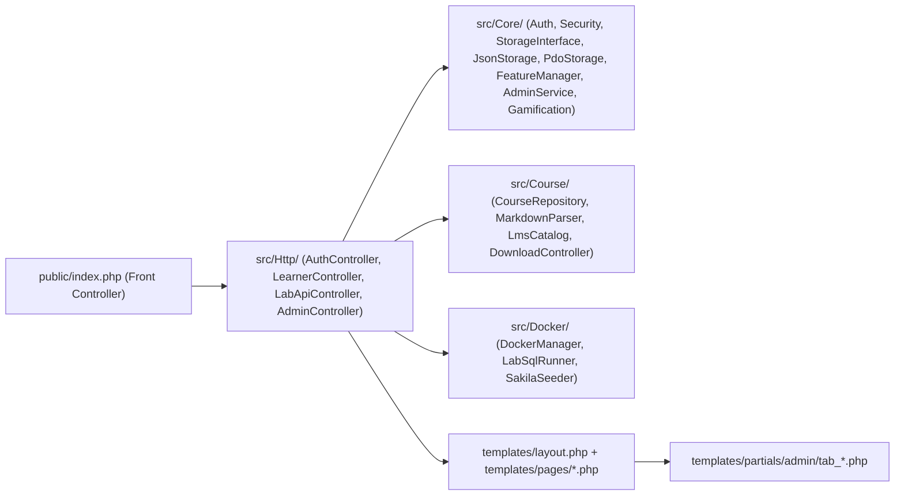

# Developer Onboarding & Testing Guide — LightPath Training Portal

> **Organization:** LightPath SARL (`https://www.lightpath.fr` | `contact@lightpath.fr`)  
> **Lead Instructor & Author:** Jean-Marie Renouard (Database & DataOps Expert, Co-developer of MySQLTuner)  
> **Scope:** Modular PHP 8.3+ codebase architecture (`src/Http/*`, `src/Core/*`, `src/Course/*`, `src/Docker/*`, `templates/partials/admin/*`), strict coding and CSP engineering standards, test pyramid, adversarial suites (`b1`..`b5`), Playwright MCP browser verification, and Git workflow.

---

## 1. Codebase Architecture Overview

`lightpath-training-portal` follows a zero-framework, PSR-4 domain-modular design (`LightPath\LMS\` -> `src/` via [src/bootstrap.php](../src/bootstrap.php)):



### Module Ownership Map

| Layer / Folder | Modules & Responsibility |
| :--- | :--- |
| **HTTP Dispatch** | [public/index.php](../public/index.php) delegates domain requests to `src/Http/AuthController.php`, `src/Http/LearnerController.php`, `src/Http/LabApiController.php`, and `src/Http/AdminController.php` while preserving legacy route compatibility anchors. |
| **Core Security & Persistence** | [Security.php](../src/Core/Security.php), [Auth.php](../src/Core/Auth.php), [StorageInterface.php](../src/Core/StorageInterface.php), [JsonStorage.php](../src/Core/JsonStorage.php), [PdoStorage.php](../src/Core/PdoStorage.php), [FeatureManager.php](../src/Core/FeatureManager.php), [AdminService.php](../src/Core/AdminService.php), [Gamification.php](../src/Core/Gamification.php). |
| **Course Engine & Streaming** | [CourseRepository.php](../src/Course/CourseRepository.php), [MarkdownParser.php](../src/Course/MarkdownParser.php), [LmsCatalog.php](../src/Course/LmsCatalog.php), [DownloadController.php](../src/Course/DownloadController.php). |
| **Container Sandbox & Oracles** | [DockerManager.php](../src/Docker/DockerManager.php), [LabSqlRunner.php](../src/Docker/LabSqlRunner.php), [SakilaSeeder.php](../src/Docker/SakilaSeeder.php). |
| **Templates & Admin Partials** | [templates/layout.php](../templates/layout.php), 16 learner/auth pages under `templates/pages/`, and [templates/pages/admin.php](../templates/pages/admin.php) dispatching lazily to `templates/partials/admin/tab_{cohort,users,qna,docker,courses,audit,system}.php`. |
| **Self-Hosted Assets** | [public/assets/css/app.css](../public/assets/css/app.css), [public/assets/js/app.js](../public/assets/js/app.js), [public/assets/js/mermaid.min.js](../public/assets/js/mermaid.min.js), `public/assets/slides_cache/`, and `public/assets/img/`. |

---

## 2. Mandatory Coding & Security Standards

All contributions are audited automatically by [tests/test_coverage_audit.php](../tests/test_coverage_audit.php):

### 2.1 Zero Inline `style=` & Strict `style-src 'self'` CSP
- **Rule:** **Zero** inline `style="..."` attributes are permitted in `src/` or `templates/`. Portal responses emit `style-src 'self'` without `'unsafe-inline'`.
- **Static Styling:** Declare reusable utility and component classes in [public/assets/css/app.css](../public/assets/css/app.css) (e.g., `.admin-split-grid`, `.table-col-nowrap`, `.lms-qr-verify-svg`, `.workbench-subtoolbar`, `.at-risk-badge`, `.integrity-pill-ok`, `.integrity-pill-error`, `.preset-toolbar`).
- **Dynamic Widths / Accents:** Render `data-progress="<?= (int)$pct ?>"` or `data-accent="..."` attributes in PHP templates and hydrate CSSOM properties (`el.style.width = ...`) inside `DOMContentLoaded` in [public/assets/js/app.js](../public/assets/js/app.js).
- **Standalone HTML Preview Exception:** Only inline static course HTML streams served by `DownloadController::streamFile()` emit `Security::sendStandaloneDocumentCspHeader()`.

### 2.2 Zero Inline `on*=` Handlers & Zero Inline `<script>` Tags
- **Rule:** Never write `onclick=`, `onchange=`, `onsubmit=`, or inline `<script>` blocks in `templates/`. `script-src` allows only `'self'` and the exact SHA-256 hash of `Security::UNLOAD_SHIM_JS`.
- **Pattern:** Use `data-*` attributes (`[data-demo-email]`, `[data-filter-table]`, `[data-filter-role-table]`, `[data-bulk-select-all]`) and bind delegated listeners in [public/assets/js/app.js](../public/assets/js/app.js).

### 2.3 Strict Technical English Source Comments
- **Rule:** Every PHP, JavaScript, CSS, Python, SQL, and `.mjs` comment and docstring MUST be written in technical English (`0` French comments permitted in code).
- **UI & Course Content:** Learner-facing UI strings, Qualiopi forms, and course Markdown files (`training_postgresql/`) remain in French.

### 2.4 Zero External CDNs & Exclusive LightPath SARL Branding
- Never add external CDN links (remote font stylesheets or external script/asset CDNs) or third-party vendor branding.
- Enforce WCAG 2.1 AA contrast (`--text-muted`: `#94A3B8` dark / `#475569` light), `:focus-visible`, `font-variant-numeric: tabular-nums`, and responsive layout down to `375x812`.

### 2.5 Security, Storage & Docker Guardrails
- **Mutating Requests:** Always validate `Security::verifySameOriginRequest()` and `Security::verifyCsrfToken()` on POST forms and `api_*` endpoints.
- **Explicit RBAC `403`:** Return HTTP `403` (never silent `200`) on unauthorized role or disabled feature access; check `Auth::isUserActive()` and `Auth::canAccessCourse()`.
- **Multi-Tenant Container Boundary:** Keep `$allowSharedFallback = false` on student-facing Docker/SQL operations; allow shared fallback only for staff (`$auth->isStaff($currentUser)`) or host CLI (`bin/lab-runner.php`).
- **SQL Sandbox:** Never weaken `LabSqlRunner::stripCommentsAndLiterals()` or remove `PGOPTIONS="-c statement_timeout=15000 -c lock_timeout=10000"` or `lms_student`.
- **Legacy `file_get_contents()` Invariants:** Always consult [PROJECT-CONTEXT.md](../PROJECT-CONTEXT.md) before refactoring guarded substrings in `public/index.php`, `templates/pages/admin.php`, `src/Core/`, `src/Course/`, or `src/Docker/`.

---

## 3. Complete Verification & Test Pyramid

Every PR must pass all six verification tiers with zero skipped or relaxed assertions.

### Tier 1 — Static Syntax & Linting
```bash
# PHP syntax check across config, src, public, templates (including partials), bin, tests
find config src public templates bin tests -name "*.php" -print0 | xargs -0 -n1 php -l

# JavaScript & Playwright E2E syntax check
node --check public/assets/js/app.js
node --check tests/e2e/run_playwright_campaign.mjs
node --check tests/e2e/test_adversarial_challenger.mjs

# Python slide exporter syntax check
python -m py_compile bin/export_slides_cache.py
```

### Tier 2 — Unit & Integration TDD Suite (`tests/run_tests.php`)
```bash
php tests/run_tests.php
# or:
composer test
```
Validates `JsonStorage` locking & SHA-256 audit hash chains (`verifyAuditIntegrity()`), `PdoStorage` (`sqlite::memory:`), `Auth` throttling/active gating/course scoping, `Security` CSP & CSV/path sanitization, `FeatureManager` dependencies/profiles/per-course overrides, `AdminService` KPIs/at-risk/exports, `MarkdownParser` 7-pillar splitting & quiz extraction, `LabSqlRunner` lexical sandbox & 34 lab oracles, `DownloadController` HTTP `206`/`416` range streaming, and documentation integrity checks.

### Tier 3 — Isolated Ephemeral HTTP Functional Suite (`tests/test_functional_http.php`)
```bash
php tests/test_functional_http.php
```
Spawns an isolated `php -S 127.0.0.1:<port>` process with a temporary `LMS_DATA_DIR` and `LMS_DOCKER_FORCE_SIMULATED=1` to execute real HTTP GET/POST/API/cookie/CSRF/RBAC workflows (including negative security guardrails, feature flag gating, standalone HTML document CSP vs portal `style-src 'self'`, and Lab/Admin APIs).

### Tier 4 — Reflection Coverage & Governance Audit (`tests/test_coverage_audit.php`)
```bash
php tests/test_coverage_audit.php
```
Programmatically inspects the entire repository across six gates:
1. `100.0%` public method reflection coverage across `src/Core`, `src/Course`, `src/Docker`, and `src/Http`.
2. `0` prohibited third-party vendor leaks across code and docs.
3. `0` external CDN references across `templates/`, `public/`, `docs/`, `README.md`, and `PROJECT-CONTEXT.md`.
4. `0` inline `on*=` attributes, `0` inline `style=` attributes across `src/` and `templates/`, and `0` invalid ES `v`-mode `pattern="..."` character-class ranges.
5. `0` non-English source code comments across PHP, JS, CSS, Python, and E2E `.mjs` files.
6. Strict SHA-256 `script-src` + `style-src 'self'` CSP verification in [src/Core/Security.php](../src/Core/Security.php).

### Tier 5 — Adversarial Security & Regression Suites (`B1` through `B5`)
```bash
php tests/test_adversarial_b1.php
php tests/test_adversarial_b2.php
php tests/test_adversarial_b3.php
php tests/test_adversarial_b4.php
php tests/test_adversarial_b5.php
```
Stress-tests `lock_solutions`, unauthenticated certificate verification, 74%/75% exam boundaries, `PGOPTIONS` timeout injection, SCORM RBAC, OPCO CSV formatting, open-redirect defenses, Markdown callout rendering, trainer countersignature preservation, `LabSqlRunner` comment/backslash bypasses, session idle timeout (`session_idle_ttl` = `7200s` default, tested beyond expiry in `b4` at `14400s`), and Admin tab rendering.

### Tier 6 — Headless Chrome E2E Campaign (`@playwright/mcp`)
```bash
node tests/e2e/run_playwright_campaign.mjs
node tests/e2e/test_adversarial_challenger.mjs
```
Uses [config/playwright-mcp.config.json](../config/playwright-mcp.config.json) (network restricted to `localhost`/`127.0.0.1`) and temporary `LMS_DATA_DIR` isolation to verify zero console/CSP errors, HTTP 200 across all pages/admin tabs, Lab workbench workflows, and zero horizontal overflow across `1440x900` (Desktop), `768x1024` (Tablet), and `375x812` (Mobile).

---

## 4. Local Setup & Git Workflow

1. **Enable Git Hooks Immediately After Cloning:**
   ```bash
   git config core.hooksPath .githooks
   ```
   [.githooks/pre-commit](../.githooks/pre-commit) prevents commits on `main` and runs `php tests/run_tests.php`; [.githooks/pre-push](../.githooks/pre-push) prevents pushes to `main`.
2. **Cache Isolation Hygiene:** Always set a fresh temporary `LMS_DATA_DIR` when running ad-hoc local HTTP/Playwright scripts so shared `storage/data/parsed_cache` stays clean.
3. **Mandatory 9-Step English GitHub Lifecycle:** `gh issue create` -> branch (`feat/...`, `fix/...`, `docs/...`) -> 100% test pass -> selective `git add` -> English Conventional Commit -> `git push -u origin <branch>` -> `gh pr create` -> `gh pr merge` -> `gh issue close --comment "..."`.
