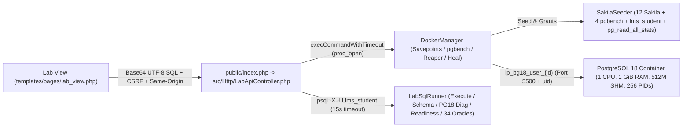

# Docker Classroom Labs & SQL Workbench Guide — LightPath Training Portal

> **Scope:** Per-learner PostgreSQL 18 container orchestration (`DockerManager`), non-blocking `proc_open()` timeouts, resource quotas, `SakilaSeeder` dataset initialization, sandboxed SQL workbench (`LabSqlRunner`), per-user savepoints, bounded `pgbench`, live PG18 diagnostics, 34-lab readiness checks, idle container reaper, Chaos Engineering fault injection/healing, and `bin/lab-runner.php` CLI operations.

---

## 1. Container Isolation Architecture

Each authenticated learner receives a dedicated isolated PostgreSQL 18 container (`lp_pg18_user_<id>`) mapped deterministically to host port `5500 + userId` (clamped safely to `[1024..65535]`).



### Runtime Detection & Graceful Degradation
- Configured via `config/app.php` (`'docker'` block):
  - `image`: `docker-pg-primary:18` (falls back automatically to `postgres:18` if local image is missing)
  - `default_db`: `formation_pg` | `default_user`: `postgres` | `default_password`: `postgres` (`DockerManager::getDefaultPassword()`)
  - `base_port`: `5500` | `max_containers`: `40`
  - `wsl_distro`: `getenv('LMS_WSL_DISTRO') ?: 'Ubuntu-24.04'` on Windows hosts
- **Forced Simulated Mode:** Set `LMS_DOCKER_FORCE_SIMULATED=1` to bypass local Docker probing cleanly in CI or restricted PHP hosting.
- **Status Truthfulness:**
  - Unpopulated cache returns `status => 'not_checked'` and `primary_cluster_running => false` (cached via `.lock` + `flock(LOCK_EX)` + atomic `@rename` in `storage/data/docker_status_cache.json`).
  - When `lp_pg18_user_<id>` does not exist yet—even if shared cluster `pg_formation_primary` is running—`running` and `user_container_running` strictly stay `false` (`status => 'cluster_ready'` or `'not_created'`) so learners are never misled into assuming their personal `5500 + uid` instance is active.
  - **Shared-Cluster Fallback Guard (`$allowSharedFallback = false`):** Both `DockerManager::seedUserContainer()` and `DockerManager::getContainerLogs()` deny falling back to the shared `pg_formation_primary` container unless `$allowSharedFallback === true`. HTTP endpoints pass `$auth->isStaff($currentUser)` so students must start their own `lp_pg18_user_<id>` container before seeding or viewing logs, while trainers/admins and `bin/lab-runner.php` retain shared-cluster access.

---

## 2. Hardening, Timeouts & Resource Quotas

- **Non-Blocking Command Timeouts (`DockerManager::execCommandWithTimeout()`):** All Docker/WSL2 CLI invocations run via `proc_open()` with non-blocking pipes and an explicit timeout (`4.0s` inspect, `6.0s` logs, `12.0s–18.0s` exec/run), terminating hung WSL2 bridges instead of wedging PHP workers.
- **Per-Container Limits (`DockerManager::startUserContainer()`):**
  - `--shm-size=512m`
  - `--memory=1g --cpus=1.0 --pids-limit=256`
  - `--security-opt=no-new-privileges --restart=no`
  - `--label lms.managed=lightpath --label lms.user_id=<id>`
  - Enforces host cap `max_containers` (default `40`) before spawning new containers.

---

## 3. Canonical Datasets (`src/Docker/SakilaSeeder.php`)

When a container starts, resets, or re-seeds (`api_seed_lab` / `seedUserContainer`), `SakilaSeeder::getBootstrapSql()` idempotently provisions extensions, datasets, and the restricted sandbox role across `formation_pg` and `dvdrental`:

| Asset Group | Contents | Notes |
| :--- | :--- | :--- |
| **PostgreSQL 18 Extensions** | `pageinspect`, `pg_stat_statements`, `pgstattuple`, `postgres_fdw` | Pre-installed in `public` |
| **Sakila / Pagila Schema (12 Tables)** | `actor` (`14`), `category` (`10`), `film` (`18`), `film_actor` (`26`), `film_category` (`20`), `address` (`12`), `store` (`2`), `staff` (`2`), `customer` (`12`), `inventory` (`30`), `rental` (`24`), `payment` (`24`) | Includes unreturned rentals (`return_date IS NULL`) and multiple MPAA ratings for realistic SQL/join/index labs |
| **`pgbench` Benchmark Schema (4 Tables)** | `pgbench_branches` (`2`), `pgbench_tellers` (`20`), `pgbench_accounts` (`1000`), `pgbench_history` (`10`) | Generated via `generate_series(1, 1000)` for `EXPLAIN` and locking labs |
| **Sandbox Role** | `lms_student` | Non-superuser with `pg_read_all_stats`, `pg_stat_scan_tables`, and `public` DDL/DML; zero OS/filesystem privileges |

---

## 4. SQL Workbench, Schema Explorer & Validation Oracles

### Sandboxed SQL Console (`LabSqlRunner::executeSql()`)
- **Allowed Databases:** `formation_pg`, `dvdrental`, `postgres` (`LabSqlRunner::ALLOWED_DATABASES`).
- **UTF-8 Lesson Fence Injection:** Inline `"Exécuter dans le Lab"` buttons in module/lab pages emit Base64-encoded UTF-8 SQL decoded cleanly in `public/assets/js/app.js` using `TextDecoder` + `Uint8Array` (preserving French comments and string literals).
- **Execution Guards (`LabSqlRunner::stripCommentsAndLiterals()`):**
  - A single-pass lexical scanner strips `--` line comments, nested `/* /* */ */` block comments, `'...'` string literals, and PostgreSQL dollar-quoted blocks (`$$...$$`, `$tag$...$tag$`), returning both `comments_stripped` and `outside_quotes`.
  - Interactive `psql` backslash commands (`\!`, `\copy`, `\o`, `\w`, `\i`, `\connect`/`\c`, `\cd`, `\e*`, `\prompt`, `\watch`, `\setenv`, `\g`, `\gx`, `\gset`, `\gexec`, `\lo_*`) are rejected strictly on `$outsideQuotes` so backslashes inside dollar-quoted `DO $$ ... $$` blocks never trigger false positives.
  - `statement_timeout`/`lock_timeout`/`ALL` overrides (`SET`/`RESET` and `set_config(...)` including `||` concatenation) are validated on both raw SQL and `$commentsStripped` before literal stripping—catching nested `DO $$ BEGIN EXECUTE 'SET statement_timeout = 0'; END $$;` bypasses while allowing benign reads like `SELECT current_setting('statement_timeout')`.
  - `COPY ... PROGRAM`, server filesystem functions (`pg_read_file`, `pg_read_binary_file`, `pg_ls_dir`, `pg_stat_file`, `lo_import`, `lo_export`), and (for untrusted queries) `ALTER SYSTEM`/`USER`/`ROLE`, `SET`/`RESET ROLE`, `SESSION AUTHORIZATION`, and role-mutating `set_config()` are rejected cleanly while student queries execute under `lms_student` with `PGOPTIONS="-c statement_timeout=15000 -c lock_timeout=10000"`.

### Schema Explorer Contract (`inspectDatabaseSchema()`)
- Returns `['success', 'mode', 'source', 'database', 'container', 'output', 'tables']`.
- `'tables'` is always an **indexed list** of objects: `{ schema, table, est_rows, columns }`.
- When Docker is active, rows are queried live from `information_schema.columns` joined with `pg_catalog.pg_class.reltuples` (`source => 'Docker PostgreSQL 18 Live'`).
- When inactive, returns the aligned static reference catalog (`source => 'Catalogue Statique Sakila / PG18'`) covering 12+ `dvdrental` Sakila tables, `formation_pg` tables, and `postgres` `pg_catalog` observability views.

### Lab Verification Oracles, Workbench Controls & Solution Runner
- **`api_validate_lab` / `api_run_oracle`:** Evaluates 34 lab-specific SQL oracles (`LabSqlRunner::getLabOracles()`, IDs `01`..`29` + `sql_01`..`sql_05`) plus expected marker verification (`extractExpectedMarkers()`), automatically awarding lab completion when `passed === true`.
- **`api_run_lab_solution`:** Guarded by trainer `lock_solutions`; returns both `steps_executed` and `steps_count` alongside per-step outputs.
- **Interactive Workbench Ergonomics (`templates/pages/lab_view.php` + `public/assets/js/app.js`):**
  - `Ctrl+Enter` / `Meta+Enter` inside `#lab-sql-editor` submits SQL directly (`#btn-execute-sql`).
  - Secondary `.workbench-subtoolbar` provides 1-click Savepoint Create/Restore (`#lab-savepoint-name`, `#btn-savepoint-create`, `#btn-savepoint-restore`), bounded `pgbench` (`#btn-run-pgbench`), live PG18 Diagnostics (`#btn-pg-diag`), and 34-lab Readiness checks (`#btn-check-readiness`), with `aria-live="polite"` output feedback (`#lab-sql-output`, `#docker-action-feedback`).

---

## 5. Sandbox Savepoints, Bounded `pgbench`, PG18 Diagnostics & 34-Lab Readiness

### 5.1 Per-User Sandbox Savepoints (`DockerManager` + `api_lab_savepoint`)
Learners can snapshot and roll back their lab database state before risky schema or tuning experiments:
- **Methods:** `createSavepoint()`, `listSavepoints()`, `restoreSavepoint()`, `deleteSavepoint()`.
- **Guardrails:** Enforces strict savepoint naming (`^[a-zA-Z0-9_-]{1,32}$`), database allowlist (`['formation_pg', 'dvdrental', 'postgres']`), cap of **5 savepoints per user**, and `$allowSharedFallback = false` tenant isolation (staff/CLI may pass `$allowSharedFallback = true`).
- **Execution:** Uses compressed `pg_dump -Fc --clean --if-exists` / `pg_restore` in `/tmp/lms_savepoints` on live Docker containers; persists deterministic savepoint metadata (`savepoints_state_<userId>`) via `StorageInterface` in `cloud_simulated` mode.

### 5.2 Bounded `pgbench` Benchmarking (`DockerManager::runPgbenchBenchmark()` + `api_lab_pgbench`)
- Clamps concurrency (`$clients` `1..8`) and duration (`$durationSeconds` `1..5`), with optional `$selectOnly` read-only mode against `formation_pg` (or allowed DBs), executed via non-blocking `execCommandWithTimeout()`.
- Returns structured telemetry (`success`, `mode`, `clients`, `duration_seconds`, `select_only`, `tps`, `latency_avg_ms`, `transactions`, `output`, `container`) for live workshop tuning comparisons.

### 5.3 Live PostgreSQL 18 Diagnostics (`LabSqlRunner::inspectPgDiagnostics()` + `api_lab_pg_diag`)
- Leveraging `pg_read_all_stats` granted to `lms_student` in [SakilaSeeder.php](../src/Docker/SakilaSeeder.php), inspects active sessions (`pg_stat_activity`), core GUCs (`pg_settings` for `shared_buffers`, `work_mem`, `max_connections`, `statement_timeout`, `io_method`), buffer cache hit ratio, and database sizes (with rich simulated PG18 payloads under `LMS_DOCKER_FORCE_SIMULATED=1`).

### 5.4 34-Lab Readiness Matrix (`LabSqlRunner::checkLabReadiness()` + `api_lab_readiness`)
- Maps every lab (`01..29`, `sql_01..sql_05`) against `LabSqlRunner::getLabOracles()`, recommended target database (`dvdrental` vs `formation_pg`), required extensions (`pageinspect`, `pg_stat_statements`, `pgstattuple`, `postgres_fdw`), and active container status, returning actionable `ready` and `checks` diagnostics.

---

## 6. Chaos Engineering, Idle Container Reaper & Fleet Hygiene

### 6.1 Chaos Fault Injection (`DockerManager::triggerChaosScenario()`)

Trainers and learners (when feature flag `chaos_engineering` is enabled — automatically dependent on `docker_labs`) can inject and heal four controlled production failure scenarios against running `lp_pg18_user_*` / `pg_formation_primary` instances via `api_chaos`:

| Scenario | `inject` Behavior | `heal` Behavior |
| :--- | :--- | :--- |
| `bloat` | Creates `public.chaos_orders` (`autovacuum_enabled = off`, `fillfactor = 100`), inserts `15,000` rows, updates all rows to create severe dead-tuple table bloat | `DROP TABLE IF EXISTS public.chaos_orders CASCADE;` |
| `lock` | Creates `public.chaos_ledger` (`2` accounts) for lock-contention diagnostics | `DROP TABLE IF EXISTS public.chaos_ledger CASCADE;` |
| `idle_in_tx` | Creates `public.chaos_sessions` with `1,000` rows for idle transaction monitoring | `DROP TABLE IF EXISTS public.chaos_sessions CASCADE;` |
| `wal_pressure` | Inserts `25,000` hashed rows into `public.chaos_wal_burst` and triggers `CHECKPOINT;` | `DROP TABLE IF EXISTS public.chaos_wal_burst CASCADE;` |

### 6.2 Idle Container Reaper, Fleet Summary & Chaos Heal
- **Activity Heartbeat (`DockerManager::touchContainerActivity()`):** Updates per-container `last_activity_at` metadata whenever lifecycle or SQL workbench operations execute.
- **Fleet Summary (`DockerManager::getFleetSummary()`):** Aggregates total/running/stopped user containers, host `max_containers` cap, primary cluster status, active runtime mode (`docker_live` vs `cloud_simulated`), and idle container counts for the Trainer/Admin Docker tab.
- **Idle Reaper (`DockerManager::reapIdleContainers(int $maxIdleSeconds = 3600)`):** Safely stops idle student containers exceeding `$maxIdleSeconds` (callable from **Administration -> Docker** or scheduled via `bin/lab-runner.php reap-idle`).
- **Fleet Chaos Heal (`DockerManager::healChaosScenario()`):** Cleans residual chaos fault tables/locks across active lab instances safely (`admin_heal_chaos` / `bin/lab-runner.php heal`).

---

## 7. CLI Reference (`bin/lab-runner.php`)

Manage student lab containers, checkpoints, benchmarks, diagnostics, and fleet hygiene directly from the host terminal (append `--json` to any subcommand for machine-readable output):

```bash
php bin/lab-runner.php list [--json]
php bin/lab-runner.php fleet [--json]
php bin/lab-runner.php status <user_id> [--json]
php bin/lab-runner.php start <user_id> [--json]
php bin/lab-runner.php stop <user_id> [--json]
php bin/lab-runner.php restart <user_id> [--json]
php bin/lab-runner.php reset <user_id> [--json]
php bin/lab-runner.php seed <user_id> [all|sakila|pgbench] [--no-reset] [--json]
php bin/lab-runner.php logs <user_id> [tail:10..200] [--json]
php bin/lab-runner.php stats <user_id> [--json]
php bin/lab-runner.php oracle <user_id> <lab_id> [--json]
php bin/lab-runner.php savepoint <user_id> <name|list|create|restore|delete> [name_or_db] [db] [--json]
php bin/lab-runner.php restore <user_id> <name> [db] [--json]
php bin/lab-runner.php bench <user_id> [clients:1..8] [duration:1..5] [db] [--select-only] [--json]
php bin/lab-runner.php diag <user_id> [db] [--json]
php bin/lab-runner.php readiness <user_id> <lab_id> [--json]
php bin/lab-runner.php reap-idle [max_idle_seconds] [--json]
php bin/lab-runner.php heal [course_slug] [--json]
php bin/lab-runner.php stop-all [--json]
php bin/lab-runner.php prune [--json]
php bin/lab-runner.php help
```
