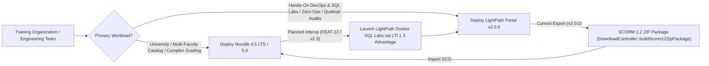

# Moodle LMS (4.5 LTS / 5.0) vs. LightPath Training Portal (`v2.0.0`) — Architectural Comparison & Roadmap

> **Scope:** Objective technical benchmark comparing **Moodle LMS (4.5 LTS / 5.0)** with **LightPath Training Portal (`v2.0.0`, Ref. `LP-LMS-QUALIOPI-2026`)**, followed by a prioritized product roadmap (`FEAT-01` through `FEAT-20`) and explicit architectural anti-goals.  
> **Related Docs:** [README.md](../README.md) • [ARCHITECTURE.md](ARCHITECTURE.md) • [SECURITY.md](SECURITY.md) • [ACTION_LOGBOOK.md](ACTION_LOGBOOK.md)

---

## 1. Executive Positioning & Architectural Philosophy

**Moodle LMS (4.5 LTS / 5.0)** and **LightPath Training Portal (`v2.0.0`)** optimize for fundamentally different operational constraints:

- **Moodle 4.5 LTS / 5.0** is a general-purpose, plugin-extensible academic and enterprise LMS designed to serve universities, K–12 districts, and multi-department corporations. It achieves immense functional breadth through a large monolithic codebase, a mandatory relational database (`PostgreSQL`, `MySQL`, or `MariaDB`), persistent file storage (`moodledata`), Composer vendor packages, Node/Grunt/Babel builds for AMD/ES6 JavaScript modules, a mandatory 1-minute background worker (`admin/cli/cron.php`), MUC cache stores (commonly Redis/Memcached at scale), and a catalog of 2,000+ community plugins.
- **LightPath Training Portal (`v2.0.0`)** is a **Zero-Dependency PHP `>= 8.3` DevOps & Qualiopi Training Engine** purpose-built for hands-on technical certifications, bootcamps, and accredited vocational training providers. It boots with zero Composer runtime libraries and zero Node.js build steps via a custom PSR-4 autoloader in [src/bootstrap.php](../src/bootstrap.php), runs from a single non-root `php:8.3-cli-alpine3.21` container (`docker compose up -d`) or `php -S localhost:8080 -t public`, reads version-controlled Markdown course packs directly from disk (`LMS_COURSE_ROOT`), orchestrates isolated per-learner PostgreSQL 18 Docker sandboxes, and enforces strict zero-CDN Content Security Policy (`style-src 'self'` with SHA-256 `script-src`).

### Architectural Comparison at a Glance

| Dimension | Moodle LMS (4.5 LTS / 5.0) | LightPath Training Portal (`v2.0.0`) |
| :--- | :--- | :--- |
| **Core Philosophy** | Academic breadth via web-configured courses and plugin ecosystem | High-rigor technical labs, Git-native content, and turnkey Qualiopi compliance |
| **PHP & Build Toolchain** | PHP `8.1–8.3` (`4.5 LTS`) / `8.2–8.4` (`5.0`), Composer vendor libs, Node/Grunt JS build | PHP `>= 8.3` (`composer.json`), custom PSR-4 autoloader ([src/bootstrap.php](../src/bootstrap.php)), zero runtime Composer/Node dependencies |
| **Mandatory Infrastructure** | Relational DB + `moodledata` + web server + 1-min `cron.php` + MUC/Redis cache | Single PHP process or container; dual driver via `StorageInterface` (`JsonStorage` zero-config flat files or `PdoStorage` via `lms_kv_store`) |
| **Course Authoring Source** | Database-stored HTML edited via TinyMCE 6 WYSIWYG (`mod_page`, `mod_book`) | Git-tracked Markdown course packs (`config/courses.php`, `CourseRepository`, `MarkdownParser`) + offline Studio 16:9 PNGs & Mermaid SVGs |
| **Hands-On Technical Labs** | External plugins required (`mod_vpl` + jail server, `qtype_coderunner` + Jobe, or LTI) | Built-in `DockerManager` + `LabSqlRunner` + `SakilaSeeder` (per-learner PG18 containers, savepoints, bounded `pgbench`, SQL `DO $$` oracles) |
| **Regulatory Audit Trail** | Assembled via optional plugins (`mod_attendance`, `mod_customcert`, `mod_feedback`) | Native 7-pillar Qualiopi workflow, half-day OPCO dual signatures, CSPRNG + offline SVG QR verification, SHA-256 hash-chained audit logs |
| **Security & CSP Posture** | Rich plugin surface; TinyMCE/AMD/plugins frequently require relaxed CSP (`'unsafe-inline'`) | Strict `style-src 'self'`, SHA-256 `script-src`, zero inline `style=` / `on*=` attributes in `src/` & `templates/`, zero external CDNs |

### Selection & Coexistence Strategy

1. **Choose LightPath Training Portal (`v2.0.0`)** when delivering instructor-led or hybrid technical bootcamps (PostgreSQL, Git, DevOps, Linux, Cloud) requiring reproducible per-learner Docker labs, Git-versioned multi-format deliverables (`PDF`, `PPTX`, `DOCX`, `MD`, `HTML`), air-gapped zero-CDN CSP guarantees, and out-of-the-box Qualiopi/OPCO audit evidence without maintaining a LAMP + Redis + Cron cluster.
2. **Choose Moodle (4.5 LTS / 5.0)** when operating large multi-faculty academic programs requiring 15+ question types, peer-review workshops, complex weighted gradebooks, `mod_assign` file rubrics, SAML/OIDC enterprise directory federation, and 100+ localized UI languages today.
3. **Coexist Today & Tomorrow:** Training providers already running Moodle as an enterprise portal can export LightPath courses today as standalone ADL SCORM 1.2 archives (`action=export_scorm_zip`) and will be able to launch LightPath's isolated Docker SQL workbenches directly from Moodle with automated grade passback once LTI 1.3 Advantage (`FEAT-12`) ships in `v2.3`.

---

## 2. Comprehensive 12-Domain Feature Matrix

All LightPath capabilities cited below are verified directly against `config/courses.php`, `config/features.php`, `public/index.php`, `src/Core/*`, `src/Course/*`, and `src/Docker/*` in `v2.0.0`.

| # | Domain | Moodle LMS (4.5 LTS / 5.0) | LightPath Training Portal (`v2.0.0`) | Assessment & Gap Status |
| :-: | :--- | :--- | :--- | :--- |
| **1** | **Runtime Footprint & Installation** | Requires relational DB (`pgsql`/`mysql`/`mariadb`), `moodledata` filestore, Composer libraries, Node/Grunt build tooling, 1-min `admin/cli/cron.php`, and Redis/Memcached MUC caches for multi-user concurrency. | Zero Composer/Node runtime deps; custom PSR-4 autoloader ([src/bootstrap.php](../src/bootstrap.php)); requires only PHP `>= 8.3`, `ext-json`, `ext-pdo` (`composer.json`), with pure-PHP UTF-8 and PKZIP fallbacks; boots via `docker compose up -d` (`php:8.3-cli-alpine3.21`, non-root `lms` user, `${LMS_PORT:-8080}`) or `php -S`; dual persistence (`JsonStorage` with `flock(LOCK_EX)` + atomic `rename()` or `PdoStorage` with `lms_kv_store` + `SELECT ... FOR UPDATE`). | **LightPath Leads** on simplicity, startup time, and zero-ops portability. |
| **2** | **Content Authoring & Studio Rendering** | Browser WYSIWYG authoring (TinyMCE 6 default; Atto removed in 5.0), `mod_page`, `mod_book`, `mod_lesson`, `mod_folder`, course subsections (`4.5+`), and native H5P content bank; manual export to print/PDF without built-in slide deck generation. | Git-tracked Markdown engine (`CourseRepository`, `MarkdownParser`, `DownloadController`); ships with 2 MIT course packs ([examples/demo-course/](../examples/demo-course/): `2` modules, `1` lab, `2` cheatsheets, `1` ref doc, `1` Python example, `1` script, `1` Mermaid SVG, `1` MP4 stub; [examples/git-basics-course/](../examples/git-basics-course/): `3` modules, `3` labs, `6` cheatsheets, `2` ref docs, `2` examples, `1` script, `3` Mermaid SVGs) and mounts full external packs via `LMS_COURSE_ROOT` (e.g., `postgresql-18`: `34` modules, `34` labs, `69` cheatsheets, `18` ref docs, `35` `pgscripts`). Renders 5 GitHub alerts, cached Mermaid PNG/SVG + local `public/assets/js/mermaid.min.js`, dual 16:9 slide viewer (`public/assets/slides_cache/` 135 DPI PNGs via `bin/export_slides_cache.py` or heading split), multi-format downloads (`PDF`, `_slides.pdf`, `PPTX`, `MD`, `HTML`, `DOCX`, `MP4`, `VTT`, `SQL`, `PY`, `SH`, `PHP`, `GO`), HTTP `206`/`416` byte-range MP4 streaming (`resolveHttpRange()` in `64 KB` chunks), and personal Markdown notes (`export_notes_md`). | **Parity / Different Model** — LightPath excels at Git/Markdown + multi-format Studio deliverables; Moodle excels at browser WYSIWYG editing. |
| **3** | **Interactive Hands-On Labs & Sandboxing** | Core has no container orchestration or SQL execution engine; requires external services and plugins such as `mod_vpl` (+ jail server), `qtype_coderunner` (+ Jobe server), or LTI tools. | Built-in `DockerManager`, `LabSqlRunner`, and `SakilaSeeder`: per-learner `lp_pg18_user_<id>` PG18 containers (`port = 5500 + userId`, `--shm-size=512m --memory=1g --cpus=1.0 --pids-limit=256 --security-opt=no-new-privileges`, quota `40`) across native Docker, Windows WSL2, or `cloud_simulated` fallback; auto-seeds **12 Sakila tables**, **4 `pgbench` tables (`1,000` `pgbench_accounts`)**, and **4 extensions** (`pageinspect`, `pg_stat_statements`, `pgstattuple`, `postgres_fdw`) in `formation_pg` & `dvdrental`; restricted non-superuser `lms_student` + `PGOPTIONS` (`statement_timeout=15000`, `lock_timeout=10000`) + `stripCommentsAndLiterals()` guard; `5` named `pg_dump -Fc` savepoints (`MAX_SAVEPOINTS_PER_USER = 5`); bounded `pgbench` (`1..8` clients, `1..5s`); live PG18 diagnostics; 34-lab readiness checks; 34 deterministic `DO $$` / `VALIDATION_OK` oracles; progressive hints; split prompt/solution (`splitLabEnonceAndCorrige()`); idle reaper (`reapIdleContainers()`); 4 Chaos scenarios (`bloat`, `lock`, `idle_in_tx`, `wal_pressure`) + `healChaosScenario()`; strict learner tenant isolation (`$allowSharedFallback = false`). | **LightPath Leads** decisively for SQL, PostgreSQL, and containerized CLI/DBA workshops. |
| **4** | **Assessments, Question Banks & Assignments** | Shared Question Bank (`mod_quiz`; redesigned course-level shared bank in Moodle `5.0`) with 15+ types (multi-select, Cloze, matching, drag-and-drop, numerical, essay, calculated, random category pools) plus `mod_assign` (file/text submissions, blind grading, PDF annotation, rubrics, marking guides). | Server-graded single-choice (`A–D`) MCQs across 3 flows (`MarkdownParser::extractQuizQuestions()` for `
` module quizzes auto-completing at `>= 66%`; `LmsCatalog::evaluateDiagnostic()` with `15` PG18 / `6` Git questions; `LmsCatalog::evaluateFinalExam()` timed summative exam with `40` PG18 / `10` Git questions at `>= 75%` pass threshold and `20`-attempt history). No database-backed reusable Question Bank (`FEAT-04`) and no learner assignment upload or rubric grading (`FEAT-05`). | **Moodle Leads** — Addressed in `P1 / v2.2` via `FEAT-04` and `FEAT-05`. |
| **5** | **Grading, Completion & Conditional Progression** | Unified Gradebook (weighted categories, natural/mean/median aggregation, custom scales, overrides, history, Excel/ODS/CSV/XML exports), granular Activity/Course Completion, and Restrict Access rules (completion, min score, date window, group, profile). | Tracks `completed_modules`, `completed_labs`, per-module `quiz_scores`, diagnostic/exam scores, and global percentage (`($doneModules + $doneLabs) / ($totalModules + $totalLabs)` in `public/index.php`), plus trainer classroom locks (`lock_solutions`, `lock_exam` via `JsonStorage::saveClassroomState()`). Lacks weighted multi-activity gradebook/scales/transcript (`FEAT-06`) and declarative module/score/date prerequisite chains (`FEAT-07`). | **Moodle Leads** — Addressed in `P1 / v2.2` via `FEAT-06` and `FEAT-07`. |
| **6** | **Compliance, Proctoring & Regulatory Trails** | No native French Qualiopi 7-pillar lab standard, half-day OPCO dual-countersigned register, J+60 cold impact workflow, or offline deterministic QR check; requires configuring `mod_attendance`, `mod_customcert`, `mod_feedback`, and custom reporting plugins. | Native end-to-end Qualiopi/Datadock pipeline: Indicator 8 domain diagnostic, half-day attendance (`J1_AM`..`J11_PM`, `3.5h`/slot) with learner timestamp + IP + 16-char SHA-256 hash and trainer batch/slot countersignature (`signTrainerAttendance()`), active LMS heartbeat (`api_heartbeat`), Indicator 11 exam + CSPRNG certificates (`LP-<PREFIX>-CERT-<uid>-<8HEX>`) and attendance attestations (`LP-<PREFIX>-ATT-<uid>-<date>`), offline deterministic `21x21` SVG QR verification (`Security::renderVerificationQrSvg()`) on public `page=verify`, hot + J+60 cold impact surveys (`cold_satisfaction_j60`), formula-safe OPCO/Cohort CSV & Qualiopi JSON exports (`AdminService::exportQualiopiJson()`), and SHA-256 hash-chained audit logs (`verifyAuditIntegrity()`). | **LightPath Leads** natively for Qualiopi, Datadock, and OPCO auditability. |
| **7** | **Interoperability & Standards** | Built-in inbound SCORM 1.2 (`mod_scorm`), native H5P (`mod_h5pactivity`), LTI 1.3 Advantage Provider & Consumer (`mod_lti`, `enrol_lti`), Open Badges v2.0/v2.1 (`core_badges`), `.mbz` course backups, and plugin-based `xAPI`/`cmi5` LRS logging. | Outbound SCORM 1.2 `imsmanifest.xml` (`LmsCatalog::generateScormManifest()`) and self-contained SCORM 1.2 ZIP package (`DownloadController::buildScorm12ZipPackage()` with `index_scorm.html` & `scorm_api.js`). No `.lpcourse.zip` cohort/course archive portability (`FEAT-10`), inbound SCORM/H5P player or `xAPI`/`cmi5` LRS (`FEAT-11`), LTI 1.3 Provider/Consumer (`FEAT-12`), or Open Badges v3.0 export (`FEAT-13`). | **Moodle Leads** — Addressed in `P2 / v2.3` via `FEAT-10`, `FEAT-11`, `FEAT-12`, and `FEAT-13`. |
| **8** | **Authentication, RBAC & Enterprise Identity** | Built-in OAuth 2.0 / OIDC, LDAP, SAML 2.0 (via `auth_saml2`), core `tool_mfa` (TOTP, email, WebAuthn), self-service email verification & password reset, and thousands of granular context-scoped capabilities with custom role inheritance. | CSPRNG first-boot account creation (`JsonStorage::ensureDefaultUsers()` -> `initial_admin_credentials.txt` mode `0600` or `LMS_INIT_*_PASSWORD`), `demo_quick_login` off by default, timing-safe dummy bcrypt verification (`Auth::verifyCredentials()`), persistent dual-bucket rate limiting (`login_throttle`: `5` per `email\|ip`, `25` per `ip\|<ip>`, `300s` lockout, admin unlock), session idle TTL (`7200`s), `isUserActive()` enforcement, `3` roles (`student`, `trainer`, `admin`), `Auth::canAccessCourse()` (`[]` = 0 courses), CSV/TSV roster import (`importUsersFromCsv()`), and bulk user actions (`AdminController::processBulkUsers()`). Missing self-service password reset/email verification (`FEAT-03`) and SSO/TOTP 2FA (`FEAT-09`). | **Moodle Leads** on enterprise IdP federation — Addressed in `P0` (`FEAT-03`) and `P2` (`FEAT-09`). |
| **9** | **Cohort & Schedule Management** | Site/category Cohorts, course Groups & Groupings, Calendar UI with `.ics` subscription/export, self-enrollment keys & time-bounded windows (`enrol_self`), and BigBlueButton (`mod_bigbluebuttonbn`) live sessions. | Track/day schedules in `config/courses.php`, per-user `enrolled_courses`, CSV cohort import, live classroom broadcast banner (`info`/`emerald`/`amber`) with 4 one-click presets (`lecture`, `guided_lab`, `exam_lockdown`, `open_review`), and `FeatureManager` (`10` flags, `4` deployment profiles, per-course overrides). Missing multi-session cohorts/groups + `.ics` calendar (`FEAT-08`) and self-enrollment keys/time windows (`FEAT-20`). | **Moodle Leads** — Addressed in `P1` (`FEAT-08`) and `P3` (`FEAT-20`). |
| **10** | **Collaborative Learning & Communication** | Full suite: `mod_forum`, `mod_workshop` peer review, `mod_choice` polls, `mod_wiki`, `mod_glossary`, internal messaging, and cron-dispatched SMTP/mobile/digest notifications. | Contextual per-module/per-lab Q&A threads (`JsonStorage::addDiscussionMessage()`, `qna_forum` flag) with trainer resolution/deletion (`tab_qna.php`), searchable technical glossary (`LmsCatalog::getGlossary()`), and one-way broadcast banner. Missing outbound SMTP/Slack/Teams/webhook notifications (`FEAT-14`) and peer workshops, live polls, or collaborative wikis (`FEAT-16`). | **Moodle Leads** — Addressed in `P2` (`FEAT-14`) and `P3` (`FEAT-16`). |
| **11** | **Analytics, Gamification & AI** | Configurable Competency-Based Education (`CBE`) frameworks & Learning Plans, `quiz_statistics` psychometric item analysis, ML/rule-based Analytics (`tool_analytics`), and native `core_ai` subsystem (`4.5` / `5.0`) supporting OpenAI/Ollama providers; XP/badges require external plugins (`block_xp`). | Built-in gamification (`Gamification::computeUserBadgesAndXp()`: XP formula, `5` course-aware ranks, `8` badges), SRS flashcards (`53` PG18 / `12` Git Basics), Trainer cohort KPIs (`AdminService::computeCohortKpis()`), at-risk learner detection (`detectAtRiskLearners()`), module/lab completion matrix (`computeModuleCompletionMatrix()`), and SHA-256 audit hash-chain verification (`verifyAuditIntegrity()`). Missing CBE frameworks (`FEAT-17`), psychometric item stats (`FEAT-18`), and opt-in AI coach (`FEAT-19`). | **Mixed** — LightPath includes zero-plugin XP/SRS/at-risk KPIs; Moodle leads on CBE, psychometrics, and AI (`P3`: `FEAT-17`..`FEAT-19`). |
| **12** | **Internationalization (i18n), Branding & Security** | 100+ AMOS language packs, Boost/custom themes, and 2,000+ marketplace plugins; broad plugin footprint increases patch burden and frequently requires permissive CSP (`'unsafe-inline'` / `unsafe-eval`). | Strict static-audited security (`tests/test_coverage_audit.php`): `style-src 'self'`, SHA-256 `script-src`, zero inline `style=` or `on*=` attributes in `src/` & `templates/`, zero external CDNs, `verifySameOriginRequest()`, CSRF tokens, `sanitizeCsvCell()` formula protection, `isPathInside()` traversal checks, WCAG 2.1 AA dark/light tokens (`app.css`), `tabular-nums`. Currently French-only UI (`FEAT-01`), fixed branding (`FEAT-02`), and no REST API (`FEAT-15`) or hook contract (`FEAT-20`). | **Mixed** — LightPath leads on CSP/supply-chain security; Moodle leads on i18n and white-labeling (`P0`: `FEAT-01`, `FEAT-02`). |

---

## 3. Where LightPath Leads Today (5 Concrete Advantages)

1. **Zero-Dependency Operational Footprint & Instant Portability:**
   LightPath `v2.0.0` runs on bare PHP `>= 8.3` with `ext-json` and `ext-pdo` (`composer.json`), requiring zero Composer runtime packages, zero Node.js/Webpack/Grunt build pipelines, and zero mandatory cron daemons. Administrators can start an isolated workshop in seconds via `docker compose up -d` or `php -S localhost:8080 -t public`, choosing either atomic `JsonStorage` (`flock(LOCK_EX)` + temporary file `rename()`) or transactional `PdoStorage` (`lms_kv_store` with `SELECT ... FOR UPDATE` and atomic SQL upserts). Pure-PHP fallbacks handle UTF-8 snippet slicing (`CourseRepository::extractUtf8SafeSnippet()`) and SCORM PKZIP packaging (`DownloadController::buildScorm12ZipPackage()`) even when optional PHP extensions are absent.

2. **Native Per-Learner PostgreSQL 18 Docker Sandboxes & Deterministic SQL Oracles:**
   Rather than delegating hands-on labs to separate jail servers, `DockerManager`, `LabSqlRunner`, and `SakilaSeeder` natively provision isolated `lp_pg18_user_<id>` containers (`--memory=1g --cpus=1.0 --pids-limit=256 --security-opt=no-new-privileges`, quota `40`), auto-seed **12 Sakila tables**, **4 `pgbench` tables (`1,000` `pgbench_accounts`)**, and **4 extensions** across `formation_pg` and `dvdrental`, enforce non-superuser `lms_student` isolation with `PGOPTIONS` (`statement_timeout=15000`, `lock_timeout=10000`) and single-pass lexer guards (`stripCommentsAndLiterals()`), and provide `5` named `pg_dump -Fc` savepoints, bounded `pgbench` benchmarking, `checkLabReadiness()` preflight checks, `34` SQL `DO $$` validation oracles, `4` Chaos Engineering scenarios, idle reaping (`reapIdleContainers()`), and automatic `cloud_simulated` degradation on hosts without a Docker daemon.

3. **Git-Native Markdown & Multi-Format Studio Course-Pack Architecture:**
   `CourseRepository` and `MarkdownParser` consume standard Git-versioned directory trees (`LMS_COURSE_ROOT` or bundled `examples/demo-course/` and `examples/git-basics-course/`), turning every curriculum into reviewable pull requests. A single course pack drives HTML reading views, interactive TOC ScrollSpy, extracted `
` formative MCQs, split Prompt/Solution 7-pillar labs (`splitLabEnonceAndCorrige()`), dual 16:9 slide decks (`slides_cache` 135 DPI PNGs or heading-segmented slides), pre-rendered Mermaid SVGs/PNGs with local `mermaid.min.js` fallback, multi-format downloads (`PDF`, `_slides.pdf`, `PPTX`, `MD`, `HTML`, `DOCX`), and HTTP `206`/`416` byte-range MP4 video streaming (`DownloadController::resolveHttpRange()`).

4. **Turnkey Qualiopi, Datadock & OPCO Compliance Pipeline:**
   Every regulatory artifact required by French/European training audits is integrated out-of-the-box: Indicator 8 domain positioning diagnostics, half-day digital attendance (`J1_AM`..`J11_PM`, `3.5h` per slot) with trainee IP/SHA-256 signatures and trainer batch countersignatures (`signTrainerAttendance()`), active LMS heartbeat tracking, Indicator 11 timed summative exams with CSPRNG certificate IDs (`LP-<PREFIX>-CERT-<uid>-<8HEX>`), offline deterministic `21x21` SVG QR verification (`Security::renderVerificationQrSvg()` on `page=verify`), hot & J+60 cold impact surveys, formula-safe CSV/JSON compliance dossiers (`export_attendance_csv`, `export_qualiopi_csv`, `export_qualiopi_json`), and SHA-256 hash-chained audit logs (`JsonStorage::verifyAuditIntegrity()`).

5. **Strict Zero-CDN, Zero-Inline-Style CSP & Supply-Chain Security:**
   Verified automatically by `tests/test_coverage_audit.php`, LightPath enforces `style-src 'self'`, SHA-256 `script-src` hashes, zero inline `style=` or `on*=` attributes in `src/` and `templates/`, zero external CDN dependencies (making air-gapped training networks effortless), strict `Security::verifySameOriginRequest()` + CSRF token checks on mutations, timing-safe dummy bcrypt verification + persistent `login_throttle` brute-force lockouts, `Security::isPathInside()` filesystem confinement, and `Security::sanitizeCsvCell()` spreadsheet formula neutralization.

---

## 4. Canonical Gap Analysis & Prioritized Feature Backlog (`FEAT-01`..`FEAT-20`)

Every backlog item below maps an observed capability gap against Moodle 4.5 LTS / 5.0 into an actionable LightPath feature designed to preserve LightPath's zero-dependency, zero-CDN, and strict CSP invariants.

### Priority P0 (`v2.1` — Global OSS Adoption & Self-Service Auth)

| ID | Feature & Scope | Moodle Baseline | LightPath `v2.0.0` Gap & Target Implementation Plan |
| :--- | :--- | :--- | :--- |
| `FEAT-01` | **Multi-Language i18n Engine (`FR`/`EN` UI dictionaries, user/session locale switcher, English demo pack)** | 100+ AMOS community language packs; per-user and per-course locale resolution. | **Gap:** UI strings in `templates/*`, `src/Http/*`, `src/Core/*`, and `LmsCatalog` are currently French-only, limiting non-Francophone open-source adoption. **Plan:** Add a zero-dependency PHP array dictionary loader (`src/Core/I18n.php`, `config/lang/{fr,en}.php`), session/user `locale` preference switcher in header/profile, translated English demo course pack under `examples/demo-course-en/` (or bilingual metadata), and localized diagnostic/exam strings in `LmsCatalog`. |
| `FEAT-02` | **Visual Identity, Hero Banner (`1280x640`), OpenGraph Social Preview & White-Label Theme Tokens** | Boost/Classic theme system with site logo, favicon, color presets, and custom SCSS overrides. | **Gap:** Branding is hardcoded to LightPath SARL assets (`lightpath_logo_*.png`, `app.css` CSS variables) without a `1280x640` GitHub/OpenGraph social preview or tenant white-label config. **Plan:** Add `public/assets/img/og_banner_1280x640.png` + `<meta property="og:*">` tags, externalize organization name/logo/accent token overrides via environment/storage configuration (`config/branding.php`) rendered into a static/cached CSS token stylesheet compatible with strict `style-src 'self'` CSP. |
| `FEAT-03` | **Self-Service Password Reset & Email Verification Workflow** | Built-in forgot-password token flow and self-registration email confirmation over SMTP. | **Gap:** Only authenticated `Auth::changePassword()` and admin `admin_reset_password` exist; unauthenticated users cannot recover forgotten passwords or verify email ownership. **Plan:** Add CSPRNG time-limited hashed reset/verification tokens in storage (`password_resets`), rate-limited `forgot_password` / `reset_password` / `verify_email` actions in `AuthController`, and pluggable mail delivery (via `FEAT-14` transport or dev/test token sink when SMTP is disabled). |

### Priority P1 (`v2.2` — Rich Assessment, Assignments, Gradebook & Cohort Scheduling)

| ID | Feature & Scope | Moodle Baseline | LightPath `v2.0.0` Gap & Target Implementation Plan |
| :--- | :--- | :--- | :--- |
| `FEAT-04` | **Shared Question Bank & Rich Question Types (multi-select, fill-in/Cloze, code/SQL output match, randomized pools)** | `mod_quiz` + Moodle `5.0` course-level shared Question Bank supporting 15+ question types and random category draws. | **Gap:** `MarkdownParser` and `LmsCatalog` support only single-choice `A–D` MCQs tied to individual files or hardcoded arrays. **Plan:** Introduce a JSON/PDO `question_bank` repository (`src/Course/QuestionBank.php`) supporting tagged categories, randomized exam draws, multi-select (`checkbox`), fill-in/Cloze prompts, and deterministic SQL/CLI output-matching questions evaluated safely via `LabSqlRunner` or regex/ast assertions. |
| `FEAT-05` | **Learner Assignment Submissions & Trainer Rubric Grading (`mod_assign` equivalent)** | `mod_assign` supporting file uploads, online text, due dates, blind grading, and rubric/marking-guide feedback. | **Gap:** Labs are validated either via self-checked completion toggles or SQL `DO $$` oracles; non-SQL deliverables (architecture diagrams, Python scripts, post-mortems) cannot be submitted or rubric-graded. **Plan:** Add bounded file/Git-patch/text assignment submissions (`src/Course/AssignmentService.php`) with strict MIME/size/path traversal guards (`Security::isPathInside()`), trainer rubric criteria scoring, annotated feedback, and audit-logged grading events. |
| `FEAT-06` | **Unified Weighted Gradebook, Scales & Learner Transcript Export** | Course Gradebook with weighted categories, custom scales, overrides, grade history, and spreadsheet/XML export. | **Gap:** Module quizzes, lab oracles, diagnostics, and final exams are tracked in separate structures without configurable weights or a consolidated learner transcript. **Plan:** Implement `src/Core/GradebookService.php` aggregating weighted formative quizzes, rubric assignments (`FEAT-05`), verified labs, and summative exams with configurable pass scales, trainer overrides (audited in SHA-256 chain), and formula-safe CSV/PDF learner transcripts. |
| `FEAT-07` | **Conditional Access & Prerequisite Chains (unlock by module completion, minimum score, or date window)** | Restrict Access (`availability`) rules gating modules, quizzes, and certificates by prior completion, grade, date, or group. | **Gap:** Classroom locks (`lock_solutions`, `lock_exam`) apply globally per course rather than per-module/lab progression. **Plan:** Add declarative `prerequisites` rules in course manifests / `config/courses.php` (`min_quiz_pct`, `required_modules`, `required_labs`, `unlock_after`, `unlock_until`) evaluated server-side in `CourseRepository` / `LearnerController` / `LabApiController` with clear UI lock badges. |
| `FEAT-08` | **Multi-Session Cohorts, Course Groups & `.ics` Training Calendar Export** | Site Cohorts, course Groups/Groupings, and Calendar UI with `.ics` subscription feeds. | **Gap:** Enrollment maps users directly to course slugs without distinct delivery sessions (e.g., `2026-Q2-Paris` vs `2026-Q3-Remote`), team sub-groups, or calendar exports. **Plan:** Add first-class `cohorts` and `sessions` entities (`cohort_id`, trainer assignment, `AM`/`PM` dates, enrollment roster scoping in `AdminService`) plus pure-PHP RFC 5545 `.ics` calendar generator (`DownloadController`) for learners and trainers. |

### Priority P2 (`v2.3` — Enterprise Auth, LMS Interoperability & Notifications)

| ID | Feature & Scope | Moodle Baseline | LightPath `v2.0.0` Gap & Target Implementation Plan |
| :--- | :--- | :--- | :--- |
| `FEAT-09` | **Enterprise SSO (`OIDC / OAuth 2.0 / SAML 2.0 / LDAP`) & Optional TOTP 2FA** | Core OAuth 2.0 / OIDC, LDAP, SAML 2.0 plugin, and core `tool_mfa` (TOTP/WebAuthn). | **Gap:** Authentication relies solely on local email + bcrypt passwords in `Auth`. **Plan:** Build zero-bloat pure-PHP OIDC/OAuth 2.0 PKCE client (`ext-openssl`/`curl` or stream context), configurable SAML 2.0/LDAP adapters behind `FeatureManager` toggles, and pure-PHP RFC 6238 TOTP 2FA enrollment with offline SVG QR provisioning (`Security::renderVerificationQrSvg()`). |
| `FEAT-10` | **Portable Course & Cohort Backup/Restore Archives (`.lpcourse.zip` import/export)** | Portable `.mbz` course backup and restore archives with optional user data. | **Gap:** `php bin/sync-course.php` syncs manifests locally and `admin_add_course` registers local paths, but courses/cohorts cannot be exported or restored across portal instances via the UI. **Plan:** Define a signed/checksummed `.lpcourse.zip` schema bundling course Markdown/assets, `courses.php` metadata, question bank items (`FEAT-04`), and optional anonymized/full cohort progress, with safe zip-slip extraction validation (`Security::isPathInside()`). |
| `FEAT-11` | **Inbound SCORM 1.2 / H5P Runtime Player & `xAPI` / `cmi5` LRS Telemetry** | Native `mod_scorm` and `mod_h5pactivity` players plus plugin-based `xAPI`/`cmi5` LRS statement forwarding. | **Gap:** LightPath exports outbound SCORM 1.2 packages (`DownloadController::buildScorm12ZipPackage()`) but cannot host inbound third-party SCORM/H5P packages or emit/ingest `xAPI`/`cmi5` statements. **Plan:** Add a sandboxed iframe SCORM 1.2 (`window.API` bridge) / self-hosted H5P runtime adapter plus an asynchronous `xAPI` (`1.0.3`) / `cmi5` statement emitter and lightweight local statement store (`StorageInterface`). |
| `FEAT-12` | **LTI 1.3 Advantage Provider & Consumer (launch LightPath Docker SQL Labs from Moodle/Canvas with Grade Passback)** | Core `mod_lti` (Consumer) and `enrol_lti` (Provider) supporting LTI 1.3 OIDC launch, Deep Linking, and AGS grade passback. | **Gap:** External LMS platforms cannot launch LightPath's PG18 Docker labs via SSO or receive automated oracle pass/fail grades. **Plan:** Implement LTI 1.3 Advantage OIDC + RS256 JWT launch (`openssl_*` stdlib, zero vendor bloat) as an **LTI Tool Provider** exposing individual Docker SQL labs/oracles with Assignment and Grade Services (`AGS`) score passback to Moodle/Canvas, plus optional Consumer support. |
| `FEAT-13` | **Open Badges v3.0 Verifiable Credentials Export** | Core `core_badges` issuing Open Badges v2.0/v2.1 JSON-LD assertions. | **Gap:** LightPath awards 8 internal badges (`Gamification`) and verifies PDF/HTML certificates via `page=verify`, but learners cannot export portable verifiable badges. **Plan:** Generate W3C Verifiable Credential / 1EdTech Open Badges v3.0 JSON-LD assertions signed with issuer Ed25519/RSA keys (or linked to public `page=verify` endpoints) downloadable from the certificate and dashboard views. |
| `FEAT-14` | **Outbound Notification Channels (SMTP Email, Webhooks, Slack/Teams Reminders & J+60 Survey Triggers)** | Cron-scheduled notifications across email, mobile push, and messaging providers. | **Gap:** `cold_satisfaction_j60` and Q&A replies are passive UI states with zero outbound reminders when attendance is unsigned or J+60 surveys become due. **Plan:** Add a pure-PHP SMTP (`STARTTLS`/`SMTPS` socket client) and signed JSON webhook/Slack/Teams dispatcher (`src/Core/Notifier.php`) triggered on Q&A replies, password resets (`FEAT-03`), missing attendance alerts, and scheduled CLI `bin/notify-due.php` runs (`J+60` survey invitations). |
| `FEAT-15` | **Token-Authenticated REST API & Outbound Webhooks for HRIS/CRM/OPCO Automation** | Moodle Web Services (`REST`/`SOAP`/`XML-RPC`) with granular service tokens. | **Gap:** All `api_*` endpoints in `public/index.php` rely on browser PHP sessions + CSRF + Same-Origin checks; external ERP/HRIS/OPCO systems cannot automate enrollments or pull dossiers programmatically. **Plan:** Introduce scoped Bearer API tokens (hashed with `hash('sha256', ...)` in storage, admin-revocable) on `/api/v1/*` routes for user provisioning, cohort enrollment, attendance/Qualiopi dossier retrieval, and HMAC-signed outbound webhooks on key lifecycle events (`EXAM_PASSED`, `CERTIFICATE_ISSUED`, `LAB_ORACLE_PASS`). |

### Priority P3 (`v2.4+` — Collaborative Pedagogy, Analytics & Controlled Extensibility)

| ID | Feature & Scope | Moodle Baseline | LightPath `v2.0.0` Gap & Target Implementation Plan |
| :--- | :--- | :--- | :--- |
| `FEAT-16` | **Peer-Review Workshops (`mod_workshop`), Live Classroom Polls (`mod_choice`) & Collaborative Wiki/Glossary** | Dedicated `mod_workshop`, `mod_choice`, `mod_wiki`, and editable `mod_glossary` activities. | **Gap:** Only Q&A threads (`discussions`) and a static `LmsCatalog::getGlossary()` exist today. **Plan:** Add trainer-triggered live classroom polls (`mod_choice` equivalent via `classroom_state` polling), structured peer-review calibration workflows for lab/architecture submissions (`FEAT-05`), and course-editable collaborative wiki/glossary entries moderated by staff. |
| `FEAT-17` | **Cross-Course Competency Frameworks (`CBE`) & Individual Learning Plans** | Site-wide Competency Frameworks mapped to courses/activities with evidence review and Individual Learning Plans. | **Gap:** Bloom competencies are parsed per module/lab metadata and mapped inside `LmsCatalog::DOMAINS` per course without cross-course skill aggregation. **Plan:** Define portable JSON/YAML competency taxonomies (`competencies.json`) linking modules, labs, oracles, and exam domains across `postgresql-18`, `git-basics`, and future courses into a unified learner skill radar and Individual Learning Plan tracker. |
| `FEAT-18` | **Psychometric Question Analytics & Predictive At-Risk Early Warning Rules** | `quiz_statistics` (facility index, discrimination index, standard deviation) and `tool_analytics` ML dropout models. | **Gap:** `AdminService` computes completion averages (`computeModuleCompletionMatrix()`) and simple `< thresholdPct` at-risk flags (`detectAtRiskLearners()`), without per-question psychometrics. **Plan:** Record anonymized per-question attempt logs to compute item difficulty (`facility`), top-vs-bottom discrimination index, distractor frequency, and configurable multi-signal early-warning rules (missed `J1`/`J2` attendance + `0` lab runs + stalled quiz scores). |
| `FEAT-19` | **Opt-In Local AI Study Coach (`Ollama` / OpenAI strictly off-by-default to preserve air-gapped CSP)** | Moodle `4.5` / `5.0` `core_ai` subsystem supporting external OpenAI/Azure or self-hosted Ollama providers. | **Gap:** No AI assistant exists; any external browser call would violate LightPath's zero-CDN air-gapped `connect-src 'self'` CSP. **Plan:** Add an **off-by-default** server-side proxy (`FeatureManager` flag `ai_study_coach`, default `false`) communicating from PHP backend only with configured local `Ollama` (preferred for air-gapped environments) or opt-in OpenAI endpoints—never exposing API keys or external URLs to browser CSP—grounded strictly in course Markdown and `extractLabHint()` outputs without leaking exam solutions during `exam_lockdown`. |
| `FEAT-20` | **Lightweight Event Hook Contract & Self-Enrollment Cohort Keys / Time-Bounded Access** | Extensive Moodle event observer/plugin API plus `enrol_self` enrollment keys and start/end access dates. | **Gap:** `FeatureManager` toggles built-in modules, and `self_registration` enrolls learners statically into default courses without cohort keys, expiry dates, or clean internal event hooks. **Plan:** Add an explicit `EventDispatcher` (`src/Core/EventDispatcher.php`) emitting typed domain events (`user.enrolled`, `lab.validated`, `exam.passed`, `attendance.signed`) for internal listeners/webhooks (`FEAT-15`), alongside self-enrollment cohort keys (`enrollment_keys`) with max seat limits and `valid_from`/`valid_until` access windows. |

---

## 5. Explicit YAGNI Anti-Goals

Following LightPath's **Ponytail / YAGNI** engineering discipline, there are entire categories of Moodle complexity that LightPath **intentionally refuses to copy**, even at v3.x scale:

1. **No Unvetted Third-Party PHP Plugin Marketplace or Arbitrary Code Drop-Ins:**
   Moodle's 2,000+ plugin ecosystem creates recurring upgrade breakage, unreviewed SQL/XSS vulnerabilities, and incompatible permission hooks. LightPath keeps domain features modular inside the audited PSR-4 codebase behind `FeatureManager` toggles, profiles, and per-course overrides—extending externally only via clean process/network boundaries (`LMS_COURSE_ROOT` packs, Docker images, LTI 1.3 `FEAT-12`, REST/webhooks `FEAT-15`, and typed internal events `FEAT-20`).
2. **No Browser WYSIWYG Rich-Text JavaScript Bundles Replacing Git-Tracked Markdown:**
   Embedding TinyMCE or similar browser editors forces permissive `style-src` / `script-src` CSP relaxations, bloats client payloads, and traps instructional material inside mutable database HTML blobs that cannot be `git diff`'d or compiled to `PPTX`/`PDF`/`DOCX` Studio decks. LightPath commits to Git-native Markdown + Mermaid as the authoritative authoring format.
3. **No Mandatory Heavyweight Runtime Dependencies (Composer Vendor Bloat, Node.js Asset Builds, or Always-On Cron/Redis):**
   Requiring Composer `vendor/` trees, Node/Grunt compilation, Redis clusters, and 1-minute cron workers just to run a 15-person workshop destroys zero-config portability. Every planned LightPath feature—including `FEAT-01` through `FEAT-20`—must run cleanly on PHP `>= 8.3` with optional enhancements degrading gracefully (`JsonStorage` single-file boot, simulated Docker fallback, opt-in SMTP/AI disabled by default).
4. **No Multi-Thousand-Capability ACL Matrix or Deeply Nested Admin Menus:**
   Moodle's context-inherited capability matrix (`> 500` permissions across site, category, course, module, and block scopes) overwhelms small and mid-sized training teams. LightPath preserves its clear 3-role RBAC (`student`, `trainer`, `admin`) plus course/cohort scoping and its lazy-loaded 7-tab administration cockpit (`templates/partials/admin/tab_*.php`).
5. **No External CDN Assets in Core Runtime or Compiled Course Views:**
   Even when adding white-label theme tokens (`FEAT-02`), OIDC/TOTP (`FEAT-09`), or H5P playback (`FEAT-11`), every font, stylesheet, script, diagram, and QR matrix remains 100% self-hosted under `public/assets/`, verified continuously by `tests/test_coverage_audit.php`.
