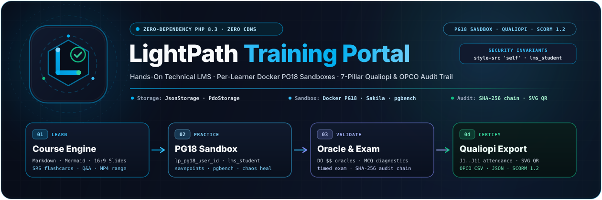

  

# LightPath Training Portal — Zero-Dependency PHP 8.3 Qualiopi LMS & Docker SQL Labs

**LightPath Training Portal** (`LightPath Academy v2.0.0`, Ref. `LP-LMS-QUALIOPI-2026`) is a zero-dependency PHP `>= 8.3` Learning Management System built for hands-on technical certifications, isolated per-learner PostgreSQL 18 Docker sandboxes, Git-native Markdown Studio course packs, and turnkey Qualiopi / OPCO compliance. Published documentation lives at [https://lsm.lightpath.fr/](https://lsm.lightpath.fr/).

  

    PHP >= 8.3
    Zero Composer &amp; Node Deps · JSON or PDO
  

  

    Per-User PG18
    Isolated Docker Sandboxes · Sakila + pgbench
  

  

    Strict CSP
    style-src 'self' · Zero External CDNs
  

  

    Qualiopi 7-Pillar
    Dual Attendance, Exams &amp; Offline SVG QR
  

[Start Tutorials](01-tutorials/index.md){ .md-button .md-button--primary }
[Browse How-To Guides](02-how-to-guides/index.md){ .md-button }
[Inspect Reference](03-reference/index.md){ .md-button }
[Read Explanation](04-explanation/index.md){ .md-button }

---

## Diátaxis Documentation Matrix (Action × Cognition)

LightPath Training Portal organizes its documentation across the four Diátaxis quadrants so every page serves one clear purpose without mixing tutorials, operational runbooks, reference tables, and architectural explanations:

| | **Practical (Action)** | **Theoretical (Cognition)** |
| :--- | :--- | :--- |
| **Acquisition (Study)** | [**1. Tutorials (`01-tutorials/`)**](01-tutorials/index.md) Guided isolated sandboxes for local boot, Docker PG18 labs, and custom course packs | [**4. Explanation (`04-explanation/`)**](04-explanation/index.md) Zero-dependency architecture, SQL sandbox & Qualiopi integrity, and ADRs |
| **Application (Work)** | [**2. How-To Guides (`02-how-to-guides/`)**](02-how-to-guides/index.md) Goal-oriented ASD-STE100 Issue 9 deployment, cohort/Qualiopi, incident, and CSP SOPs | [**3. Reference (`03-reference/`)**](03-reference/index.md) Exhaustive env vars, 10 feature flags, HTTP/JSON routes, CLI scripts, and alert matrices |

---

## Explore Documentation by Quadrant

-   :material-school-outline:{ .lg .middle } **1. Tutorials (`01-tutorials/`)**

    ---

    *Practical · Study / Acquisition* — Follow reproducible isolated sandboxes to boot the portal locally, execute your first PostgreSQL 18 Docker SQL lab, and author a custom Markdown course pack.

    - [Tutorials Quadrant Index](01-tutorials/index.md)
    - [Tutorial 1: Local Quickstart Sandbox](01-tutorials/01-local-quickstart-sandbox.md)
    - [Tutorial 2: First Docker PG18 Lab](01-tutorials/02-first-docker-pg18-lab.md)
    - [Tutorial 3: Author Custom Course Pack](01-tutorials/03-author-custom-course-pack.md)

-   :material-wrench-outline:{ .lg .middle } **2. How-To Guides (`02-how-to-guides/`)**

    ---

    *Practical · Work / Application* — Execute ASD-STE100 Issue 9 procedures for Docker and PDO deployment, cohort and Qualiopi exports, feature-flag and course configuration, incident remediation, and CSP/audit hardening.

    - [How-To Guides Quadrant Index](02-how-to-guides/index.md)
    - [Deploy Portal with Docker & PDO](02-how-to-guides/deployment/deploy-portal-docker-and-pdo.md)
    - [Manage Cohorts & Qualiopi Exports](02-how-to-guides/operations/manage-cohorts-and-qualiopi-exports.md)
    - [Configure Feature Flags & Courses](02-how-to-guides/operations/configure-feature-flags-and-courses.md)
    - [Remediate Docker Lab & Auth Incidents](02-how-to-guides/incident-response/remediate-docker-lab-and-auth-incidents.md)
    - [Harden CSP, Credentials & Audit Chain](02-how-to-guides/security/harden-csp-credentials-and-audit-chain.md)

-   :material-table-search:{ .lg .middle } **3. Reference (`03-reference/`)**

    ---

    *Theoretical · Work / Application* — Look up exact environment variables, all 10 feature flags and 4 deployment profiles, HTTP/JSON endpoints, CLI utilities and exit codes, and error/alert matrices.

    - [Reference Quadrant Index](03-reference/index.md)
    - [Environment & Feature Flags](03-reference/configuration/environment-and-feature-flags.md)
    - [HTTP Routes & JSON API](03-reference/api-and-routes/http-routes-and-json-api.md)
    - [CLI Utilities & Exit Codes](03-reference/cli-and-scripts/cli-utilities-and-exit-codes.md)
    - [Error & Alert Matrix](03-reference/troubleshooting-codes/error-and-alert-matrix.md)

-   :material-lightbulb-outline:{ .lg .middle } **4. Explanation (`04-explanation/`)**

    ---

    *Theoretical · Study / Acquisition* — Understand the zero-dependency LMS topology, least-privilege SQL sandbox and SHA-256 Qualiopi audit guarantees, and Architecture Decision Records.

    - [Explanation Quadrant Index](04-explanation/index.md)
    - [Zero-Dependency LMS Architecture](04-explanation/architecture-overview/zero-dependency-lms-architecture.md)
    - [ADR-001: Zero-Dependency, Zero-CDN & Strict CSP](04-explanation/design-decisions/adr-001-zero-dependency-zero-cdn-strict-csp.md)
    - [ADR-002: Versioned Diátaxis MkDocs Publishing](04-explanation/design-decisions/adr-002-versioned-diataxis-mkdocs-publishing.md)
    - [SQL Sandbox & Qualiopi Integrity](04-explanation/deep-dives/sql-sandbox-and-qualiopi-integrity.md)

-   :material-book-open-variant:{ .lg .middle } **Deep-Dive Engineering Guides**

    ---

    Consult the complete platform handbooks covering course authoring, Docker lab orchestration, Trainer/Admin cockpits, production operations, testing, HTTP APIs, security, Moodle benchmarking, and Ponytail quality audits.

    - [Course-Pack Authoring & Sync (`COURSE_PACK_GUIDE.md`)](COURSE_PACK_GUIDE.md)
    - [Docker Classroom Labs (`DOCKER_LABS_GUIDE.md`)](DOCKER_LABS_GUIDE.md)
    - [Admin & Trainer Guide (`ADMIN_AND_TRAINER_GUIDE.md`)](ADMIN_AND_TRAINER_GUIDE.md)
    - [Deployment & Operations (`DEPLOYMENT_AND_OPERATIONS.md`)](DEPLOYMENT_AND_OPERATIONS.md)
    - [Developer & Testing Guide (`DEVELOPER_AND_TESTING_GUIDE.md`)](DEVELOPER_AND_TESTING_GUIDE.md)
    - [API & Route Reference (`API_REFERENCE.md`)](API_REFERENCE.md)
    - [System Architecture (`ARCHITECTURE.md`)](ARCHITECTURE.md)
    - [Security Architecture (`SECURITY.md`)](SECURITY.md)
    - [Moodle Comparison & Roadmap (`MOODLE_COMPARISON.md`)](MOODLE_COMPARISON.md)
    - [Quality Audit Ponytail (`QUALITY_AUDIT_PONYTAIL.md`)](QUALITY_AUDIT_PONYTAIL.md)

-   :material-history:{ .lg .middle } **Releases & Governance**

    ---

    Track versioned releases, contributor standards, living engineering actions, root-cause analyses, and the live documentation portal at [lsm.lightpath.fr](https://lsm.lightpath.fr/).

    - [Technical Overview (`README.md`)](../README.md)
    - [Changelog (`CHANGELOG.md`)](../CHANGELOG.md)
    - [Contributing Guide (`CONTRIBUTING.md`)](../CONTRIBUTING.md)
    - [Project Context (`PROJECT-CONTEXT.md`)](../PROJECT-CONTEXT.md)
    - [Security Disclosure Policy (`SECURITY.md`)](../SECURITY.md)
    - [Action Logbook (`ACTION_LOGBOOK.md`)](ACTION_LOGBOOK.md)
    - [RCA Register (`RCA_REGISTER.md`)](RCA_REGISTER.md)

