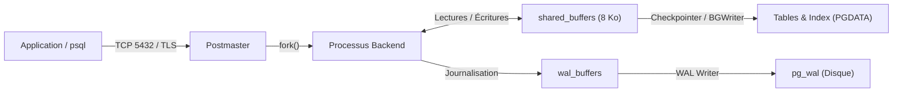

# 🐘 Module 01 : Introduction & Architecture PostgreSQL 18 (Démo Open-Source)

> **Module :** 01 — Architecture Interne & Nouveautés PostgreSQL 18 (Édition Démo MIT)
> **Durée :** 2h00
> **Objectif Pédagogique (Bloom C2) :** Comprendre & Analyser l'architecture PostgreSQL 18
> **Formateur :** Jean-Marie Renouard — LightPath SARL

Ce module de démonstration open-source présente l'architecture multi-processus de PostgreSQL 18, la gestion de la mémoire partagée, le nouveau sous-système d'entrées/sorties asynchrones (AIO) et le modèle MVCC.

---

## 1. Objectifs Pédagogiques Opérationnels

À l'issue de ce module, les participants sont capables de :

* **Comprendre (Bloom C2)** le cycle de vie d'une connexion cliente gérée par le processus `postmaster`.
* **Identifier (Bloom C2)** le rôle des processus d'arrière-plan (`checkpointer`, `walwriter`, `bgwriter`, `autovacuum`).
* **Analyser (Bloom C2)** le trajet d'une requête SQL entre la mémoire partagée (`shared_buffers`), le WAL et le stockage physique.
* **Expliquer (Bloom C2)** les gains du sous-système AIO introduit dans PostgreSQL 18.

---

## 2. Plan du Module

1. Positionnement et apports majeurs de PostgreSQL 18.
2. Architecture multi-processus : `postmaster` et processus `backend`.
3. Schéma d'architecture interne et flux mémoire/disque.
4. Mémoire partagée (`shared_buffers`, `wal_buffers`) et mémoire locale (`work_mem`).
5. Sous-système I/O asynchrone (AIO) de PostgreSQL 18.
6. Stockage physique : pages de 8 Ko, TOAST et journaux WAL.
7. Modèle MVCC, visibilité des tuples et `autovacuum`.
8. Synthèse, Quiz formatif et lancement de l'atelier pratique.

---

## 3. Positionnement & Nouveautés PostgreSQL 18

PostgreSQL 18 consolide le standard des bases de données relationnelles critiques grâce à plusieurs avancées majeures :

* **Sous-système AIO natif :** lectures asynchrones sur les scans séquentiels, bitmap heap scans et opérations de maintenance (`VACUUM`).
* **Optimiseur & indexation :** support étendu du skip scan sur index B-Tree multi-colonnes et statistiques améliorées.
* **Sécurité & observabilité :** authentification OAuth 2.0 en complément de SCRAM-SHA-256 et métriques I/O enrichies dans `pg_stat_io`.
* **Licence permissive :** distribution sous licence PostgreSQL (type MIT/BSD), sans limitation de cœurs ni de volume.

---

## 4. Architecture Multi-Processus (Postmaster & Backends)

Contrairement aux moteurs purement multi-threadés, PostgreSQL repose sur une isolation stricte par processus OS :

* **Postmaster (`postgres`) :** processus père qui écoute sur le port TCP `5432` (ou socket Unix) et fork un processus fils par connexion.
* **Backend client :** processus dédié à une session applicative ; il exécute le parseur, le planificateur (CBO) et l'exécuteur.
* **Isolation des pannes :** l'arrêt anormal d'un backend est intercepté par le postmaster pour protéger l'intégrité des données.

```sql
-- Inspect active PostgreSQL backend processes and roles
SELECT pid, backend_type, state, usename
FROM pg_stat_activity
ORDER BY backend_type, pid;
```

---

## 5. Schéma d'Architecture Interne



---

## 6. Mémoire Partagée : shared_buffers & wal_buffers

La mémoire de PostgreSQL se divise en segments partagés entre tous les processus et zones privées par session :

| Zone Mémoire | Portée | Rôle Principal | Ordre de Grandeur |
| :--- | :--- | :--- | :--- |
| `shared_buffers` | Globale (IPC) | Cache de pages 8 Ko des tables et index | 25% à 40% de la RAM |
| `wal_buffers` | Globale (IPC) | Tampon circulaire des enregistrements WAL | 16 Mo à 64 Mo |
| `work_mem` | Par opération | Tris, tables de hachage et agrégations | 16 Mo à 128 Mo |
| `maintenance_work_mem` | Maintenance | Création d'index et opérations `VACUUM` | 256 Mo à 2 Go |

---

## 7. Sous-système I/O Asynchrone (AIO PostgreSQL 18)

PostgreSQL 18 introduit le paramètre `io_method` permettant de paralléliser les lectures disque sans bloquer le processus exécuteur :

* **`worker` (par défaut) :** délègue les requêtes I/O à un pool de travailleurs dédiés (`io_workers`).
* **`io_uring` (Linux) :** exploite l'interface noyau asynchrone à très faible latence.
* **`sync` :** mode synchrone historique conservé pour la compatibilité.

> **Bonnes Pratiques AIO & Mémoire PostgreSQL 18**
> * Dimensionnez `shared_buffers` à 25 % de la RAM au démarrage avant de calibrer `effective_cache_size`.
> * Vérifiez les statistiques d'attente dans `pg_stat_io` après activation de `io_method = 'io_uring'` ou `'worker'`.
> * Surveillez `temp_blks_written` pour détecter un `work_mem` insuffisant sur les tris volumineux.

---

## 8. Stockage Physique : Pages 8 Ko, TOAST & WAL

Chaque table et chaque index est découpé en blocs de taille fixe (`8192` octets par défaut) :

* **Structure d'une page :** en-tête (24 octets), tableau de pointeurs (`ItemIdData`), espace libre et tuples écrits depuis la fin.
* **Mécanisme TOAST :** compression et déport des valeurs volumineuses (> 2 Ko) dans une table annexe dédiée.
* **Write-Ahead Logging (WAL) :** toute modification de page est d'abord écrite séquentiellement dans `pg_wal` pour garantir la durabilité ACID.

---

## 9. Multi-Version Concurrency Control (MVCC) & Autovacuum

Le modèle MVCC assure l'isolation transactionnelle sans verrouillage en lecture :

* **Lecteurs et écrivains :** une lecture ne bloque jamais une écriture, et une écriture ne bloque jamais une lecture.
* **Visibilité par XID :** chaque tuple porte `xmin` (transaction créatrice) et `xmax` (transaction de suppression/mise à jour).
* **Rôle d'`autovacuum` :** récupère l'espace des tuples morts, met à jour la `visibility map` et prévient le bouclage des XID (`wraparound`).

---

## 10. Synthèse & Points Clés

* PostgreSQL 18 isole chaque session dans un processus OS dédié supervisé par le `postmaster`.
* Les accès disque sont accélérés par `shared_buffers` et le nouveau moteur AIO (`io_method`).
* La cohérence et la reprise sur incident reposent sur le WAL séquentiel (`pg_wal`) et les points de contrôle (`checkpointer`).
* Le moteur MVCC garantit une concurrence élevée grâce aux versions multiples de tuples nettoyées par `autovacuum`.

---

## 11. Quiz d'Évaluation Formative

<details>
<summary>Question 1 : Quel processus PostgreSQL écoute les nouvelles connexions TCP et crée les processus backend associés ?</summary>

* **A.** `checkpointer`
* **B.** `postmaster`
* **C.** `autovacuum launcher`
* **D.** `walwriter`

**Réponse correcte : B**

**Justification :** Le processus père `postmaster` (binaire `postgres`) écoute sur le port réseau configuré, authentifie le client et fork un processus `backend` dédié pour chaque session.

</details>

<details>
<summary>Question 2 : Quel paramètre PostgreSQL 18 permet de sélectionner le moteur d'entrées/sorties asynchrones (AIO) ?</summary>

* **A.** `shared_buffers`
* **B.** `wal_level`
* **C.** `io_method`
* **D.** `effective_io_concurrency`

**Réponse correcte : C**

**Justification :** Introduit dans PostgreSQL 18, le paramètre `io_method` choisit le mécanisme AIO (`worker`, `io_uring` ou `sync`) utilisé par le moteur de stockage.

</details>

<details>
<summary>Question 3 : Pourquoi le mécanisme Write-Ahead Logging (WAL) écrit-il les modifications dans pg_wal avant les fichiers de données ?</summary>

* **A.** Pour garantir la durabilité ACID et permettre la reprise après crash via des écritures séquentielles rapides
* **B.** Pour compresser automatiquement les colonnes texte supérieures à 2 Ko
* **C.** Pour remplacer totalement le besoin d'exécuter `autovacuum`
* **D.** Pour allouer la mémoire locale `work_mem` de chaque tri SQL

**Réponse correcte : A**

**Justification :** La journalisation préalable (WAL) transforme des écritures aléatoires coûteuses en journaux séquentiels persistés, permettant de rejouer les transactions validées en cas d'arrêt brutal.

</details>

---

## 12. Présentation de l'Atelier Pratique

Dans l'**Atelier 01 : Prise en Main & Diagnostic PostgreSQL 18**, vous allez :

* Vérifier la version exacte du moteur et les paramètres mémoire actifs de votre instance.
* Explorer les vues système `pg_stat_activity` et `pg_stat_io`.
* Valider automatiquement l'état de conformité du cluster via un bloc `DO $$` Qualiopi.
