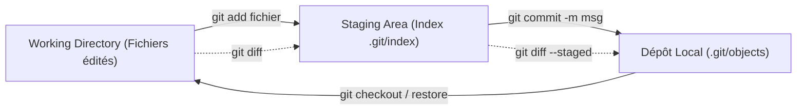

# 🌿 Module 01 : Initialisation d'un Dépôt, Index (Staging) & Premiers Commits

> **Module :** 01 — Cycle de Vie Local, Indexation & Historique Git
> **Durée :** 2h00
> **Objectif Pédagogique (Bloom C2) :** Comprendre et piloter le cycle de vie local d'un dépôt Git
> **Formateur :** Jean-Marie Renouard — LightPath SARL

Ce module introduit le modèle distribué de Git, la séparation entre répertoire de travail, zone d'indexation (Staging Area) et historique des commits, ainsi que le filtrage des fichiers via `.gitignore`.

---

## 1. Objectifs Pédagogiques Opérationnels

À l'issue de ce module, les participants sont capables de :

* **Comprendre (Bloom C2)** la différence entre un gestionnaire de versions centralisé et le modèle distribué à instantanés (snapshots) de Git.
* **Distinguer (Bloom C2)** les trois zones locales de Git : Working Directory, Staging Area (Index) et Repository (`.git`).
* **Initialiser et configurer (Bloom C2)** un dépôt Git propre avec une identité auteur traçable et un fichier `.gitignore` adapté.
* **Inspecter et valider (Bloom C2)** des modifications atomiques avec `git status`, `git diff`, `git add`, `git commit` et `git log`.

---

## 2. Plan du Module

1. Architecture distribuée et modèle d'instantanés Git.
2. Les trois zones locales : Working Tree, Index et Objet `.git`.
3. Initialisation et configuration identitaire (`git init`, `git config`).
4. Cycle d'édition, inspection (`git status`) et indexation (`git add`).
5. Validation atomique (`git commit`) et exclusion via `.gitignore`.
6. Lecture de l'historique (`git log`) et comparaison (`git diff`).
7. Annulation ciblée (`git restore`) et amendement local (`--amend`).
8. Synthèse, Quiz formatif QCM et présentation de l'Atelier 01.

---

## 3. Architecture Distribuée & Les Trois Zones Git

Contrairement aux outils historiques qui stockent des deltas fichier par fichier sur un serveur unique, Git fonctionne par **instantanés complets** et place un dépôt autonome sur chaque poste :

* **Working Directory (Répertoire de travail) :** copie extraite des fichiers que vous éditez directement dans votre IDE ou éditeur.
* **Staging Area / Index (`.git/index`) :** zone intermédiaire de préparation qui assemble exactement le contenu du prochain commit.
* **Git Repository (`.git/objects`) :** base locale immuable des instantanés validés, identifiés par empreinte cryptographique SHA-1 / SHA-256.

| État d'un Fichier | Zone Git Associée | Commande de Transition | Visibilité dans l'Historique |
| :--- | :--- | :--- | :--- |
| `Untracked` (Non suivi) | Working Directory uniquement | `git add <fichier>` | Absent |
| `Modified` (Modifié) | Working Directory (delta vs Index) | `git add <fichier>` | Ancienne version seulement |
| `Staged` (Indexé) | Staging Area (`.git/index`) | `git commit -m "..."` | Prêt pour le prochain commit |
| `Committed` (Validé) | Dépôt local (`.git/objects`) | Historique persistant | Traçable via `git log` |

---

## 4. Schéma du Cycle de Vie Local



---

## 5. Initialisation & Configuration Identitaire (git init / git config)

Avant le premier commit, chaque poste doit déclarer l'identité qui signera les instantanés dans l'historique :

```bash
# Configure global author identity and default initial branch name
git config --global user.name "Alice Martin"
git config --global user.email "alice.martin@lightpath.fr"
git config --global init.defaultBranch main

# Initialize a new local repository
mkdir -p billing-api && cd billing-api
git init
```

* Le sous-répertoire caché `.git/` contient toute l'intelligence du dépôt (`HEAD`, `config`, `objects/`, `refs/`).
* Utilisez `git config --list --show-origin` pour auditer la provenance des paramètres (système, utilisateur `--global` ou dépôt `--local`).

---

## 6. Inspection d'État & Indexation Sélective (git status / git add)

La commande `git status` reste le tableau de bord permanent du développeur pour savoir quels fichiers sont non suivis, modifiés ou prêts à être validés :

```bash
# Inspect short and verbose status
git status
git status --short --branch

# Stage a specific file or interactive hunks
git add app/routes.py
git add -p app/config.py
```

* **Pourquoi éviter `git add .` par réflexe ?** Un ajout aveugle risque d'embarquer des fichiers temporaires, secrets `.env` ou journaux de debug non filtrés.
* L'option `-p` (`--patch`) découpe les modifications bloc par bloc afin de ne valider que les lignes pertinentes à un sujet donné.

---

## 7. Enregistrement Atomique & Règles .gitignore (git commit)

Un bon commit représente **une unité logique cohérente et compilable** accompagnée d'un message explicite au format Conventional Commits (`feat:`, `fix:`, `docs:`, `chore:`) :

```bash
# Create an atomic commit with a clear conventional subject
git commit -m "feat(billing): add VAT validation helper"

# Typical .gitignore rules for Python / Web projects
cat <<'EOF' > .gitignore
.env
*.log
__pycache__/
dist/
.venv/
EOF
```

> **Bonnes Pratiques .gitignore & Commits Atomiques**
> * Créez et validez `.gitignore` dès l'initialisation du dépôt avant d'exécuter le premier `git add`.
> * Rédigez des messages de commit impératifs à l'anglais technique (`feat: add invoice export`, `fix: guard null tax rate`).
> * Ne commitez jamais de secrets (`.env`, clés SSH, jetons API) : un fichier déjà suivi reste suivi malgré `.gitignore` tant qu'il n'est pas retiré via `git rm --cached`.

---

## 8. Lecture de l'Historique & Comparaison (git log / git diff)

Pour diagnostiquer une régression ou relire un travail avant validation, Git propose des vues compactes et précises :

```bash
# Compact graphical history of commits
git log --oneline --graph --decorate -n 10

# Inspect changes in Working Directory vs Index
git diff

# Inspect changes already staged in Index vs HEAD
git diff --staged

# Show full patch of a specific commit
git show HEAD
```

| Commande | Source Comparée | Cible Comparée | Cas d'Usage Principal |
| :--- | :--- | :--- | :--- |
| `git diff` | Working Directory | Index (Staging) | Relire les éditions non encore indexées |
| `git diff --staged` | Index (Staging) | Dernier commit (`HEAD`) | Vérifier exactement le contenu du prochain commit |
| `git log -p -n 2` | Historique `HEAD` | Commits précédents | Auditer les lignes modifiées sur les 2 derniers commits |

---

## 9. Corriger & Annuler Proprement (git restore / --amend)

Tant qu'un commit n'a pas été poussé sur un dépôt partagé, les erreurs locales se réparent sans risque :

```bash
# Unstage a file without losing working directory edits
git restore --staged app/secret_test.py

# Discard unstaged modifications in working directory (irreversible locally)
git restore app/routes.py

# Amend the last local commit message or include a forgotten staged file
git add README.md
git commit --amend --no-edit
```

* `git restore --staged` retire uniquement le fichier de l'Index sans toucher au contenu sur disque.
* `git commit --amend` remplace le dernier commit local par un nouvel objet SHA : à réserver strictement aux commits non publiés.

---

## 10. Synthèse & Points Clés

* Git repose sur trois zones locales complémentaires : **Working Directory**, **Staging Area (Index)** et **Dépôt `.git`**.
* `git status` et `git diff --staged` permettent de contrôler ce qui entrera dans le prochain instantané avant `git commit`.
* Le fichier `.gitignore` protège le dépôt contre l'ajout accidentel de secrets, caches et artefacts de build.
* Les commits atomiques au format Conventional Commits rendent l'historique `git log` lisible et exploitable pour les revues de code.

---

## 11. Quiz d'Évaluation Formative

<details>
<summary>Question 1 : Quelle commande permet de voir uniquement les modifications déjà ajoutées à l'Index (Staging Area) avant de lancer git commit ?</summary>

* **A.** `git diff`
* **B.** `git diff --staged`
* **C.** `git log --oneline`
* **D.** `git init --bare`

**Réponse correcte : B**

**Justification :** L'option `--staged` (ou `--cached`) compare l'Index préparé avec le dernier commit `HEAD`, alors que `git diff` sans option compare le répertoire de travail à l'Index.

</details>

<details>
<summary>Question 2 : Un fichier .env a déjà été commité par erreur dans le dépôt. Que fait l'ajout de .env dans .gitignore seul ?</summary>

* **A.** Il supprime immédiatement `.env` de tout l'historique Git
* **B.** Il ignore automatiquement les futures modifications sur `.env` sans autre action
* **C.** Il n'arrête pas le suivi d'un fichier déjà indexé tant qu'on n'exécute pas `git rm --cached .env`
* **D.** Il bloque toute exécution de `git commit`

**Réponse correcte : C**

**Justification :** `.gitignore` ne s'applique qu'aux fichiers non suivis (`Untracked`) ; un fichier déjà suivi doit d'abord être désindexé avec `git rm --cached`.

</details>

<details>
<summary>Question 3 : Quelle commande retire un fichier de la Staging Area tout en conservant ses modifications intactes dans le répertoire de travail ?</summary>

* **A.** `git restore --staged <fichier>`
* **B.** `git restore <fichier>`
* **C.** `git rm -f <fichier>`
* **D.** `git clean -fd`

**Réponse correcte : A**

**Justification :** `git restore --staged` réinitialise l'entrée correspondante dans l'Index depuis `HEAD` sans écraser les modifications du répertoire de travail.

</details>

---

## 12. Présentation de l'Atelier Pratique

Dans l'**Atelier 01 : Premier Dépôt & Commits Atomiques**, vous allez :

* Initialiser le dépôt local du microservice `billing-api` et configurer votre identité Git.
* Déployer un fichier `.gitignore` filtrant les secrets `.env` et les journaux d'exécution.
* Enregistrer deux commits conventionnels propres, inspecter `git diff --staged` et valider votre dépôt avec l'oracle Bash `VALIDATION_OK`.
