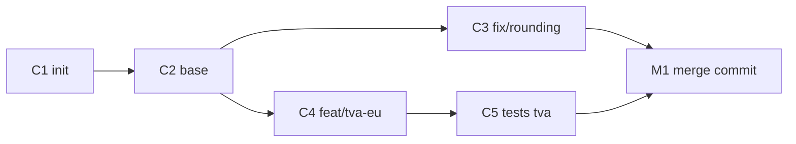

# 🔀 Module 02 : Branches, Bascule (git switch) & Résolution de Conflits (git merge)

> **Module :** 02 — Branches Isolées, Stratégies de Fusion & Résolution de Conflits
> **Durée :** 2h30
> **Objectif Pédagogique (Bloom C3) :** Appliquer le workflow par branches et résoudre un conflit de fusion sans perte de code
> **Formateur :** Jean-Marie Renouard — LightPath SARL

Ce module détaille le fonctionnement interne des branches Git comme pointeurs légers, les commandes modernes de bascule (`git switch`), les mécanismes de fusion (`Fast-Forward` et `3-way merge`) et la méthodologie rigoureuse de résolution des conflits.

---

## 1. Objectifs Pédagogiques Opérationnels

À l'issue de ce module, les participants sont capables de :

* **Expliquer (Bloom C2)** qu'une branche Git est un simple pointeur mobile vers un commit (`refs/heads/*`) et comprendre le rôle de `HEAD`.
* **Appliquer (Bloom C3)** l'isolation des développements et correctifs via `git branch` et `git switch -c`.
* **Distinguer et exécuter (Bloom C3)** une fusion `Fast-Forward` d'une fusion à trois voies (`3-way merge`).
* **Résoudre (Bloom C3)** un conflit de fusion en lisant les marqueurs `<<<<<<<`, `=======` et `>>>>>>>` sans régression.

---

## 2. Plan du Module

1. Modèle de pointeurs légers : `HEAD` et `refs/heads/*`.
2. Visualisation de la divergence d'historique entre branches.
3. Création, navigation et bascule sécurisée (`git switch`).
4. Stratégies de fusion : `Fast-Forward`, `--no-ff` et `3-way merge`.
5. Anatomie d'un conflit de fusion sur ligne partagée.
6. Protocole pas-à-pas de résolution et annulation (`--abort`).
7. Nettoyage post-fusion (`git branch -d`).
8. Synthèse, Quiz formatif QCM et présentation de l'Atelier 02.

---

## 3. Anatomie d'une Branche : Pointeurs Légers & HEAD

Dans Git, créer une branche ne duplique aucun fichier sur disque : une branche est un fichier texte de **41 octets** contenant l'empreinte du commit de pointe :

* **`refs/heads/main` :** pointeur nommé avançant automatiquement à chaque nouveau commit réalisé sur `main`.
* **`HEAD` :** pointeur symbolique spécial indiquant la branche active courante (contenu typique : `ref: refs/heads/main`).
* **Coût quasi nul :** basculer ou créer une branche est instantané, ce qui encourage une branche dédiée par fonctionnalité ou correctif.

```bash
# Inspect current branch pointer and HEAD reference
cat .git/HEAD
git show-ref --heads
```

---

## 4. Schéma d'Arbre & Divergence de Branches



---

## 5. Créer, Lister & Basculer de Branche (git branch / git switch)

Introduit pour clarifier l'ancien `git checkout` surchargé, `git switch` sépare nettement la gestion des branches de la restauration de fichiers (`git restore`) :

```bash
# List local branches and show active branch (*)
git branch -vv

# Create and immediately switch to a feature branch
git switch -c feat/tva-eu

# Switch back to main without creating a branch
git switch main
```

| Action | Commande Moderne (`Git >= 2.23`) | Équivalent Historique |
| :--- | :--- | :--- |
| Basculer vers `main` | `git switch main` | `git checkout main` |
| Créer et basculer vers `feat/x` | `git switch -c feat/x` | `git checkout -b feat/x` |
| Restaurer un fichier modifié | `git restore fichier.py` | `git checkout -- fichier.py` |

---

## 6. Stratégies de Fusion : Fast-Forward vs 3-Way Merge

Lorsque vous exécutez `git merge <branche>` depuis `main`, Git choisit l'algorithme selon la topologie du graphe :

* **Fast-Forward (`--ff`) :** si `main` n'a reçu aucun nouveau commit depuis la création de `<branche>`, Git déplace simplement le pointeur `main` vers l'avant sans créer de commit supplémentaire.
* **No Fast-Forward (`--no-ff`) :** force la création d'un commit de fusion explicite afin de conserver la trace visuelle d'une fonctionnalité dans `git log --graph`.
* **3-Way Merge :** si `main` et `<branche>` ont divergé depuis un ancêtre commun, Git compare trois instantanés (l'ancêtre commun et les deux pointes) pour générer un commit à deux parents.

```bash
# Merge preserving explicit branch topology with --no-ff
git switch main
git merge --no-ff feat/tva-eu -m "merge: integrate EU VAT calculation"
```

---

## 7. Anatomie d'un Conflit de Fusion

Un conflit survient uniquement lorsque deux branches ont modifié **les mêmes lignes (ou des lignes adjacentes)** d'un même fichier depuis leur ancêtre commun :

```text
<<<<<<< HEAD
TAX_RATE = 0.20
=======
TAX_RATE = 0.21
>>>>>>> feat/tva-eu
```

* `<<<<<<< HEAD` délimite la version actuellement présente sur la branche cible (`main`).
* `=======` sépare les deux versions concurrentes.
* `>>>>>>> feat/tva-eu` clôture le bloc issu de la branche fusionnée.

> **Bonnes Pratiques face aux Conflits de Fusion**
> * Ne paniquez jamais devant un conflit : Git met simplement la fusion en pause dans l'état `MERGING` pour vous laisser arbitrer.
> * Supprimez intégralement les trois lignes de marqueurs (`<<<<<<<`, `=======`, `>>>>>>>`) après avoir retenu ou combiné les deux changements.
> * Exécutez toujours les tests unitaires ou un script de validation avant de conclure une fusion ayant généré des conflits.

---

## 8. Protocole de Résolution Pas-à-Pas & Annulation (git merge --abort)

En cas de conflit détecté pendant `git merge`, appliquez toujours cette séquence déterministe :

```bash
# 1. Identify conflicted files (marked UU / both modified)
git status

# 2. Edit conflicted file(s), remove conflict markers, keep valid code
# 3. Stage resolved file(s) and finalize the merge commit
git add src/pricing.py
git commit -m "merge: resolve TAX_RATE conflict between main and feat/tva-eu"

# Alternative: cancel an ongoing merge and restore clean pre-merge state
git merge --abort
```

* Tant que les fichiers en conflit ne sont pas réindexés via `git add`, Git refuse de valider le commit de fusion.
* `git merge --abort` rétablit immédiatement votre dépôt dans l'état exact précédant la tentative de fusion.

---

## 9. Nettoyage & Hygiène des Branches (git branch -d / -D)

Une fois une fonctionnalité intégrée dans `main`, la branche temporaire doit être supprimée pour éviter l'accumulation de branches obsolètes :

```bash
# Safe delete: succeeds only if branch commits are already merged
git branch -d feat/tva-eu

# Force delete: removes an abandoned unmerged branch intentionally
git branch -D experiment/draft-ui

# Inspect merged vs unmerged branches
git branch --merged
git branch --no-merged
```

* Privilégiez toujours `-d` (suppression protégée) : Git vous alerte si des commits risquent de devenir inaccessibles.

---

## 10. Synthèse & Points Clés

* Une branche Git est un pointeur mobile ultra-léger vers un commit, et `HEAD` identifie la branche courante.
* `git switch -c` isole chaque développement sans perturber la branche stable `main`.
* Un conflit apparaît uniquement sur des modifications concurrentes de lignes communes et se résout par édition, suppression des marqueurs, `git add` puis `git commit`.
* `git merge --abort` reste la sortie de secours immédiate pour annuler une fusion problématique.

---

## 11. Quiz d'Évaluation Formative

<details>
<summary>Question 1 : Quelle commande moderne crée une nouvelle branche feat/auth et bascule immédiatement dessus ?</summary>

* **A.** `git branch -d feat/auth`
* **B.** `git switch -c feat/auth`
* **C.** `git merge --ff-only feat/auth`
* **D.** `git restore --staged feat/auth`

**Réponse correcte : B**

**Justification :** `git switch -c <nom>` combine la création de la nouvelle branche et le déplacement de `HEAD` vers cette branche en une seule opération claire.

</details>

<details>
<summary>Question 2 : Dans quel cas Git peut-il effectuer une fusion Fast-Forward automatique ?</summary>

* **A.** Uniquement lorsque deux branches ont modifié le même fichier
* **B.** Lorsque la branche cible n'a reçu aucun commit depuis la divergence de la branche source
* **C.** Uniquement lorsqu'on passe l'option `--no-ff`
* **D.** Lorsque le répertoire de travail contient des fichiers non indexés

**Réponse correcte : B**

**Justification :** En l'absence de divergence sur la branche cible, le chemin vers la branche fusionnée est purement linéaire et Git avance simplement le pointeur sans commit de fusion.

</details>

<details>
<summary>Question 3 : Après avoir édité un fichier en conflit et supprimé les marqueurs =======, que devez-vous exécuter pour finaliser la fusion ?</summary>

* **A.** `git merge --abort` puis `git init`
* **B.** `git add <fichier>` puis `git commit`
* **C.** `git switch -c conflict`
* **D.** `git branch -D HEAD`

**Réponse correcte : B**

**Justification :** Marquer le fichier comme résolu passe impérativement par `git add` sur le fichier corrigé, suivi de `git commit` pour enregistrer le commit de fusion.

</details>

---

## 12. Présentation de l'Atelier Pratique

Dans l'**Atelier 02 : Branches Isolées & Résolution de Conflit Merge**, vous allez :

* Développer une fonctionnalité `feat/tva-eu` et un correctif concurrent `fix/rounding-bug` sur le projet `checkout-service`.
* Réaliser une fusion `Fast-Forward` puis provoquer et résoudre proprement un conflit sur le fichier `pricing.py`.
* Valider l'absence totale de marqueurs résiduels et l'historique final avec l'oracle Bash `VALIDATION_OK`.
