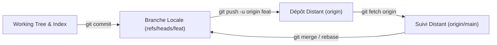

# 🌐 Module 03 : Dépôts Distants (clone, remote, fetch, pull, push) & Pull Requests

> **Module :** 03 — Synchronisation Distante, Branches de Suivi & Workflow Pull Request
> **Durée :** 2h30
> **Objectif Pédagogique (Bloom C3) :** Appliquer la synchronisation avec un dépôt distant et mener une Pull Request propre
> **Formateur :** Jean-Marie Renouard — LightPath SARL

Ce module couvre la collaboration distribuée entre développeurs via des dépôts distants : clonage, gestion des remotes, distinction critique entre `git fetch` et `git pull`, publication avec branches de suivi et conduite complète d'une Pull Request.

---

## 1. Objectifs Pédagogiques Opérationnels

À l'issue de ce module, les participants sont capables de :

* **Cloner et connecter (Bloom C2)** un dépôt distant en vérifiant les URL configurées (`git clone`, `git remote -v`).
* **Différencier et appliquer (Bloom C3)** `git fetch` (synchronisation d'observation sans fusion) et `git pull` (récupération suivie d'intégration).
* **Publier (Bloom C3)** une branche locale vers le serveur distant avec suivi amont (`git push -u origin <branche>`).
* **Conduire (Bloom C3)** un cycle complet Feature Branch -> Pull Request -> Revue -> Fusion & Nettoyage.

---

## 2. Plan du Module

1. Topologie des dépôts distants et références `refs/remotes/origin/*`.
2. Schéma des flux de synchronisation (`fetch`, `pull`, `push`).
3. Clonage initial et gestion des remotes (`git clone`, `git remote`).
4. Différence stratégique entre `git fetch` et `git pull`.
5. Publication avec suivi amont (`git push -u`).
6. Anatomie et bonnes pratiques d'une Pull Request (PR).
7. Gestion des divergences et prévention de l'historique cassé.
8. Synthèse, Quiz formatif QCM et présentation de l'Atelier 03.

---

## 3. Architecture des Dépôts Distants (origin & refs/remotes)

Lorsqu'un dépôt est cloné, Git enregistre par convention le serveur source sous l'alias **`origin`** et maintient un miroir local en lecture seule des branches distantes :

* **Branches locales (`refs/heads/*`) :** vos pointeurs de travail modifiables par `git commit` et `git merge`.
* **Branches de suivi distant (`refs/remotes/origin/*`) :** photographie locale du dernier état connu du serveur distant lors du dernier `fetch` ou `push`.
* **Branches amont (`upstream`) :** association entre une branche locale et sa cible distante permettant d'exécuter `git pull` ou `git push` sans répéter la cible.

```bash
# Inspect configured remote URLs and tracking branches
git remote -v
git branch -vv
```

---

## 4. Schéma de Synchronisation Locale & Distante



---

## 5. Clonage & Gestion des Remotes (git clone / git remote)

Pour démarrer sur un projet existant ou connecter un dépôt initialisé localement à un serveur central :

```bash
# Clone a remote repository via SSH or local bare path
git clone git@github.com:lightpath/billing-api.git

# Attach a remote to an existing local repository
git remote add origin /srv/git/billing-api.git
git remote -v

# Update remote URL if protocol changes (HTTPS to SSH)
git remote set-url origin git@github.com:lightpath/billing-api.git
```

* Un dépôt serveur sans répertoire de travail est créé avec `git init --bare` : il stocke uniquement les objets `.git` et accepte les `git push` entrants sans conflit d'espace de travail.

---

## 6. Récupération Sûre vs Intégration (git fetch vs git pull)

Comprendre la distinction entre `fetch` et `pull` évite les fusions surprises en milieu de développement :

* **`git fetch origin` :** télécharge les nouveaux commits et branches du serveur dans `origin/*` **sans toucher** à votre branche locale ni à vos fichiers ouverts.
* **`git pull` :** équivaut à `git fetch` suivi immédiatement d'une intégration (`git merge` par défaut, ou `git rebase` avec `--rebase`).

```bash
# Inspect remote changes safely before integrating them
git fetch origin
git log --oneline main..origin/main

# Integrate remote commits cleanly without hidden merge commits
git pull --ff-only origin main
```

> **Bonnes Pratiques Fetch, Pull & Rebase**
> * Lancez `git fetch origin` avant de fusionner pour inspecter les commits arrivés sur le serveur avec `git log HEAD..origin/main`.
> * Utilisez `git pull --ff-only` ou `git pull --rebase` sur vos branches de travail afin de garder un historique linéaire propre.
> * N'exécutez jamais `git pull` avec des modifications non commitées instables : validez ou mettez de côté avec `git stash` au préalable.

---

## 7. Publication & Branches de Suivi (git push -u)

Lorsqu'une branche locale vient d'être créée, elle n'existe pas encore sur `origin`. L'option `-u` (`--set-upstream`) la publie et lie le suivi en une seule commande :

```bash
# Publish new feature branch and link upstream tracking
git switch -c feat/export-csv
git commit -m "feat(export): add CSV invoice generator"
git push -u origin feat/export-csv

# Subsequent pushes on the same tracked branch
git push
```

* Si `git push` est rejeté (`[rejected] non-fast-forward`), cela signifie que le serveur possède des commits absents en local : exécutez `git fetch` puis `git pull --rebase` avant de repousser.

---

## 8. Cycle Complet d'une Pull Request (Revue & Intégration)

La **Pull Request (PR)** (ou Merge Request) formalise l'intégration d'une branche isolée dans `main` via une revue par les pairs et des contrôles automatisés :

| Étape | Acteur | Commande / Action | Objectif Qualité |
| :--- | :--- | :--- | :--- |
| **1. Branche dédiée** | Développeur | `git switch -c feat/export-csv` | Isoler la modification de `main` |
| **2. Tests & Push** | Développeur | `git push -u origin feat/export-csv` | Publier le code testé pour relecture |
| **3. Ouverture PR** | Développeur | Création PR vers `main` (`Closes #42`) | Documenter le besoin et les preuves |
| **4. Revue & Merge** | Mainteneur | Relecture diff, CI verte, Merge PR | Protéger `main` contre les régressions |
| **5. Nettoyage** | Équipe | `git switch main && git pull && git branch -d feat/export-csv` | Resynchroniser le poste local |

---

## 9. Gestion des Divergences & Sécurité d'Équipe

Protéger la branche `main` garantit que tout le code en production a traversé une revue et passé la suite de tests :

* **Interdiction du `--force` sur les branches partagées :** réécrire l'historique public (`git push --force`) casse les dépôts des autres développeurs ; sur une branche personnelle uniquement, préférez `--force-with-lease`.
* **Synchronisation régulière :** intégrez fréquemment `origin/main` dans votre branche de fonctionnalité pour détecter les conflits tôt sur de petits diffs.

```bash
# Safe alternative to force-push on a personal PR branch after rebase
git push --force-with-lease origin feat/export-csv
```

---

## 10. Synthèse & Points Clés

* `origin` désigne par défaut le dépôt distant principal et `origin/*` représente son miroir local en lecture seule.
* `git fetch` télécharge sans modifier votre travail en cours ; `git pull` télécharge et fusionne (ou rebase) immédiatement.
* `git push -u origin <branche>` crée la branche sur le serveur et configure le suivi amont.
* Le workflow Pull Request sécurise `main` grâce aux branches isolées, aux revues de code et au nettoyage post-merge.

---

## 11. Quiz d'Évaluation Formative

<details>
<summary>Question 1 : Quelle est la différence fondamentale entre git fetch et git pull ?</summary>

* **A.** `git fetch` supprime les branches locales obsolètes alors que `git pull` crée un dépôt `--bare`
* **B.** `git fetch` télécharge les nouveautés dans `origin/*` sans modifier la branche locale, tandis que `git pull` enchaîne avec une intégration (`merge` ou `rebase`)
* **C.** `git pull` ne fonctionne qu'en SSH alors que `git fetch` ne fonctionne qu'en HTTPS
* **D.** `git fetch` envoie vos commits vers le serveur distant

**Réponse correcte : B**

**Justification :** `git fetch` met uniquement à jour les références de suivi distant (`refs/remotes/origin/*`) afin que vous puissiez inspecter les changements avant toute fusion locale.

</details>

<details>
<summary>Question 2 : Que réalise l'option -u dans la commande git push -u origin feat/login ?</summary>

* **A.** Elle force l'écrasement de la branche distante même en cas de conflit
* **B.** Elle publie la branche et mémorise le lien amont (`upstream`) pour les futurs `git push` et `git pull`
* **C.** Elle supprime automatiquement la branche locale après envoi
* **D.** Elle fusionne immédiatement `feat/login` dans `main` sur le serveur

**Réponse correcte : B**

**Justification :** L'option `-u` (`--set-upstream`) configure le suivi entre la branche locale et sa branche homologue sur `origin`, simplifiant les synchronisations ultérieures.

</details>

<details>
<summary>Question 3 : Pourquoi doit-on éviter git push --force sur la branche principale main partagée en équipe ?</summary>

* **A.** Parce qu'il réécrit l'historique distant et désynchronise les clones de tous les autres contributeurs
* **B.** Parce qu'il compresse le fichier `.gitignore`
* **C.** Parce qu'il désactive la commande `git status` en local
* **D.** Parce qu'il convertit le dépôt en mode `--bare`

**Réponse correcte : A**

**Justification :** Un push forcé écrase des commits existants sur le serveur partagé, provoquant des conflits et des pertes potentielles chez les coéquipiers ayant déjà récupéré l'historique précédent.

</details>

---

## 12. Présentation de l'Atelier Pratique

Dans l'**Atelier 03 : Synchronisation Remote & Workflow Pull Request**, vous allez :

* Déployer un dépôt serveur local `--bare` et simuler deux postes développeurs (`dev-alice` et `dev-bob`).
* Résoudre un rejet de push via `git fetch` et `git pull --rebase` puis publier une branche PR propre avec `git push -u`.
* Intégrer la branche sur `main`, synchroniser les postes et valider le tout avec l'oracle Bash `VALIDATION_OK`.
